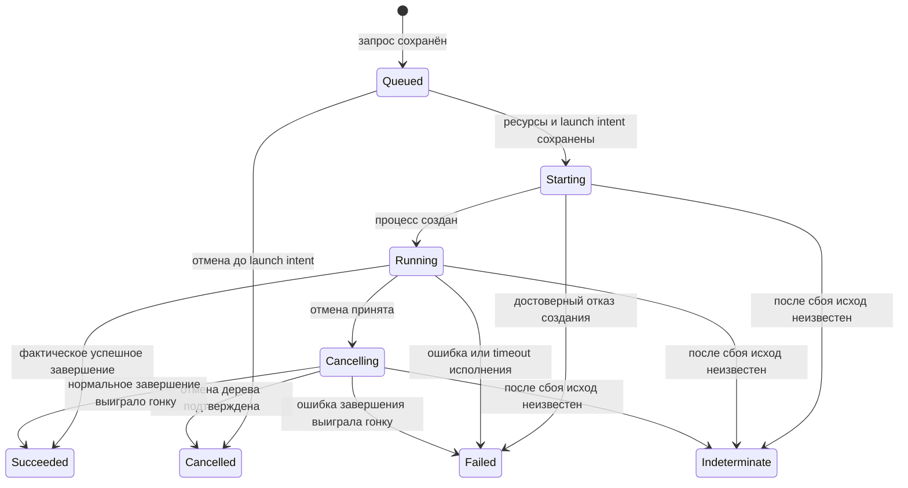

# Actor Model + FSM: состояния, контракты и развитие WinBridge

Дата: **2026-10-13**. Основание: код WinBridge `a42cd7e`,
[предыдущий анализ Actor Model](../actor-model/README.md) и
[анализ консистентности](../consistency-extensibility/README.md).
Это новый архитектурный отчёт и план; описанные расширения ещё не реализованы.

## Вывод

**Actor Model и FSM совместимы и решают разные части одной задачи.**
Актор определяет владельца состояния и порядок обработки сообщений.
FSM определяет допустимые переходы, условия и решения о побочных эффектах.
Версионированный контракт определяет, что другая сторона может запросить и
как интерпретировать ответ. Контрактные тесты проверяют соответствие реализации
этим ожиданиям, а совместный прогон проверяет настоящее взаимодействие.

Для WinBridge такой подход целесообразен. Он уменьшает количество мест,
в которых можно случайно объявить процесс завершённым, повторить запуск
или послать старому клиенту новое непонятное состояние. **FSM стоит выделить
до массового перевода обработчиков в акторы.** Иначе Kameo только переместит
нынешние переходы между handlers, сохранив их разрозненность.

Не нужно менять SQLite, ws://, local IPC, verified snapshots и владение деревом
процессов. Нужно расширить фундамент в трёх местах: явные правила переходов,
обнаружение и выбор контрактов, воспроизводимый набор проверок совместимости.
Kafka, отдельные микросервисы и distributed Kameo для этого не требуются.

Подробности:

- [Контракты, совместимость и тесты обеих сторон](contracts.md).
- [План перехода, критерии приёмки и стоимость](transition-plan.md).

## Что сейчас есть в коде

| Область | Реализация сейчас | Что требуется для предлагаемой модели |
| --- | --- | --- |
| Task | `TaskStatus`: queued, running, succeeded, failed, cancelled, interrupted, indeterminate. | Общая функция переходов и типизированные события; статус сам по себе не задаёт FSM. |
| Workflow/application | Отдельные `WorkflowStepStatus` и `ApplicationStatus`. | Согласовать правила переходов, связи и причины; не объединять все состояния в один enum. |
| Соединение | `ConnectionState`, handshake, reconnect. | Сохранить независимость связи от исполнения; добавить согласование доступных контрактов. |
| Протокол | Rust DTO, JSON Schema для MCP, генерация TypeScript. Версия transport protocol равна 1. | Отдельные версии предметных контрактов и совместимый каталог поддержки. |
| Ошибки | В том числе общий LocalResponse::Error с текстовым message. | Typed error codes и признак «принято/не принято/неизвестно» в новом контракте. |
| Принятие и восстановление | SQLite, idempotency key, commit до ACK, неизвестный исход после restart. | Сохранить правила при изменении state owner и persistence schema. |
| Actor runtime | Основной worker ещё не переведён на Kameo. | Локальные акторы за interfaces; внешний executor остаётся отдельным процессом. |

Источники:
[protocol DTO](../../../crates/protocol/src/lib.rs),
[workflow DTO](../../../crates/protocol/src/workflow.rs),
[session DTO](../../../crates/protocol/src/session.rs),
[Store](../../../apps/worker/src/store.rs),
[worker](../../../apps/worker/src/lib.rs),
[MCP](../../../apps/controller/src/mcp.rs),
[TypeScript exporter](../../../crates/protocol/examples/export-types.rs).

## Как распределить FSM между акторами

Не следует требовать ровно одну бизнес-FSM у каждого технического актора.
Адаптер без собственного предметного состояния может преобразовывать сообщения;
project actor может владеть несколькими независимыми Run FSM. Нужен **один ответственный владелец
переходов каждой сущности**, а не одинаковая машина для всех actors.

| Владелец | Предметное состояние | Граница ответственности |
| --- | --- | --- |
| Session actor controller/worker | Connecting → Connected → Disconnected; выбранные контракты сессии. | Потеря связи не отменяет run и не изменяет достоверность его результата сама по себе. |
| Admission/scheduler actor worker | Очередь, политика запуска, ресурсные claims. | Атомарно допускает старт с учётом всех проектов; не ждёт окончания сборки в handler. |
| Project/run coordinator | Runs, steps, зависимости и их подтверждённые результаты. | Планирует следующий шаг, не объявляя его успешным до фактического результата. |
| Process owner | Launch intent, создание процесса, отмена и завершение дерева. | Источник фактов об OS-процессе; actor restart не означает повтор запуска. |
| Report handler | Awaiting → Received → Validated либо Rejected/Missing. | Отличает exit code процесса от verdict тестов и валидности отчёта. |
| Project coordinator на Debian | Локальное намерение, pending request, accepted run ID, наблюдаемый результат. | Хранит выбранный контракт и original key; не является вторым владельцем Windows run. |
| Project executor на Windows | Подготовка, исполнение проверок, формирование отчёта. | Сообщает факты родительскому worker; не подтверждает за него долговечное сохранение. |

Состояния report и execution независимы: процесс может завершиться с exit 0,
а отчёт оказаться неверным. Состояние проекта также не сводится к одному слову:
прошлый run успешен, новый стоит в очереди, а application уже работает.
Разделение этих осей предотвращает рост enum из всех возможных комбинаций.

FSM с ID, timestamp, revision и параметрами — практически расширенная машина
состояний: конечен набор вариантов, а не число возможных значений данных.
Не требуется заранее перечислять все проекты, тесты и номера прогонов.

## Типизированные состояния и переходы

Предлагаемая форма внутреннего состояния, **не новый wire DTO и не готовый код**:

```rust
enum ExecutionState {
    Queued { request: AcceptedRequest },
    Starting { intent: LaunchIntent },
    Running { process: ProcessIdentity },
    Cancelling { process: ProcessIdentity, cause: StopCause },
    Finished { outcome: ExecutionOutcome },
    Indeterminate { reason: UnknownOutcome },
}
```

Rust enum допускает данные у каждого варианта. Это позволяет не держать отдельно
произвольные комбинации `status`, `pid: Option<_>` и нескольких bool.
[Rust Reference: enums](https://doc.rust-lang.org/reference/items/enumerations.html).
Но enum **не запрещает** произвольное присваивание нового состояния. Нужны
закрытая точка мутации, исчерпывающий reducer и тесты правил.

Чистая функция примерно `reduce(state, event, context) -> Transition`
возвращает новое состояние, события истории и намерения эффектов.
Отдельные типы описывают command, observation, error и effect. Например,
`CancelRequested` — команда, а `ProcessTreeTerminated` — наблюдение;
первое не является доказательством второго.

Typestate можно применять к локальному builder или process handle, но не следует
менять тип актора при каждом состоянии. Состояние восстанавливается из journal,
а события приходят во время исполнения: их допустимость всё равно проверяется
runtime reducer. Для внутренних State/Event полезен исчерпывающий match;
универсальная ветка «любой новый event → ignore» скрывает пропущенную реализацию.



Диаграмма показывает основные переходы, а не полную спецификацию.
Например, отмена во время Starting требует учёта гонки создания процесса.
В таблице переходов должны быть guards и результаты для каждого такого случая.
Timeout исполнения инициирует остановку и становится итогом только после
подтверждённого завершения управляемого дерева. Timeout ожидания RPC и deadline
в очереди — другие события; они не доказывают прекращение уже принятой работы.
Событие несёт operation ID, attempt/generation и ожидаемую revision;
PID сам по себе недостаточен для различения старого и нового процесса.

Текущий v1 уже сохраняет `running` до создания процесса:
«Launch intent committed; awaiting process creation». Поэтому `running` без PID
сейчас допустим. Внутренний Starting может проецироваться в этот старый статус
с прежним объяснением. Добавлять значение `starting` в ответ старому клиенту
нельзя: его enum этого значения не понимает.

## Консистентность и побочные эффекты

Рекомендуемая последовательность:

1. Актор проверяет допустимость события и актуальность revision/generation.
2. Транзакция сохраняет state, event, effect intent и решение о ресурсах.
3. После commit возвращается бизнес-ACK либо запускается запланированный effect.
4. Исполнитель возвращает observation; следующая транзакция сохраняет результат.

Нельзя сделать одной SQLite-транзакцией запись строки и создание OS-процесса.
Сбой между ними остаётся фундаментальным риском. Повтор допустим только для
эффекта с доказанной безопасностью повторения; запуск внешней команды неизвестного
исхода автоматически не повторяется. `indeterminate` остаётся частью контракта.

Последовательные handlers одного актора не обеспечивают атомарность решений двух
акторов. Выделение ресурса и старт нескольких проектов согласуются через общий
scheduler и journal transaction. Не следует реализовывать отдельный scheduler
в каждом project actor с независимым счётчиком «свободных слотов».

Kameo остаётся подходящим кандидатом для **локального runtime**, как в
[предыдущем отчёте](../actor-model/kameo.md). Чистый reducer не зависит от Kameo;
его можно запускать в обычном handler, затем в actor handler. Worker удерживает
actors/process ownership независимо от жизни desktop и сетевой сессии.
Восстановление инфраструктурного актора читает journal; supervision не воспроизводит
побочные эффекты по старым сообщениям.

## Контракты, известные сторонам

Общими должны быть внешние команды, ответы, состояния, ошибки и правила конкретной
**согласованной версии**, а не все внутренние enum каждого компонента.
Другой проект может реализовать такой контракт без Rust и без Kameo.
Общая Rust crate удобна для Rust-участников; JSON Schema, TypeScript и fixtures
нужны другим клиентам.

Нужно разделить версии транспортного envelope, предметного контракта, формата
журнала и build identity. Добавление поля внутренней FSM не обязательно меняет
wire contract; новый смысл внешнего состояния может требовать новой версии.
`#[non_exhaustive]` помогает расширять Rust API между crates, но не делает
неизвестный JSON-вариант автоматически читаемым.
[Rust Reference: non_exhaustive](https://doc.rust-lang.org/reference/attributes/type_system.html#the-non_exhaustive-attribute).

Идея пользователя «новая функция включается после проверки обеих сторон» верна,
если готовность фиксируется **для конкретного маршрута и версии контракта**.
Две программы с новой version string ещё не доказывают готовность.
Нужны проверенные реализации, consumer/provider tests, совместный receipt и
разрешённый профиль включения. До этого обычные запросы используют v1;
сама новая функция остаётся недоступной.

## Что увидит пользователь

Desktop и MCP читают один durable run view: project, source commit, выбранный
контракт, текущий шаг, очередь/причины, команды, output, report и достоверность.
Снимок journal снабжается revision; он отражает сохранённые наблюдения worker,
а не атомарное состояние двух компьютеров и всех OS-процессов в эту миллисекунду.
Состояние соединения и время последнего наблюдения показываются отдельно.
«Последний известный running; связь потеряна» точнее, чем выдуманный cancelled.

Для новой функции: «Контракт test-report/2 поддержан, но проверка пары не пройдена»,
«Профиль использует v1» либо «v2 включён для Netwatch; проверена такая-то пара».
Техническое имя актора и mailbox не заменяют понятное имя действия.
Сигналы внимания относятся к принятию работы и значимым исходам; каждый poll
и внутренний FSM-переход не должен повторять звук.

## Границы этой проверки

В этой сессии проверена десериализация **настоящих текущих Rust DTO**:
старый Hello читается, неизвестная capability/поле Hello/TaskStatus отвергаются,
добавочное поле каталога в WorkerInfo игнорируется старым reader.
Результаты и ограничения описаны в [contracts.md](contracts.md#проверка-текущей-совместимости).

Новая FSM, negotiation и contract runner здесь не внедрены. Рабочие
controller/worker, зависимости основного workspace и Windows runtime не менялись;
автоматический Windows прогон для написания этого анализа не запускался.
