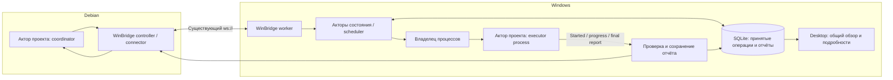

# Actor Model для WinBridge и акторов других проектов

Дата: **2026-10-12**. Анализ WinBridge `a42cd7e` и опубликованной Kameo **0.22.2**.
Это предложение архитектуры; рабочий WinBridge не переведён на Kameo.

## Оценка предложенной модели

**Модель реализуема без замены основного фундамента**, если разделить два уровня:

1. Внутри WinBridge акторы владеют состоянием и принимают короткие решения.
   SQLite, process ownership и восстановление остаются обязательными.
2. Актор другого проекта — отдельный управляемый процесс. WinBridge доставляет
   его исходники, собирает Windows binary, запускает и принимает отчёты через
   версионированный протокол. Этот процесс не обязан использовать Kameo.

На Debian проект запускает своего координатора, а на Windows WinBridge запускает
исполнителя того же проекта. Они могут собираться из общей Rust codebase,
но это **два разных бинарных артефакта, два экземпляра и два отдельных состояния**.
Actor Model не делает Windows executable запускаемым в Debian и не синхронизирует
память двух акторов автоматически.

WinBridge остаётся центральной точкой доступа логически. Делать все сборки,
запуски и запросы статуса одним последовательным handler главного актора
не следует: одна долгая сборка задержит остальные проекты и управление.

## Рекомендуемая схема

Актор проекта на Windows не регистрируется вместо основного WinBridge worker:
нынешняя сессия рассчитана на одного execution authority. У него собственный
локальный канал к родительскому worker. Debian получает его данные через
существующий controller, без второй независимой сетевой системы.

Подробности:

- [Контракты, переносимость, отчёты и миграция](integration.md).
- [Оценка Kameo и результаты прототипа](kameo.md).

## Что уже можно сделать, а что требует расширения

| Сценарий | Сейчас | Что добавить |
| --- | --- | --- |
| Собрать и запустить отдельный project executor | Snapshot + build/direct task + управляемый процесс уже есть | Проектная команда сборки, изолированный workspace и контракт executor. |
| Вернуть JSON в stdout и exit code | Worker сохранит байты и итог процесса, агент сможет прочитать output | Автоматическое распознавание/валидация/показ отчёта ещё не реализованы. |
| Долговечно хранить понятный test report | Есть task/output journal и каталог некоторых workflow artifacts | Общий report envelope, ingestion, привязка к run/commit, хранение и query API. |
| Обмениваться командами с живым project executor | Общего managed child RPC нет; `stdin` команды сейчас закрыт | Отдельный child transport, request lifecycle, cancellation и capabilities. |
| Несколько проектов одновременно | Межпроектный параллелизм уже есть | Общий лимит, справедливая очередь и причины ожидания, как в предыдущем анализе. |

Простейший полезный вариант — executor на **один прогон**: получить описание работы,
выполнить тесты, вернуть проверяемый итог и завершиться. Долгоживущий актор нужен,
когда есть конкретная польза: повторные команды приложению, сохранение дорогого
инициализированного состояния или интерактивная диагностика.

Источник текущих границ: [worker](../../../apps/worker/src/lib.rs),
[managed process](../../../crates/platform/src/lib.rs),
[workflow](../../../apps/worker/src/workflows.rs),
[session DTO](../../../crates/protocol/src/session.rs).

## Kameo как кандидат

**Kameo подходит для ограниченного внутреннего прототипа и может стать реализацией
акторов WinBridge.** Она даёт типизированные сообщения, mailbox и supervision.
Это инфраструктура concurrency, а не готовый durable execution engine.
[API Kameo 0.22.2](https://docs.rs/kameo/0.22.2/kameo/).

Рекомендую сначала использовать **локальные акторы без `remote`**. Distributed
Kameo включает libp2p и отдельную модель сетевых actors. В текущей паре уже есть
ws://, handshake, ограничения RPC и reconnect; перевод на P2P означал бы отдельную
миграцию транспорта. В опубликованном manifest remote также включает зависимости
с Noise/QUIC. Это выходит за принятый объём локального соединения без добавления
нового сетевого стека.
[Manifest релиза](https://raw.githubusercontent.com/tqwewe/kameo/90138758779d2260798c41cfaa47598db84f05b8/Cargo.toml),
[remote API](https://docs.rs/kameo/0.22.2/kameo/remote/).

Внешний контракт должен оставаться независимым от `ActorRef`, actor type path
и версии Kameo. Тогда Netwatch сможет использовать Kameo, обычные Tokio tasks,
Python или собственную реализацию, не заставляя WinBridge обновляться вместе с ним.

## Нужно ли переделывать фундамент

| Сохранить | Расширить | Рефакторить постепенно |
| --- | --- | --- |
| Controller/worker separation, ws:// и local IPC | Run/step/report DTO и capability negotiation | `Mutex<Store>` и связанные mutable registries → явное владение состоянием. |
| Commit до ACK, dedup, `indeterminate` | Контракт запуска project executor и приёма отчёта | Распределённые по handlers переходы → общий reducer/state machine. |
| Проверенные snapshot и реальные project/path checks | Scheduler/resources и общий query обзор | Фиксированный startup workflow → типизированные шаги без потери старого API. |
| Job Object/process tree, cancel, stdout/stderr drain | При необходимости managed child RPC | Долгая работа отделяется от actor message loop. |

Основная сложность — не добавить crate Kameo, а сохранить доказанные свойства
при изменении владельцев состояния. Например, actor restart не должен повторно
запустить внешнюю команду, а root supervisor должен удерживать исполнение после
закрытия MCP/desktop. Эти правила библиотека за WinBridge не реализует.

## Стоимость перехода

Ориентиры в инженерных днях одного разработчика с тестами и документацией,
без гарантии срока. Пакеты частично пересекаются; их нельзя просто складывать.
Стоимость global scheduler отдельно описана в
[предыдущем анализе](../consistency-extensibility/README.md#порядок-развития-и-бюджет).

| Шаг | Сложность | Ориентир |
| --- | --- | --- |
| Изолированный Kameo proof: mailbox, timeout, Windows compile | Небольшая | Выполнен в этой сессии; не является миграцией WinBridge. |
| Ограниченный внутренний переход: state owner и один project/run coordinator | Средняя, с высоким значением recovery tests | 4–8 дней. |
| One-shot project executor: контракт, report ingestion/storage, UI/MCP, fault tests | Средняя/большая | 8–15 дней. |
| Подключение реального проекта к готовому контракту | Зависит от существующих Windows тестов и изоляции проекта | Примерно 3–7 дней для небольшого runner; перенос тестов приложения может быть существенно дороже. |
| Долгоживущий executor с duplex RPC/recovery | Большая | Дополнительно 10–20 дней после one-shot сценария. |
| Полная замена ws:// на distributed Kameo | Большая, отдельная архитектурная задача | Надёжной оценки без прототипа нет; сейчас не рекомендуется. |

Оптимальный первый вертикальный сценарий: один внешний executor из тестового
проекта, запускаемый WinBridge, выдаёт `Started` и итог тестов; WinBridge сохраняет
отчёт, показывает его и возвращает Debian клиенту. Проверить lost ACK, crash,
отсутствующий/неверный report и cancel. Затем подключить Netwatch и общий scheduler.
Переписывание всех модулей в акторы до этого сценария не требуется.

## Что проверено здесь

Изолированный прототип опубликованной Kameo 0.22.2: **4 tests passed на Linux**,
`cargo check --tests --target x86_64-pc-windows-msvc` прошёл. Проверены 300 concurrent
updates трёх акторов, mailbox full, timeout без отмены и задержка status долгим handler.
Это подтверждает переносимость проверенного локального ядра на уровне компиляции;
Windows запуск и реальный project executor здесь не проверялись.

Зависимости основного workspace, рабочие controller/worker и Windows runtime
не изменялись. Код прототипа/receipt находится в игнорируемом
`.winbridge/research/actor-model/`; воспроизводимые сведения — в [kameo.md](kameo.md).
