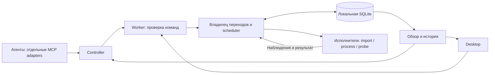
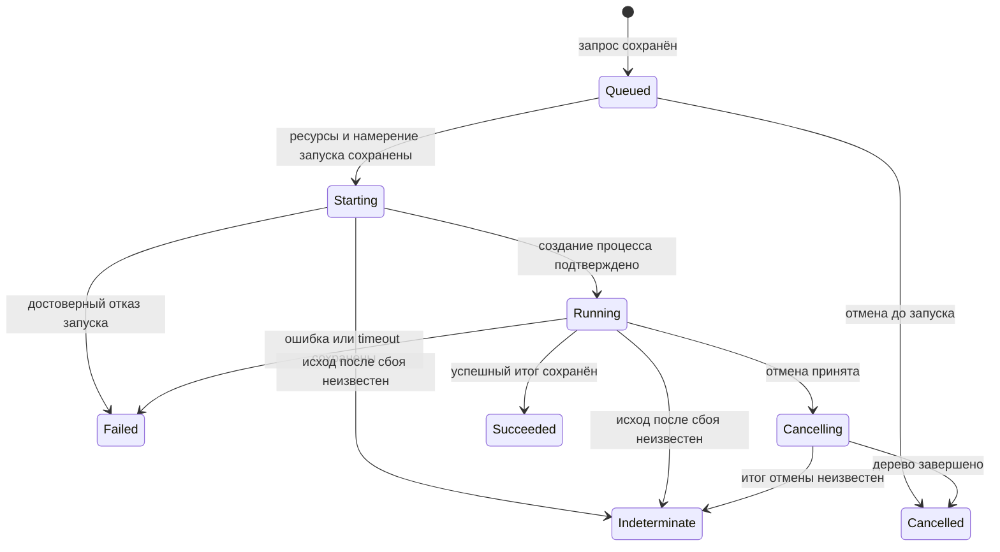

# Предлагаемый фундамент и сценарий нескольких проектов

Часть [анализа](README.md), 2026-10-12. **Всё ниже — предложение**, кроме явно
обозначенных существующих механизмов. Это не инструкция к уже готовым API.

## Архитектура внутри существующего worker

Это модульный worker, а не новый набор сервисов. Общий владелец переходов
проверяет состояние и сохраняет решения, исполнители делают файловый I/O,
hashing и работу с процессами. Они возвращают факты; UI не пишет себе успешное
состояние до подтверждения worker.

Начать можно с выделения scheduler и общей функции переходов при существующем
`Mutex<Store>`. Затем, если это упростит владение и отзывчивость, использовать
bounded command channel и replies, а SQLite connection передать выделенному
потоку. Синхронную БД и тяжёлый I/O нельзя просто перенести в одну async task,
которая будет блокировать всё обслуживание. Чтение, output и управляющие команды
также требуют ограниченных буферов и защиты от взаимного вытеснения.

Центр состояния — **контракт и источник истины**, а не один глобальный mutable
объект, в который все модули пишут произвольный JSON.

## Машины состояний и общий прогон

Нужны небольшой общий жизненный цикл исполняемой операции и отдельные предметные
состояния workflow/application. Не нужно сводить всё к одному огромному enum.

Схема показывает основной путь, а не все гонки: процесс может успеть нормально
завершиться до отмены. Редуктор должен принять фактический итог, сохранить запрос
отмены в истории и не переписать успешное завершение на выдуманную отмену.
Timeout, ошибка команды и неверный запрос имеют разные причины даже при общем
терминальном состоянии `failed`.

Правило перехода: **проверить текущую версию → сохранить состояние/событие/решение
о ресурсах одной транзакцией → выполнить побочный эффект → сохранить наблюдение**.
Это упорядочивает решения, но не устраняет разрыв между commit и созданием процесса.
После сбоя `indeterminate` остаётся необходимым.

Общий `Run` должен связывать намерение агента «проверить этот commit» с шагами,
а не заменять существующие task IDs. Минимальные данные:

| Данные | Назначение |
| --- | --- |
| `runId`, `projectId`, `parentRunId` при необходимости | Связь шагов, повторных явных попыток и общего результата. |
| `origin`, `clientRunId`, понятное название/цель | Пользователь видит, кто и зачем поставил работу; это метаданные, не аутентификация. |
| Commit, snapshot, profile/recipe pins, execution workspace | Однозначно известно, какой код и какими командами проверяли. |
| `stepId`, тип шага, task/import/application IDs | Повторное использование существующих исполнителей и восстановления. |
| State, timestamps, revision, причины ожидания/ошибки | Машиночитаемый статус и объяснение для UI. |
| Execution outcome и test verdict отдельно | Exit code 0 означает завершение процесса; не заменяет отчёт о найденных/пропущенных/упавших тестах. |

Сначала достаточно типизированной последовательности `import`, `prepare_workspace`,
`command`, `test`, `readiness`, `collect_report`. Ветвления и произвольный DAG вводить
после конкретного сценария. Запуск произвольного plugin-кода внутри worker сейчас
не нужен: новые handlers можно подключать статически.

## Ресурсы вместо увеличения одного числа

Сначала сохраняем существующую эксклюзивную mutation lease проекта и добавляем
общий лимит активных тяжёлых операций. Это уже решает межпроектную нагрузку.
Позже уточняем ресурсы, когда появятся отдельные execution workspace:

| Ресурс | Пример политики |
| --- | --- |
| Project/workspace mutation | Один изменяющий исполнитель на конкретную папку. |
| Build slots | Например, максимум две сборки/тяжёлых теста на Windows host. |
| Application binary/cache | Сборка не меняет файлы, используемые живым приложением. |
| IPC instance, port, interactive desktop | Эксклюзивные ресурсы, даже если source projects различаются. |
| Verified snapshot чтение | Совместное чтение только для handlers с действительно неизменяемыми входами. |

Resource claims определяются доверенной политикой проекта/handler; произвольная
команда не становится безопасно read-only из-за пожелания агента. Windows права
процесса и возможность команды выйти за `cwd` остаются прежними ограничениями.

Получать весь необходимый набор ресурсов нужно атомарно, перед запуском шага.
Не держать build slot, ожидая ещё и project lease: это создаёт риск взаимного
ожидания. Родительский workflow и его шаг не должны дважды списывать один слот.
Между шагами дорогостоящий слот освобождается; нужная защита workspace может
сохраняться на весь run по отдельному правилу.

Готовое приложение больше не занимает слот сборки, но продолжает владеть своими
binary/IPC/port ресурсами и потреблять нагрузку. Эта нагрузка должна учитываться
отдельной политикой, а не исчезать из обзора после `ready`. Ресурс неизвестного
живого процесса нельзя автоматически отдавать другому только по истечению lease:
нужны recovery/reconciliation и достоверное завершение владения.

## Сценарий: A, B и C одновременно отправляют работу

Пользователь выбирает лимит **2 тяжёлых операции**. Внутри каждого проекта —
одна mutation lease; A1/A2, B1/B2 и C1 используют разные project workspace.

| Момент | Исполняется | Ожидает | Что видно пользователю и MCP |
| --- | --- | --- | --- |
| A1, B1, C1 приняты | A1 и B1 | C1 | «Занято 2 из 2 слотов; C1 ждёт общий лимит», IDs и время принятия. |
| Приходит A2 | A1 и B1 | C1 и A2 | У A2 причины «проект занят A1» и «общий лимит»; процесс ещё не создан. |
| A1 завершился | B1 и C1 | A2 | Следующий свободный слот получает готовый проект C по ротации. |
| B1 завершился, пришёл B2 | C1 и A2 | B2 | Непрерывные запросы B не вытесняют остальные проекты. |
| Пользователь уменьшил лимит до 1 | Уже начатые C1 и A2 продолжают | B2 | «Новые старты приостановлены до освобождения слотов»; скрытой отмены нет. |
| Активные шаги закончились | B2 | Остальная очередь | Один тяжёлый шаг до следующего изменения лимита. |

Это иллюстрация выбранной политики, не гарантия сегодняшнего scheduler.
Минимальная справедливость — ротация готовых проектов, FIFO внутри проекта
для сравнимых операций. Заблокированный проект пропускается, сохраняя очередь.
Нужны определённые правила для дочерних шагов и отмены; исполнение, уже начавшееся,
не вытесняется. Приоритеты с защитой от голодания можно добавить позже.

Лимит размера backlog проверяется **после поиска прежнего idempotency key**:
заполненная очередь не должна мешать восстановить ACK уже принятого запроса.
Отказы должны сообщать, что запрос не принят, с кодом `queue_full`, а не выдавать
ложный `queued`. Квоты по project ID полезны уже сейчас; квоты по доверенной
личности агента потребовали бы отдельного механизма идентификации.

Чтение статуса/output не использует слот исполнения или project mutation lease.
Для status/cancel нужны доступная полоса обслуживания и ограничения частоты/размера
чтений; flood output не должен бесконечно отодвигать управляющие команды.
Очередь, отказ admission и перегрузка RPC — три разные причины для клиента.

Режимы «последовательно / лимит N / пауза новых стартов» должны явно задаваться
пользователем и показываться в общем обзоре. Локальное изменение policy можно
сделать отдельной операцией с `expectedRevision`, не меняя принятое правило
ручного restart для проекта, recipes и controller address. MCP сначала читает
эту policy; агент не увеличивает лимит для удобства собственного прогона.

Уменьшение лимита и пауза не отменяют принятые/работающие задачи. Отмена — отдельное
подтверждённое действие. Deadline ожидания в очереди и timeout исполнения нужно
разделить. Estimated start time без модели длительности показывать не следует;
точную глобальную позицию при ротации и разных ресурсах тоже нельзя обещать.

Лимит двух команд не гарантирует низкую CPU/RAM нагрузку: `cargo` или тестовый
runner могут породить много рабочих потоков. Начать стоит с ручного лимита,
recipe-параметров параллельной сборки и наблюдаемых метрик. Автоматическая
регулировка по нагрузке — отдельная функция с измерениями и гистерезисом,
а не незаметная эвристика, меняющая поведение accepted task.

## Единый обзор для человека и агента

Добавить один query-контракт, условно `overview`, над существующим journal.
Он возвращает согласованный снимок локального worker состояния, а не заставляет
UI самостоятельно объединять десяток ответов:

- Instance, worker generation, journal revision, время наблюдения.
- Policy, используемые/свободные ресурсы, пауза, journal recovery gate.
- По каждому проекту: активные runs/steps, ожидающие операции и их причины,
  живые applications, непрочитанные attention events.
- Для run: шаги, источники, команды, связь с output/reports и достоверность итога.
- Для модулей: доступность обработчика, активная операция/очередь и конкретный
  сбой. «Модуль подключён» не означает «все его операции успешны».

Проект не имеет одного исчерпывающего статуса: он может одновременно иметь
успешный прошлый тест, готовое приложение и новую задачу в очереди. Поэтому обзор
сохраняет независимые оси: связь, очередь, исполнение, приложение, ошибки внимания.
Связь controller и hardware metrics наблюдаются отдельно: их timestamp/freshness
надо показывать, а не объявлять весь Debian/Windows мир одной атомарной транзакцией.

Пример строки UI: «Netwatch · тесты commit abc123 · выполняется test 2/4 ·
1 слот занят · WinBridge ждёт слот · controller подтверждён 2 s назад».
Раскрытие строки показывает полный argv, cwd, snapshot, причины, output и результаты.
Звук/popup сообщают о новом намерении агента и важных итогах с привязкой к run;
каждый повторный poll или внутренний переход не создаёт новое уведомление.
Неизвестный исход и stale connection выделяются явно.

Сохранять revision вместе с состоянием и компактным событием в той же транзакции.
Полный event sourcing с replay всего прошлого не обязателен: существующие записи
остаются источником истины. In-process notifications после commit могут ускорять
UI, но являются подсказкой; пропущенное уведомление восстанавливается чтением.

Для начала достаточно bounded polling общего обзора и cursor-чтения output.
Позже можно добавить `changes(afterRevision)`/wait с resync при пропущенной
истории. Revision/cursor проверяются в контексте instance/journal/generation;
нельзя сравнивать их как вечный счётчик всех workers. Не нужно включать каждый
output byte в большой overview: output имеет отдельную последовательность.

## MCP и расширение модулей

Свести описание операции в проверяемый статический descriptor: DTO/schema,
handler, требуемая capability, разрешённость удалённого вызова, read/mutation,
описание эффекта и метаданные UI. DTO нового maintenance метода не должна
автоматически открыть его агенту. Capability negotiation сохраняется для старых
worker, а unsupported операция возвращает структурированный отказ.

При новом handler общая инфраструктура обеспечивает принятие, переходы,
resource admission, журнал и связь run/step. Handler определяет свои проверки,
исполнение, понятное описание, отмену и границы восстановления. Места изменений:

| Место | Что добавлять |
| --- | --- |
| `crates/protocol` | Совместимые DTO, typed errors, overview/run/step, capabilities. |
| `crates/core` | Чистые переходы, policy/resources и правила scheduler, тестируемые без ОС. |
| `apps/worker` | SQLite persistence, admission/reconciliation, adapters исполнителей. |
| `modules` / platform | Предметные handlers и операции с процессами/файлами; без самостоятельной второй очереди. |
| `apps/controller` | Routing, capability guards, CLI/MCP descriptors и source publication. |
| `ui` / desktop | Общий обзор, управление разрешённой policy, объяснения, уведомления. |

Worker остаётся authority даже при едином API controller. Если позднее понадобится
принимать запросы при выключенной Windows, Debian outbox получит отдельные состояния
`pending_send`, `submission_unknown`, `worker_accepted`. Ни запись в outbox, ни
сообщение брокеру не становятся Windows ACK. Нужен read-only поиск по типу операции,
project ID и idempotency key; неизвестное принятие сверяется, а не повторяется с
новым ключом. Этот outbox не нужен для первого многопроектного scheduler.

## Как менять без поломки существующего фундамента

1. Добавить global admission и query активных записей, сохранив нынешние
   project leases и IDs. Не начинать с замены всех исполнителей.
2. Добавить overview, причины ожидания, общую revision и локальную policy operation.
   У UI и MCP один контракт чтения; предыдущие status/history методы сохраняются.
3. Выделять reducer/Run связи по мере расширения handlers. Старые операции остаются
   legacy task/workflow, без выдуманного origin или test verdict.
4. Ввести типизированные test/workspace шаги, сохранив существующий startup
   workflow как совместимый профиль. Только затем разрешать параллелизм
   одного проекта при доказанной изоляции workspace/IPC/cache.

Миграции — транзакционные, с проверкой восстановления. Добавление полей не должно
менять fingerprint ранее принятого запроса: нужны версионирование сравнения или
совместимая нормализация старого payload. Новые timestamps, labels и observations
не становятся случайной причиной повторного исполнения.

Распределение на микросервисы стоит пересмотреть при нескольких hosts,
независимом масштабировании или необходимости отдельно обновлять исполнителей.
Тогда понадобятся маршрутизация, ownership/fencing и события/outbox между сервисами.
Сейчас те же полезные идеи — явные contracts, command/query separation, bounded
messages и state machines — реализуются Rust-модулями без нового deployment.

## Чем подтвердить реализацию

| Проверка | Что она должна доказать |
| --- | --- |
| Три независимых MCP clients и backlog проектов | Лимит соблюдается; ротация не оставляет проект голодать; очередь ограничена. |
| Дубли/потеря ACK одновременно с переполнением | Прежний key возвращает прежнюю операцию; новый не принимается скрытно. |
| Crash между commit, spawn и результатом | Queued сохраняется; неизвестный эффект не повторяется; leases восстанавливаются безопасно. |
| Cancel/pause/уменьшение лимита, гонка policy revisions | Нет скрытой отмены; ресурс освобождается после достоверного итога; устаревшая запись policy отвергается. |
| Долгая история, output flood и частый status | Scheduler не сканирует всё прошлое; отмена и обзор отвечают в измеренных пределах. |
| Несколько полных startup/test pipelines на Windows | Нет столкновений workspace, cache, IPC, портов и живых binaries; result связывается с правильным commit. |
| Потеря связи, закрытие UI/агента, возврат клиента | Worker сохраняет владение; overview показывает stale связь и прежние IDs. |
| Один источник данных для UI и MCP | Они показывают одинаковую revision, причины ожидания и итог; polling не создаёт лишних attention событий. |

Основные policy/reducer/fault проверки автоматизируются локально. Windows нужен
для дерева процессов, реальных сборок, native UI и конфликтов ресурсов. Проверять
через изолированный runtime и одобренные сценарии; заранее сообщать пользователю,
какой worker нужен и какие тестовые окна появятся. Ручные наблюдения оставлять
для свойств интерфейса, которые автоматизация пока не подтверждает.
