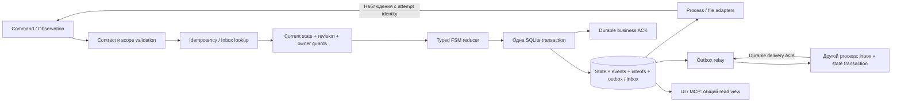

# Как объединить техники в фундаменте

Часть [анализа восьми техник](README.md), 2026-10-13.
Предлагаемые типы и таблицы описывают проектирование, а не существующую schema.
План уточняет [переход Actor Model + FSM](../actor-model-fsm/transition-plan.md).

## Единая точка переходов



Actor владеет конкретной сущностью, но запись проходит общий consistency contract.
Reducer не делает сеть/OS I/O; Store транзакционно применяет решения,
adapter выполняет effect и возвращает факт. Это не требует одного актора
для всех проектов, одного handler для каждой stdout строки или полной event sourcing.
Mutable snapshot остаётся допустимым источником состояния; events нужны для
истории/доставки и не обязаны быть единственным способом rebuild.

Важно **искать прежний key/message до проверки новой admission policy или CAS**.
Уже принятый запрос не становится непринятым из-за заполненной очереди,
изменённого профиля или выросшей revision. Возвращается прежний ID/receipt;
актуальный статус читается отдельно или добавляется к ответу.
Сначала проверяются допустимость envelope и права чтения/доступа к scope,
а не разрешается произвольному sender получать чужой результат по совпавшему key.

## Идентификаторы и области

| Значение | Кто назначает и где живёт | Инвариант |
| --- | --- | --- |
| IdempotencyKey | Caller до первой отправки; original request сохраняется до известного исхода. | Повтор одного намерения имеет тот же key и значимый payload. |
| OperationRef | Worker при admission; typed kind + нынешний durable ID. | Не меняется после reconnect/restart; связывает results и effects. |
| Run/Step/ParentRef | Coordinator/worker по контракту планирования. | Склеивает пользовательскую цель с существующими task/import/application IDs. |
| AttemptId | Authority при конкретной разрешённой попытке effect. | Actor restart сам по себе не создаёт новый attempt. |
| MessageId/EventId | Producer при создании immutable delivery/event. | Повтор доставки сохраняет ID и payload; RPC correlation может изменяться. |
| EntityRevision | Store при committed изменении entity state. | CAS проверяет именно эту сущность, а не весь host. |
| StreamSequence | Store/producer внутри явно определённого stream. | Порядок committed entries; cursor не перескакивает необработанный gap. |
| OwnershipEpoch | Authority при выдаче нового владения resource. | Проверяется вместе с owner/resource/incarnation при защищённой мутации. |
| JournalIncarnation | Installation/recovery authority; устойчивый ID логической истории. | Reset/restore истории не выглядит продолжением прежнего cursor/epoch. |
| WorkerGeneration/SessionId | Runtime/transport; существующие IDs. | Freshness и session correlation; не отзывают живой process при reconnect. |

Нельзя использовать один счётчик сразу как sequence, entity revision,
protocol version и fencing epoch. Смысл и область этих значений различаются.
Wire encoding должен сохранять точное сравнение counters в Rust/TypeScript:
для новых контрактов можно выбрать decimal strings; старые numeric DTO
не меняются скрытно.

Новый scope ключа: installation + project + **стабильное семейство операции** + key.
Версия контракта входит в fingerprint, а не создаёт новое семейство при каждом
обновлении. Иначе один key в v1 и v2 создаст два процесса.
Legacy таблицы с `UNIQUE(project,key)` сохраняют свою область и adapter.
Нельзя просто перенести keys в новую namespace и объявить старые отсутствующими.

Fingerprint включает параметры, влияющие на действие: contract pin, source,
команду/profile, timeout и другие согласованные preconditions.
Request ID, номер попытки доставки и текущее время транспорта исключаются.
Одинаковые JSON objects требуют фиксированного canonical encoding по версии.
Это не заменяется произвольным hash от байтов нового serializer.

## Что хранить вместе

Минимальное логическое представление:

```text
operations: id, kind, project, original request, contract pin, fingerprint version,
            state, revision, attempt, outcome
events: event id, stream, sequence, entity revision, typed payload
ownership: resource, owner operation/attempt, epoch, journal incarnation
outbox: recipient, message id, immutable envelope/digest, delivery state
inbox: producer, message id, payload digest, durable receipt
report slots: operation, attempt, kind, artifact/content digest
```

При application transition одной транзакцией записываются state/revision,
соответствующий event и resource decision; если нужен внешний получатель —
также outbox entry. При durable message processing в той же transaction
фиксируются inbox receipt, business result и новые исходящие messages.
Это новые таблицы/columns рядом с существующим journal, не новый кластер БД.

Если FSM решает, что message устарел, можно долговечно сохранить rejected receipt
и диагностическое событие. Но не следует помечать message «processed» до
фиксации решения: crash между inbox INSERT и state UPDATE иначе потеряет действие.
Неизвестный schema/contract не исполняется; retry того же invalid payload
не должен бесконечно блокировать остальные independent streams.

Entity revision не обязана расти на каждый output byte.
Output имеет собственную append-only область и quota; events/progress можно
батчить. Snapshot общего обзора читает одну transaction/revision journal,
а freshness внешних observations показывается отдельно.

## CAS и fencing не заменяют друг друга

Пример: процесс started при revision 10 и epoch 7; progress поднял revision до 11,
cancel — до 12. Нормальный exit от того же process attempt нельзя отклонить
только потому, что он несёт старую launch revision 10.

Сначала подтверждается identity соответствующего attempt/владения и допустимость
observation. Затем актуальная FSM принимает exit/cancel race и применяет CAS
к текущей revision 12. При локальном CAS conflict допустим повтор **чистого
вычисления перехода**, а не повтор внешней команды.

Epoch проверяется на конкретном protected resource. Освобождение выполняется
условно по resource + owner + epoch; поздний release от старого actor не удаляет
lease нового. Actor с cached state не имеет права обходить эту проверку.
Ошибки `stale_revision`, `stale_owner` и `idempotency_conflict` различаются.

Исторический факт прежнего run можно сохранить как evidence именно того run.
Это не разрешение старому executor менять нынешний workspace owner,
состояние другого attempt или новый итог проекта. Не стоит отбрасывать всю
историю только потому, что началась новая сессия.

## OS effects требуют отдельной политики

Предлагаемая классификация effects задаётся доверенным handler:

| Вид | Replay |
| --- | --- |
| Pure read/probe | Можно повторять с новой freshness, не выдавая старое наблюдение за текущее. |
| DB mutation с key/message/business slot | Повтор доставки возвращает тот же committed результат. |
| Проверяемый immutable artifact | Reconcile hash/marker/ownership; продолжение только по определённому контракту. |
| Process launch или произвольная команда | Не повторять после неизвестного исхода; сохранять intent и indeterminate. |
| UI/sound/file effect без общей transaction | Отдельная bounded policy; exactly-once не обещается. |

Outbox допускает автоматический **повтор доставки** команды одному и тому же
получателю с тем же ID. Доставка `StartProcess` ещё не разрешает повтор
физического spawn: получатель сначала дедуплицирует и сохраняет effect intent.
В crash window между intent и spawn прежний attempt не запускается заново вслепую.

Нужен один process owner с фактическими handles/Job Object.
Worker.lock сейчас исключает второй worker для одного stateDirectory,
но не является host-wide защитой всех workspaces разных установок.
В рамках одного config перекрывающиеся roots уже запрещены
[project validation](../../../crates/core/src/config.rs).
Тестовые/рабочие instances должны иметь разные mutable roots.
Shared port, IPC и interactive desktop учитываются отдельно от project ID.

Перевыдача workspace lease допускается после доказанной остановки старого дерева
или для другого изолированного root. Ни истечение TTL, ни новый epoch в SQLite
не останавливают старый code. Если ownership неизвестно, scope блокируется
с понятной причиной либо освобождается через отдельное проверяемое recovery
действие; повторный запуск не является скрытым лечением.

## Outbox + inbox: delivery и execution различаются

Первый полезный поток — сохранённый report/event от worker к durable project
coordinator. Но one-shot executor сначала может отдавать report через уже
сохраняемый stdout: parse/validation повторяются из journal без повторного exe.
Долговечный child inbox нужен, когда появляются повторяемые **команды живому
executor**, а не автоматически для каждого запуска.

Для одного recipient и ordering stream первый relay может иметь один in-flight
message. Один недоступный recipient не задерживает доставку другим.
При duplicate после lost ACK получатель возвращает receipt из inbox;
sender отмечает delivery ACK в своём journal. Между БД нет distributed transaction.

При out-of-order сообщение с обязательным missing predecessor не применяется.
Первый вариант — вернуть gap и повторить позже из sender outbox.
Более сложный durable buffer допустим, если контракт отдельно различает
«принято в inbox для ожидания» и «применено». Продвигать processed cursor
можно только после требуемых predecessor entries.
Если event является полной replacement snapshot, правила иные и описываются явно.

Recipient identity/cursor устойчивы между reconnect; новый session ID не создаёт
нового consumer автоматически. Outbox payload фиксирует contract version:
при unsupported receiver доставка остаётся blocked, не преобразуется молча в v1.
Resync по query/snapshot возможен лишь если он сохраняет обещания этого stream.

Backlog ограничивается и показывается в UI. Временная недоступность Debian
не отменяет accepted Windows task. Если нельзя долговечно сохранить обязательный
report/event, это journal fault; новые admissions/launches закрываются по policy,
а уже принятое не исчезает. Completion и его delivery имеют разные статусы.

Нужны правила удаления: крупный output можно очистить, original keys,
inbox fingerprints/receipts и replay tombstones сохраняются.
Outbox artifact нельзя удалить до нужных ACK или определённого контрактом
переноса данных. ACK одного recipient не очищает работу остальных.

## Reconciliation и восстановление

На старте worker восстановления достаточно такой последовательности:

1. Получить exclusive authority для stateDirectory и открыть совместимый journal.
2. Восстановить operation/intent/resource view, не выполняя pending launch автоматически.
3. Собрать доступные OS/file/report observations вне короткого actor handler.
4. Применить typed recovery transition с revision/epoch guards.
5. Возобновить только доказанно допустимые admissions и message delivery.

Отсутствие PID не доказывает «команда не выполнялась». Наличие PID не доказывает
«это прежний процесс». Snapshot hash доказывает содержимое generation,
а не успешность произвольных предыдущих side effects.
Late report и состояние процесса также проверяются независимо.

DB restore может вернуть уже использованные sequence/epoch и забыть keys.
Смена incarnation помогает отвергнуть старые messages/cursors, но **не восстанавливает
утраченный ledger и не отменяет выполненные команды**. Restore требует остановки/
проверки участников, consistent backup и отдельной recovery процедуры.
Автоматическая обработка «потерянных» intents как новых запрещена.

## Пример с несколькими проектами

Netwatch и WinBridge-agent одновременно отправили jobs; оба имеют свои keys/IDs.
Scheduler выдал им независимые resources/epochs при допустимом общем лимите.
Один agent потерял ACK и повторил original request: возвращается прежний ID.
Другой agent прочитал старую policy revision и попытался её заменить: conflict.

После reconnect приходят duplicate reports и поздний lease release.
Inbox/business slot сохраняют report один раз; stale release не затрагивает
нового владельца. Потерявшаяся доставка отражается как pending, а operation
остаётся с фактическим execution outcome.
Если worker упал в launch window, это indeterminate, а не повод запустить
«ещё одну попытку для сходимости».

Общий лимит и fairness scheduler сами по себе этими техниками не реализуются.
Они используют consistency guards и общий resource transaction;
[их предметная политика](../consistency-extensibility/proposed-design.md)
остаётся отдельной частью.

## Где внедрять

| Место | Ответственность |
| --- | --- |
| crates/protocol | Typed IDs/references, versioned command/observation/result/error envelopes, scopes и codec fixtures. |
| crates/core | FSM reducer, guards, effect/replay policy, reconciliation decisions, interfaces transaction/resource. |
| apps/worker | Authority/Store implementation, migrations, unique/CAS/epoch checks, effect owner, inbox/outbox/query. |
| crates/transport | Bounded delivery, correlation и ACK framing; семантический ACK формирует business layer. |
| crates/platform | Process identity, stop/probe/file evidence; не принимает решения об автоматическом повторе. |
| apps/controller/MCP | Forwarding/discovery и удобные queries; local ledger только при собственном durable обещании. |
| Modules и project executors | Возвращают typed observations/reports, объявляют effect semantics через handler; не обходят Store guards. |
| Desktop | State/revision/freshness, причины blocked/recovery/delivery; cursor и coalesced attention. |

Не менять legacy Hello/closed enum capabilities для объявления каждой новой
техники. Используется совместимый catalog и version pin из
[плана контрактов](../actor-model-fsm/contracts.md).
Не нужен обязательный generic envelope со всеми полями на каждом read/heartbeat.
Типы команд и observations должны требовать только применимые guards.

## Проверки

Существующие tests действительно выполнены на Debian:

```bash
PATH=/home/user1/.local/bin:$PATH cargo test -p winbridge-worker \
  --test runtime --test attention --locked
```

**18 passed:** 8 runtime + 10 attention. Есть реальное Unix исполнение,
оба output streams, duplicate/conflicting request, launch-intent recovery,
tree cancel/timeout, rollback task+attention и journal-fault gate.
Это не Windows выполнение и не проверка новой actor архитектуры.

Отдельный [SQLite prototype](README.md#проверки-этой-сессии) прошёл 7 сценариев.
Использованы две sender connections и отдельная receiver DB, исключения для
rollback и close/reopen для persisted replay. OS crash/power-loss, transport,
fencing filesystem writes и candidate binaries в нём не тестировались.

Обязательные проверки при реализации:

| Сбой/гонка | Ожидаемый invariant |
| --- | --- |
| Lost acceptance ACK; retry после policy/revision change | Тот же key возвращает тот же ID без spawn. |
| Тот же key, новый method/version/payload | Conflict до нового effect. |
| Два actors рассчитали update от одной revision | Только одно условное изменение; второй перечитывает. |
| Progress изменил revision, пришёл настоящий exit | Текущий attempt принимается FSM; launch revision не отвергает exit. |
| Старый owner прислал completion/release | Не меняет нового owner/attempt; historical evidence отделяется. |
| Crash/rollback state+event+outbox | Либо всё committed, либо ничего; event не публикуется до commit. |
| Recipient committed, ACK потерян | Replay того же Message ID не создаёт второй DB result. |
| Inbox записан, result commit упал | Нет ложного processed ACK; replay может обработать заново. |
| Тот же report с новым Message ID | Business slot исключает второй итог либо обнаруживает conflict. |
| Gap, filtered page, delayed duplicate | Cursor semantics не теряет обязательные messages. |
| Lease TTL прошёл, старый child ещё пишет | Новый mutable root не используется параллельно без изоляции. |
| Crash между launch intent и spawn | Reconciliation/indeterminate, никакого blind replay. |
| Restore, retained keys и output cleanup | Старые messages не принимаются за новую историю; dedup не исчезает от очистки output. |
| Sound показан, cursor save упал | Возможный повтор ограничен и объяснён; exactly-once звук не обещается. |

Native Windows suite проходит через approved сценарий в isolated runtime.
Рабочие worker/configs не подменяются; тестовые окна обозначаются заранее.
Consumer новой функции добавляет expectation cases, provider добавляет эти
fault/invariant tests; new/new и поддерживаемые mixed-version пары проходят
совместный gate до включения профиля.

## Порядок и стоимость

1. **Установить правила scopes/IDs/retention/replay.** Сохранить legacy fixtures,
   keys и fingerprints; задать acceptance versus delivery ACK. Ориентир 2–4 дня.
2. **FSM + общий transaction path.** Entity revision, owner/attempt guards,
   events и typed reconciliation без изменения старого wire. Ориентир 5–10 дней;
   сильно пересекается с прежним reducer/actor pilot планом.
3. **Первый durable report поток.** Совместно outbox, inbox, business slot,
   bounded replay, per-recipient state/query и failure tests. Ориентир 5–10 дней,
   если report contract уже определён; long-lived child RPC сюда не входит.
4. **Native paired gate и постепенное включение.** Fault cases, mixed versions,
   UI/MCP и receipt одного проекта. Ориентир 3–6 дней.

Оценки — инженерные ориентиры, не сроки и не независимые суммы поверх
Actor Model/FSM сметы. Сложность определяется внешними effects, восстановлением
и upgrade paths, а не количеством новых enum.

Имеет смысл закрепить все восемь техник в architecture contracts сейчас.
Обязательные общие primitives реализуются при выделении FSM/state owner;
полный message ledger — с первым потоком, которому он нужен.
Это оставляет новые проекты простыми consumers и позволяет позже расширять
delivery/actors без переизобретения acceptance, ownership и recovery.
