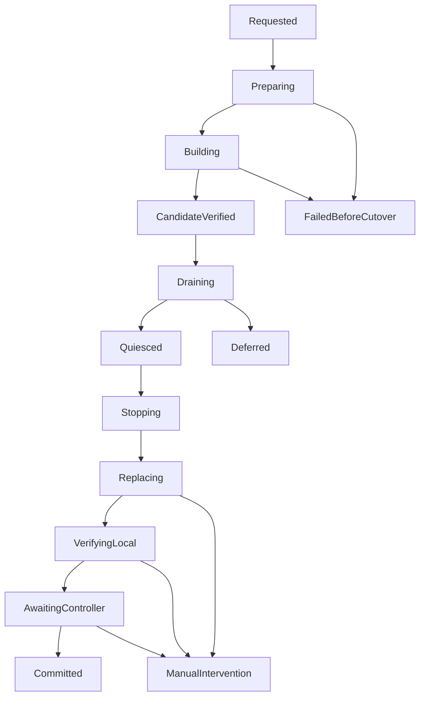

# Автообновление Windows worker и desktop

Анализ 2026-10-17, код `1f3aa9f` / runtime candidate `fc5c90e`.
**Статус: предложение, самообновление ещё не реализовано.** По просьбе пользователя
продолжение A4 временно отложено; его готовность не изменяется.

Продолжение: пользователь одобрил предложение; подготовлен
[подробный план реализации U0–U4](../../plans/worker-self-update/README.md),
начата [readonly подготовка U0](../../guides/worker-update-preparation.md).
Остальной текст фиксирует исходный анализ, а не готовность реализации.

## Вывод

Сценарий реализуем в существующей архитектуре. Сохраняем сборку в
`K:\_proj-26\winbridge\src`, а рабочие exe — в
`K:\_proj-26\winbridge\runtime`. Нужны отдельный `winbridge-update.exe`,
долговечный режим обслуживания worker и согласованное завершение desktop.
Полного перехода на actors, Windows service или нового брокера сообщений не нужно.

Предлагаемое поведение: агент запрашивает обновление конкретным проверенным
пакетом, дальнейшие действия автоматические. Пользователь видит ход и итог;
подтверждать каждую штатную операцию не требуется. При ошибке updater прекращает
продвижение и выдаёт точную инструкцию. Действующие задания не прерываются ради
обновления. Неизвестное состояние процесса или установки не считается успехом.

Нынешний установленный worker по последнему подтверждённому наблюдению — `99351ea`,
journal schema 13; кандидат использует schema 14. В обоих отсутствует update
contract. Потребуется **одна первоначальная ручная установка** worker/desktop/updater
с новой возможностью. Обходить это ограничение через принудительное завершение
старого worker из обычного task не рекомендуется. После bootstrap повторные
обновления смогут проходить автоматически.

## Что уже есть и чего недостаёт

| Область | Фактическое состояние | Что добавить |
| --- | --- | --- |
| Исходники | [export-source.py](../../../scripts/export-source.py) создаёт ZIP, per-file manifest, SHA-256 и ready JSON. | Проверенный локальный импорт поставки в постоянный `src`, учёт удалённых файлов и конфликтов с локальными правками. |
| Сборка и runtime | [prepare-windows-session.ps1](../../../scripts/prepare-windows-session.ps1) собирает worker/fixture/desktop; [session-runtime.ps1](../../../scripts/session-runtime.ps1) staging/hash-check и запрет замены активных exe. | Отдельные build/stage/apply; текущий `-PrepareOnly` всё ещё обновляет runtime и **не является** build-only режимом. |
| Остановка worker | [serve/stop](../../../apps/worker/src/lib.rs) обслуживают Ctrl+C и внутренний stop. Stop завершает управляемые деревья; `is_idle()` проверяет только счётчик active jobs. | Отдельный проверяемый update handoff; durable barrier, полный inventory и физическое подтверждение отсутствия исполнителей. |
| Очередь | [queue control](../../../apps/worker/src/store/queue_control.rs) хранит пользовательские pause/revision/receipts. | Отдельная maintenance cause, которая не меняет пользовательскую паузу и не снимается обычной командой Resume. |
| Журнал | [Store::open](../../../apps/worker/src/store.rs) мигрирует SQLite с consistent backup, отказывает слишком новой schema. | Preflight migration на consistent копии, проверка совместимости и явная граница допустимого отката. |
| Desktop | [companion](../../../apps/desktop/src-tauri/src/companion.rs) имеет tray, popup, диагностику и native exit. [main](../../../apps/desktop/src-tauri/src/main.rs) открывает главное окно при повторном запуске. | Update IPC, сохранение формы перед выходом, настоящий запуск в tray без вспышки окна, отдельные update notifications. |
| Управление из Debian | CLI/MCP, discovery, request fencing и paired verification уже есть. | Отдельная installation capability обновления и status, отсутствующая у обычных project commands. |

Просто заменить `Copy-Item` и добавить `Start-Process` недостаточно: возможны
потеря отчёта после остановки worker, смесь версий после частичной замены и
невозможность открыть мигрированный журнал старым exe.

## Порядок выполнения

Главное изменение предложенной последовательности: **updater запускается до
изменения исходников**, а worker останавливается только после успешной сборки.
Так одна утилита владеет всем обновлением и сообщает об ошибках независимо от worker.

1. **Зафиксировать запрос.** Создать Update ID и durable receipt, закрепить ZIP,
   SHA-256, source manifest, текущие build/config identities и набор компонентов.
   Повтор того же запроса возвращает тот же Update ID. Одновременно допускается
   одно обновление установки; другой пакет получает понятный `UpdateBusy`.
2. **Проверить входные данные.** Скопировать готовый ZIP из shared в локальный
   staging, проверить actual bytes и manifest, пути и размеры. Изменение `latest`
   после этого не меняет выбранный пакет. Проверить toolchain, место для сборки,
   staging, прежних binaries и consistent DB backup; менее 6 GiB — запрет новой
   тяжёлой сборки. Сохранить измерение, учитывать также оценку требуемого объёма.
3. **Обновить source и собрать.** Захватить служебное владение `src`/build cache;
   применить manifest-controlled source change. Старый worker обслуживает другие
   проекты. Собрать с lockfiles в том же `src`, записать stdout/stderr, stage
   кандидатов в `runtime\update\<Update ID>\payload`. Не менять рабочие exe.
4. **Проверить кандидата.** Сверить source/build/artifact hashes и config, выполнить
   автоматический smoke/contract gate с отдельными state/instance/IPC. Проверить
   требуемые DLL, desktop assets и WebView dependencies. Затем исключить новые root
   submissions, дать уже принятой очереди закончиться и показать blockers.
5. **Передать управление.** Транзакционно закрыть dispatch и зафиксировать
   barrier/receipt; после этого подтвердить завершение всех принятых операций и
   отсутствие физических owners. Сделать финальный consistent backup журнала и
   migration preflight актуальных данных. Проверить config. Если desktop обновляется — сохранить форму,
   получить ACK и дождаться выхода процесса. Worker получает `PrepareShutdown`
   для этого Update ID, подтверждает готовность и завершает работу. Updater ждёт
   фактического завершения, освобождения instance lock и файлов.
6. **Применить.** Сохранить прежние поставляемые binaries, записать intent для
   каждого файла, заменить компоненты и проверить hashes. Новый worker стартует
   из постоянного runtime с **тем же фактическим config path**, state и instance,
   в режиме проверки после обновления: задачи пока не запускаются.
7. **Подтвердить результат.** Проверить actual running executable/build, новый
   generation, прежнюю journal incarnation, ожидаемую schema/config, healthy IPC,
   ownership/reconciliation и согласованные контракты с controller. Снять только
   maintenance barrier, сохранив пользовательскую паузу. Восстановить desktop по
   правилам ниже; опубликовать итоговый локальный и shared отчёт. Установка,
   готовность desktop/уведомления и доставка отчёта имеют отдельные результаты:
   успешный worker restart не скрывает ошибку запуска desktop.

Если desktop binary менять не требуется и он совместим с кандидатом, его можно
оставить открытым: IPC переподключится. Набор компонентов определяют хеши и
совместимость всего release, а не сравнение одного worker.exe.

## Безопасная очистка постоянного src

Распаковка поверх каталога оставляет удалённые из нового commit файлы. Полное
удаление `src` уничтожает cache и локальное состояние. Предлагается следующий
компромисс без второго места сборки:

- Предыдущий установленный source manifest задаёт файлы, которыми владеет поставка.
  Удалять отсутствующий в новом manifest файл можно только при совпадении его
  текущего SHA-256 с предыдущей поставкой. Перед заменой проверяется и изменённый
  файл; пользовательская правка вызывает остановку с указанием пути.
- `.git`, `target`, `.winbridge`, local configs, пользовательские файлы и секреты
  сохраняются. Неожиданный source-файл, который может попасть в сборку, — конфликт,
  который нельзя молча оставить или удалить. У bootstrap должен быть достоверный
  manifest; при его отсутствии нужно отдельно принять исходное состояние.
- Сначала полностью проверить staging, затем применять source plan с журналом
  замен и доступной прежней поставкой. После сбоя сборку нельзя продолжать из
  смешанных исходников: сначала reconciliation и проверка полного manifest.
- `node_modules` восстанавливается штатным `npm ci`; обычный update не требует
  полного `cargo clean`. Сохраняем основной cache; сборки последовательные,
  `CARGO_INCREMENTAL=0`. Очистка Windows validation directories сюда не входит.
- Проверки traversal, case collisions, links/junctions и зарезервированных имён
  обязательны и при распаковке, и перед применением. Paths из ZIP не задают места
  установки; source/runtime roots берутся из локальной installation policy.

Пока source меняется или собирается, другие WinBridge tasks с теми же исходниками
или cache должны ждать. Это требует координации с существующими project/resource
guards, а не только updater mutex. Внешний редактор или ручная сборка пользователя
не становятся изолированными автоматически: `cwd` и resource declarations не sandbox.

## Отдельная утилита и владение процессами

`winbridge-update.exe` — небольшой Rust executable, без Tauri и сетевого listener.
Он ведёт durable update state, выполняет подготовку/установку, имеет собственный
ограниченный IPC для status и взаимодействует с worker/desktop под тем же Windows
пользователем. Администраторские права, service и системный автозапуск не нужны.

**Updater нельзя запускать обычной управляемой задачей.** В WinBridge process tree
покрыт Job Objects с `KILL_ON_JOB_CLOSE`: дочерний updater такого task мог бы
погибнуть вместе с worker. Windows по умолчанию также включает потомков в job.
[Документация Microsoft](https://learn.microsoft.com/en-us/windows/win32/procthread/job-objects).

Нужен специальный infrastructure launch непосредственно из worker, вне execution
domain задач, с проверкой фактического Job membership и отдельной process identity.
Обычный agent task может собрать кандидата, но обязан завершиться до apply и не
может сам быть долгоживущим владельцем cutover. Не нужно ослаблять Job limits или
разрешать breakaway всем заданиям. PID, время создания, путь и сохранённый handle
помогают отличать нужный процесс от повторно использованного PID; ACK не заменяет exit.

Утилита сама управляет деревом своих build-процессов. Её рабочая копия на время
транзакции не входит в заменяемый payload. Сначала можно оставить bootstrap updater
стабильным; обновление его реализации делать запуском проверенной локальной копии
при совместимом bootstrap contract. Это отдельный тестируемый handoff, а не попытка
перезаписать собственный работающий exe.

## Maintenance barrier и консистентность

Нужен типизированный update FSM с durable transitions:

Диаграмма показывает основной путь и примеры отказов; ошибка допускается на каждом
шаге. Полный reducer должен проверять допустимость переходов и факты, разрешающие
следующий OS effect. `Deferred` означает «не удалось дождаться свободной установки»,
а не ошибку работающего worker.

Хранилище update state размещается локально, например
`runtime\update-state\updates.sqlite`, отдельно от мигрируемого `state\journal.sqlite`.
В нём Update ID, immutable request/hash, revision, phase, source/artifact identities,
per-file apply receipts, process identities и результат. JSONL с ротацией нужен
для диагностики, но не заменяет транзакционное состояние. Staging хранится в
`runtime\update\<id>`, local report переживает исчезновение shared.

Worker сохраняет связанный maintenance token в своём журнале; updater ведёт свою
транзакцию. Это **не одна транзакция между двумя SQLite**: handoff идемпотентный,
каждая сторона сохраняет receipt до ACK, сверяет scope/update ID/epoch и наблюдает
результат после потери ACK. Пока соглашение не подтверждено, замены запрещены.

До открытия/миграции журнала и до scheduler новый worker проверяет durable update
guard. Ручной запуск во время частичной установки не должен обходить barrier.
Падение updater не снимает его по таймеру. Повтор утилиты с тем же Update ID сначала
сверяет actual files/processes/state; при неоднозначности требуется ручная помощь.
После перезагрузки Windows guard действует при следующем запуске; обещать запуск
updater при входе в Windows без отдельного системного автозапуска нельзя.

Draining блокирует новые корневые запросы, но допускает необходимые children уже
принятых workflows. При переходе к Quiesced barrier проверяется в транзакции claim
и непосредственно перед OS resume; уже получивший разрешение scheduler thread
не должен запустить процесс после итоговой проверки. Физическое отсутствие owners
подтверждается после закрытия dispatch, а не проверкой idle до его закрытия.
Проверяется не
только `active_jobs`: queued/running roots, imports/copy threads, workflows,
Ready applications, scopes/leases и physical execution domain. Непроверенный owner
блокирует замену. Долгоживущее приложение может удерживать update до явного stop
пользователем; updater не закрывает его автоматически. Уже установленная пользователем
dispatch pause не снимается ради drain.

Автоматический restart также применяет сохранённый worker config. Если в UI были
сохранены ещё не применённые настройки, это отдельное изменение поведения: в первой
версии рекомендован `ConfigRestartPending` с объяснением, без незаметного применения.
Config hash фиксируется и проверяется перед cutover; поздняя правка не игнорируется.

## Замена файлов и откат

Стабильные runtime paths сохраняют привязку правил firewall к путям. Это не гарантия,
что сторонний firewall никогда не спросит о новой версии: он может учитывать и
другие признаки. При блокировке связи updater показывает конкретную ошибку;
правила firewall не меняет.

Замена одного файла через [ReplaceFileW](https://learn.microsoft.com/en-us/windows/win32/api/winbase/nf-winbase-replacefilew)
не даёт транзакции на worker + desktop + DLL. API имеет документированные частичные
отказы; поэтому updater хранит intent/old/new hashes, проверяет actual names/bytes
и разрешает запуск только после проверки целого комплекта. Backup/replacement
нужно держать на том же томе; одной записи «копирование начато» недостаточно.

| Момент ошибки | Рекомендуемый результат |
| --- | --- |
| ZIP, source conflict, build или candidate gate | Старый runtime продолжает работу; source состояние показывается отдельно, частично обновлённый source не используется для следующей сборки. |
| Drain не завершён | Update отложен с blockers. Снимается только собственный barrier, если подтверждено отсутствие handoff/замен; пользовательская pause сохраняется. |
| Desktop не сохранился/не вышел | Не заменять его и не останавливать исправный worker; показать причину и ручное действие. |
| Частичная замена до старта новой версии | Не запускать смешанный runtime. Допустимо восстановить доказанно прежний комплект, если journal/config не изменялись и нет нового owner; update заканчивается ошибкой без автоматического повтора. При сомнении ManualIntervention. |
| Новый worker открыл или мигрировал journal и затем упал | Не делать автоматический downgrade БД/старта старого exe. Сохранить backup и оба комплекта, заблокировать дальнейшие effects, выдать точный recovery plan. |
| Новый worker healthy, controller не подтверждает связь | Показать «версия установлена, связь не подтверждена», а не «exe не установлен». Повторять наблюдение в пределах deadline; после него остановить update с отдельной сетевой диагностикой. |
| Shared report недоступен после успешной установки | Install outcome остаётся успешным, report delivery — pending. Локальный итог доступен; повторная публикация не повторяет установку. |

Миграция 13→14 уже демонстрирует важность этого разделения: backup есть, но старый
worker не открывает новую schema. Для cross-schema update нужны consistent backup
через SQLite API/`VACUUM INTO`, rehearsal на копии данных и сохранение incarnation,
history, idempotency keys, attention и queue policy. Репетиция не даёт разрешения
запускать из копии сохранённые команды: migration verifier работает без effects.
Ни backup main DB без WAL, ни автоматический возврат старой истории неприемлемы.

## Что видит пользователь и агент

**Desktop запущен.** В нём popup «WinBridge обновляется: версия A → B», текущий
шаг, output, blockers, Update ID и ссылка на отчёт. Если main виден, после обновления
он возвращается; если desktop уже в tray, сохраняется это состояние. Предупреждение
о коротком restart появляется до закрытия, форма должна получить подтверждение
сохранения. В начале можно отложить update; во время замены безопасная остановка
означает reconciliation, а не произвольный выход посреди копирования.

**Desktop не запущен.** Не создавать main window/popup. Использовать минимальный
tray companion updater, который сообщает этап/успех/ошибку и открывает отчёт по
клику. После обновления можно передать tray новому desktop через будущий
`--background`, без вспышки окна и без показа старых attention popups. При передаче
не должно оставаться двух значков. Если tray создать нельзя — сохранить локальный
отчёт и сообщить агенту `NotificationUnavailable`, не открывать окно внезапно.
Звук подчиняется notification preferences/quiet hours; отсутствующий desktop не
должен становиться причиной навязчивого popup. Финал доступен и после следующего
ручного открытия UI.

Уведомление живёт вне процесса, который заменяется. Нужны отдельный update feed
и update detail: нынешний `AttentionTarget` знает только task/workflow/application.
Нельзя молча добавить новый вариант и сломать frozen legacy schema; capability
объявляется отдельно, старые клиенты получают прежние DTO.

Агент получает тот же Update ID, stage, фактические версии, blockers, outputs,
ошибку и manual recovery steps. Разрыв связи ожидаем во время restart, он не повод
отправлять второй update. Controller хранит ссылку на accepted operation; после
reconnect читает durable результат. При недоступном worker итог можно прочитать из
checksummed shared report, указав источник и свежесть. Локальный журнал остаётся
источником истины, shared export — копией.

Предлагаемые, **пока не существующие**, MCP операции — `prepare_update`,
`request_update`, `get_update`. Подготовка показывает план; после включения локальной
auto-update policy агент может запросить исполнение без отдельного ручного шага.
Update authority относится ко всей установке, не к отдельному проекту. Нужны
явно разрешённая installation policy и новый management contract; readonly
extension transport и local-only queue setters не становятся удалённо изменяемыми.
Обычный Netwatch agent не получает произвольную запись в runtime через эти API.

Источник по умолчанию — конкретный готовый WinBridge ZIP из разрешённого namespace,
с привязанным manifest и проверками. Файл `latest` служит указателем, а не сам по
себе разрешением установить произвольный архив. Hash подтверждает целостность,
не аутентифицирует издателя: первая версия рассчитана на уже принятую доверенную
локальную среду. Никаких TLS, сертификатов или новых firewall правил не требуется.

## Где реализовывать и сколько это затрагивает

| Место | Предлагаемая ответственность |
| --- | --- |
| `crates/protocol` | Versioned UpdateRequest/State/Receipt/Error, capability/schema и management scope, не изменение frozen task RPC. |
| `crates/core` | Чистая Update FSM, preconditions, maintenance/source policy и решение о допустимости rollback. |
| `crates/platform` | Проверка process identity/exit, независимый supervisor launch, Windows file replace и tray adapter. |
| Новый `apps/update` | Durable update store, single owner, source/build/stage/apply/reconcile, собственные logs/reports. |
| `apps/worker` | Принятие update, source/resource guards, drain/handoff и startup verification mode. |
| `apps/controller` | Discovery/CLI/MCP bridge, tracking accepted update через restart и получение отчёта. |
| `apps/desktop`, `ui` | Update view/feed, native exit после save ACK, background launch и восстановление UI. |
| `scripts` | Переиспользуемая build-only подготовка и автоматические candidate/fault/installed gates. |

В фундаменте меняется lifecycle установки и admission: нужен restart, который
сначала доказывает безопасность, а не обычный stop с завершением процессов.
Runner/import/workflow переписывать не нужно, но каждый путь создания effects
должен учитывать maintenance. Это отдельная существенная функция, а не небольшой
PowerShell fix. Actor Model + FSM подходит: updater — один последовательный
владелец update state, его типизированный reducer можно позже обернуть actor.
Внедрение Kameo и полного A5 для этого не является предпосылкой.

Стандартный [Tauri updater](https://v2.tauri.app/plugin/updater/) использует подписанные
installer artifacts; на Windows запускает MSI/NSIS update. Он не решает нашу
подготовку `src`, владение worker процессами и SQLite cutover. Поэтому для текущей
portable layout предлагается отдельный Rust updater; installer delivery можно
рассмотреть позднее при смене способа распространения приложения.

## Последовательность реализации и автоматические проверки

1. **U0 — контракты и проверяемая подготовка.** Update FSM/receipts, local policy,
   manifest source reconciliation, build-only script и dry-run plan. Контрактные
   тесты duplicates/stale scope/config/conflicts; runtime не заменяется.
2. **U1 — supervisor и maintenance.** Independent updater, drain/startup barrier,
   owner identity и shutdown handshake. Windows gate на отдельной установке:
   updater переживает выход worker, task tree не разрушается, Ready app блокирует
   restart, duplicate request не создаёт второго supervisor, lost ACK наблюдается.
3. **U2 — same-schema apply.** Stage/backup/replace/new worker verification,
   controller reconnect и итоговый report. Fault injection после каждого intent,
   замены файла и ACK; locked exe, disk full, corrupt payload, updater crash,
   повторный запуск и ручной запуск worker во время partial update.
4. **U3 — desktop и cross-schema.** Save-before-exit, visible/tray/absent сценарии,
   отдельная update attention; migration rehearsal/consistent backup и запрет
   unsafe downgrade. Проверить сохраняемые project settings, форму и pause.
5. **U4 — первоначальная установка и реальный automatic update.** Один ручной
   bootstrap, затем агент обновляет установленную пару на следующий проверенный
   пакет. Проверить actual exe paths/versions/schema, keys/history, controller
   handshake, notification и штатную работу после обновления. После этого вернуться
   к ожидающему installed gate A4.3.

Проверки U1–U3 выполняются через нынешний worker в отдельных test installations,
без замены рабочего runtime. Candidate UI должен иметь заметный тестовый заголовок;
перед запуском сообщать требуемые worker/desktop и появляющиеся окна. Browser tests
не заменяют Windows проверки file locks, Job lifetime, native exit и tray.

Начальные рекомендованные решения: update по явному запросу агента к закреплённому
пакету, автоматическое исполнение по локальной policy; ожидание idle вместо отмены
работы; остановка на source/config conflict; ручная помощь при ошибке после migration;
tray без popup при отсутствовавшем desktop. Эти решения позволяют начать реализацию
без дополнительных архитектурных выборов. В этой задаче выполнен анализ, Windows
исходники/runtime и configs не изменялись, автоматический update не запускался.
