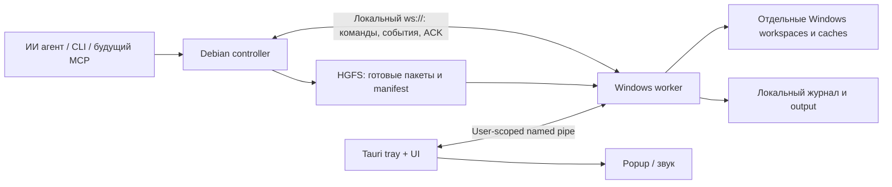

# Архитектура WinBridge

Статус: решения для локального проекта, утверждённые пользователем 2026-10-04. Local worker/journal/IPC и native UI прошли [Windows gate 2026-10-05](windows-gate-2026-10-05.md); этап 1 завершён. Приняты рецепты + произвольные команды в проекте и доставка через HGFS с отдельной Windows сборкой. Диаграмма описывает целевую архитектуру; WebSocket/controller реализованы и проверены в Debian; Windows gate этой сессии ещё ожидается. Snapshot delivery пока не реализована.

## Назначение и среда

Одна Windows машина, её Debian VM в VMware и несколько зарегистрированных проектов. ИИ агент работает внутри Debian и обращается к CLI/controller. Пользователь на Windows видит действия агента, output, причины сбоев и состояние процессов. Netwatch — отдельный проект и возможный первый сценарий сборки, а не зависимость WinBridge.

## Компоненты и владение

Windows worker устанавливает постоянное соединение с controller Debian. Команды отправляются обратно по той же двусторонней сессии. Привязка listener к адресу VM адаптера и IP Windows выбирается при настройке. Выбор host-only либо существующей частной NAT сети зависит от доступной локальной связности; дополнительные адаптеры не являются обязательной установкой.

| Компонент | Что он решает | Что не переносить сюда |
| --- | --- | --- |
| protocol | Версия wire schema, DTO, ошибки, task/event IDs | ОС, UI, выполнение |
| core | Project policy, orchestration задач, дедупликация, transitions, interfaces Store/Runner/Delivery | Tauri, фиксированные HGFS пути, прямой доступ к процессам |
| transport | WebSocket, framing, IPC, heartbeat, request timeout, session recovery | Команды сборки, бизнес-состояние проекта |
| platform | Windows process tree и paths, user-scoped IPC primitives, local filesystem | Pipeline, UI, fixed recipes |
| controller | Вход от агента, capture snapshot, dispatch, reconnect/reconcile | Windows выполнение и достоверный exit code |
| worker | Accepted task до ACK, project registry, execution, journal, snapshot import | Автоматический повтор неизвестно завершившейся команды |
| desktop/UI | Timeline, управление проектами/задачами, внимание пользователя | Независимая очередь и обход worker policy |

Для расширения использовать статические capability handlers и interfaces adapters. Один поток выполнения command service используется recipes и direct commands. Свободный command не обходит журнал или project scope. Динамические плагины, удалённые облачные узлы и cross-project federation не нужны для первого сценария.

## Локальное соединение без шифрования

Протокол — WebSocket с JSON сообщениями поверх plain TCP (`ws://`). TLS, сертификаты, SSH, VPN и внешние relay не входят в план. HTTP listener не открывается на всех интерфейсах по умолчанию. Node/instance IDs служат для сопоставления и журнала; не выдавать их за криптографическую проверку идентичности.

Worker использует настроенный адрес controller. Controller принимает worker из явно выбранной локальной пары/адреса и показывает его в UI. Ограничение локальной пары — часть маршрутизации и product setup, не основание для навязывания encrypted transport. Изменения firewall/mounts не выполняются скрытно.

Handshake: protocolVersion, appVersion, nodeId, instanceId, generation, список реально реализованных capabilities. Несовместимая версия даёт понятную ошибку с дальнейшим действием. AppVersion не заменяет wire version. Session generation меняется после рестарта, durable task/event IDs сохраняются.

Текущая сессия: выбран VMnet8, Debian `192.168.44.203:1143`, Windows `192.168.44.1` (адрес подтверждён пользователем). Strict schema 1 controller config задаёт stateDirectory, listenAddress, allowedWorkerAddresses и workerNodeId; instanceId совпадает у пары. Поддерживаются literal private/loopback IPv4, без DNS и extra URL path. Controller CLI использует private Unix socket (0700 directory/0600 socket), worker сохраняет прежний SID named pipe для desktop.

Handshake включает HTTP upgrade и JSON hello/welcome; общий deadline 5 секунд. Не более четырёх network connections/handshakes, одной принятой worker session, 32 queued calls и 16 in-flight запросов. Frames/messages не более 1 MiB; write/flush deadline 2 секунды; RPC deadline 8 секунд. Controller посылает JSON ping раз в 5 секунд, ждёт соответствующий nonce не более 10 секунд: другой traffic не продлевает deadline. Worker прекращает session после 15 секунд без нового ping. Backoff 1–10 секунд восстанавливает соединение, без retry команд.

Controller `submit/get/list/output/cancel` вызывает тот же worker handler, что и desktop. `watch TASK_ID [AFTER_EVENT_SEQUENCE] [AFTER_OUTPUT_SEQUENCE]` — подписка CLI через polling journal/output каждые 500 ms; курсоры исключают повторы при reconnect. Output читается страницами, `outputComplete` появляется после terminal task и пустой следующей страницы. Отдельная server-push очередь пока не нужна. `watch` не отправляет submit; неизвестный результат мутации требует того же key/ID. Controller не копирует Windows SQLite и не кеширует неподтверждённый task success.

Transport использует [tokio-tungstenite](https://docs.rs/tokio-tungstenite/0.30.0/tokio_tungstenite/) с отключёнными TLS features и явными bounds. [Проверка настоящими процессами](windows-session-validation.md) описывает следующий Windows gate.

Heartbeat отвечает за свежесть соединения; task status отвечает за выполнение. Offline controller, закрытый UI и неизвестный результат команды — разные состояния. Bounded buffers, timeout, cancellation и backpressure проектируются до непрерывного stdout stream.

## Команды и проекты

Windows пользователь регистрирует project ID и локальный корень. Настройки проекта разрешают recipes и direct commands, задают log paths, caches и concurrency. По умолчанию один изменяющий процесс на workspace; импорт и сборка одного поколения не выполняются одновременно.

Direct request содержит executable, массив аргументов, относительный cwd и timeout. Recipe раскрывается в те же параметры; UI показывает источник рецепта и итоговые параметры. Агенту не нужно подтверждение каждого обычного действия в уже разрешённом проекте.

`cwd` проверяется относительно зарегистрированного корня с учётом actual paths, traversal, symlinks/junctions и NTFS имён. Аргументы не соединяются в shell строку. Если запрашивается PowerShell, cmd или script, это видимый executable/argument set и отдельная корректная обработка Windows quoting. Сборка доверенного проекта действует с правами пользователя; выбранная папка не является файловым sandbox.

Windows worker владеет дочерними процессами и Job Object для управляемого дерева. Controller и WebView не владеют process handles. Отмена завершает управляемую группу с фиксированным deadline; stdout и stderr всегда читаются независимо от скорости UI. Длительный `process.start` отделён от короткого `task.submit`: старт PID не равен подтверждённой готовности приложения.

## Задачи, persistence и восстановление

1. Controller формирует запрос с requestId, projectId, idempotencyKey, source snapshot и deadline.
2. Worker валидирует project scope и сохраняет принятую задачу до ACK.
3. Worker записывает intent шага, запускает процесс и сохраняет output/exit code.
4. UI и controller читают события с sequence и догружают пропуски после reconnect.
5. Тот же key с тем же содержимым возвращает прежнюю задачу; другой payload с тем же key отклоняется.

Task states: queued, running, succeeded, failed, cancelled, interrupted, indeterminate. Timeout — failed с явной причиной. Отсутствие свежих данных не переписывает последнее известное состояние задачи. Падение между внешним эффектом и фиксацией результата даёт indeterminate; автоматическое повторение такой команды запрещено.

Windows journal — источник истины по исполнению. SQLite metadata и сегменты output находятся на локальном диске Windows. Debian может иметь локальный dispatch journal, но не открывает Windows live SQLite файл через HGFS. WAL работает на одном хосте, а не как shared network database. [SQLite WAL](https://www.sqlite.org/wal.html).

Output events могут ссылаться на уже сохранённые byte ranges. При переполнении live очереди UI дочитывает файл с offset. При достижении retention/quota продолжать drain stdout и отмечать пропуски; нельзя подвесить процесс заполненным pipe. Короткие диагностические logs runtime отделены от пользовательского task journal.

## Доставка снимков

Delivery adapter отделён от orchestration. Первый adapter — shared-folder delivery. Controller публикует snapshot в namespace WinBridge внутри `/mnt/hgfs/shared`; worker читает тот же пакет через `K:\VMs\shared` и импортирует его в собственный локальный workspace.

Manifest фиксирует source mode (commit SHA или dirty snapshot), пути, hashes, размеры, состав обязательных build files. Staging и ready marker защищают от чтения неполного пакета. До выполнения worker проверяет manifest и содержимое. Сборка работает на стабильном поколении Windows, а caches остаются локальными и переиспользуемыми.

Операция sync удаляет только ранее управляемые исходники. Runtime configs, secrets, пользовательские файлы, live databases, logs и результаты других программ не входят в source snapshot. Подробности в [shared-folders.md](shared-folders.md).

## UI и расширение

Каждое capability имеет понятное имя, описание параметров, видимые события, cancel/retry semantics и read model для UI. Event journal — единый источник данных для task page, общего audit и уведомлений. Desktop закрывается независимо от worker; отдельное явное действие останавливает worker с показом активных задач.

Поля формы desktop сохраняются в `winbridge-desktop-state.local.json` рядом с exe. Scope — worker instance ID, project ID и workspace root; отдельный файл формы не меняет worker config или task journal. Запись завершается заменой временного файла, закрытие окна ждёт ACK последних записей. Восстановление формы только заполняет поля; task.submit вызывается явной кнопкой. Ошибки сохранения видны пользователю. DTO формы находятся в protocol, файловое хранилище — в core, IPC и расположение файла — в desktop shell.

Добавление возможности проходит через DTO → core handler → platform/delivery adapter → journal/read model → UI → проверку восстановления. Добавление другого проекта в первую очередь требует project configuration/recipes; новая capability нужна только для новых действий. Обобщать interfaces после появления второго реального handler, а не создавать пустую систему plugins заранее.

Первый полный сценарий и критерии готовности перечислены в [roadmap.md](roadmap.md).
