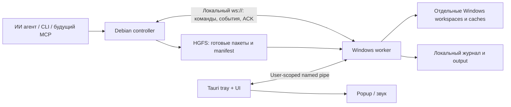

# Архитектура WinBridge

Дополнение2026-10-25: [Main24 writer gate подтверждён](plans/worker-self-update/resume-2026-10-25-writer-verified.md)
на19/17/actor24/view16/private3:193 tests,56 files twice,44+16+18 negative audits.
Новые startup admissions240s разрешены пользователем, старые intents не меняются.
[Диагностика](plans/worker-self-update/review-2026-10-25-latency.md) и
[следующий normal local service](plans/worker-self-update/local-service-activation.md).
Ниже сохранён предшествующий статус, включая историческую ошибку120s; актуальное
состояние и точные pins — в новом checkpoint. Normal service/controller/lifetime
и U3/U4 не реализованы, public install off, installed runtime не менялся.

Статус 2026-10-10: этапы 1–7 завершены; Windows runtime/IPC, WebSocket, snapshot delivery и изолированный Netwatch workflow проверены на настоящей Windows. Этап 6: [baseline и Git batch capture](done/stage0-7/stage6/performance-capture-gate-2026-10-09.md) измерены и проверены автоматически, [delta от verified generation](done/stage0-7/stage6/windows-delta-gate-2026-10-09.md) прошла отдельные native и Debian → Windows gates; [output batching](done/stage0-7/stage6/windows-output-gate-2026-10-10.md) и [pinned chunk resume](done/stage0-7/stage6/windows-resume-gate-2026-10-10.md) также прошли automatic gates. [Журнал внимания этапа 5](guides/attention.md) и [settings/output retention](guides/settings-retention.md) реализованы и проверены. Windows regression запускается [автоматически](validation/windows-workflow-validation.md). Tray/popup/sound прошли native gate; workflow/application attention также [прошли автоматический native gate](done/stage0-7/stage5/windows-workflow-attention-gate-2026-10-08.md).

## История состояния updater до положительного writer gate

Source **updater19/worker17, supervisor24/view16, private physical2 + writer3**.
[Checkpoint](plans/worker-self-update/resume-2026-10-25-journal-activation.md) и
[writer actor](plans/worker-self-update/journal-writer-actor.md) приоритетнее
исторических статусов ниже. [Physical Main23 StateOwned132/0](plans/worker-self-update/windows-activation-state-gate-2026-10-25.md)
доказан на18/16/private2. Последний writer результат и его границы — в
[native отчёте](plans/worker-self-update/windows-journal-writer-gate-2026-10-25.md).

Worker17 атомарно сохраняет header CAS+immutable receipt, stale owners fenced,
maintenance остаётся Quiesced. [Opening owner](plans/worker-self-update/activation-journal-opening.md)
механически удерживает Store и тот же acquired state lock, запрещает CREATE/
migration/повтор попытки и close-time checkpoint до grant. Ordinary inactive16→17
migration имеет backup, active cross-schema takeover16→17 не поддерживается.

Updater19 добавляет immutable writer intent/causal history. Factory связывает
StateOwned6 и old authority из verified final backup в одном snapshot. Trusted
original guard проверяет capability3, сохраняет Issued до одной private send;
worker V3 сверяет graph/parent/window и делает fresh atomic CAS. Authenticated
receipt сохраняется как факт, timeout/partial/EOF — uncertainty без replay.
Поздние факты связываются с frozen6 после последующего local/uncertainty progress.

Actor24/view16 подключены: one resident Owned guard, один blocking slot,
volatile ACK/busy без full audit до private grant, saved confirmation отдельно
от actual residency/liveness. Старые views1–15 frozen; source781/0 и Linux/MSVC
Clippy/TS/UI passed. Обычный activated
service/reconciliation/local/controller/lifetime и U2 faults/U3/U4 впереди.
Source Main24 и independent writer verifier добавлены: same-child fast path,
два связанных SQL journals/receipts, fencing и отдельное cold наблюдение.
Hooks4/Python19 и обе validation Clippy passed. PS/observer и actual18→19/
worker16→17/refusal fixtures добавлены, Python24/MSVC/Linux passed. PowerShell
syntax preflight прошёл на Windows; actual worker16→17/active16 refusal и updater18→19/old18 refusal
подтверждены в повторном gate. Independent migration audit отверг18 подмен.
Combined run190 passed/1 failed: Main24 writer observe отклонён после expiry
original120s. Полного writer proof нет; сначала latency review/fix и новый isolated
native gate, затем normal service/controller/lifetime. Все проверки завершены;
installed d052 healthy/idle, обновление working runtime не выполнялось.
Старый physical132 readonly принят снова.
Original120s сохраняется. Public install off, advertised activation/controller/
desktop=None. Serialized data не восстанавливают kernel custody или permissions.
Installed runtime не менялся; source/cross checks не подменяют actual Windows gate.

## История реализации updater

Ниже статусы конкретных прежних source/gates, не текущие задания.

Подключены [replacement driver/actor v17/view9](plans/worker-self-update/runtime-replacement-actor.md):
одноразовое admission, consuming original custody, manifest-last перенос и
trusted FilesVerified → VerifyingLocal. Их native gates относятся к schema15.
[Actual Main15 replacement60/0 gate](plans/worker-self-update/windows-runtime-replacement-main-gate-2026-10-23.md)
и [четыре actual faults60/0](plans/worker-self-update/windows-runtime-replacement-faults-gate-2026-10-23.md)
пройдены. [Readonly updater support query](plans/worker-self-update/windows-updater-support-gate-2026-10-23.md)
прошла отдельный native8/0 gate. [Typed compatibility policy](plans/worker-self-update/updater-compatibility.md)
дополнена [candidate support schema16](plans/worker-self-update/candidate-support.md):
immutable ledger/fresh permit/journal-bound driver с frozen executor contracts.
[Native metadata/query/migration25/0 gate](plans/worker-self-update/windows-candidate-support-gate-2026-10-23.md)
пройден, actual15→16/refusal подтверждён. [Support actor18/view10](plans/worker-self-update/candidate-support-actor.md)
добавлен; [actual Main23/0](plans/worker-self-update/windows-candidate-support-actor-gate-2026-10-23.md)
проверен. Production support→drain binding реализован с local/cross проверками;
его native gate прошёл, activation ещё впереди. Public install выключен. [Актуальный handoff](handoff.md)
содержит точные границы доказательств, карту кода и план продолжения.
Ниже сохранена история предыдущих commits.

Продолжение: [replacement admission ledger](plans/worker-self-update/runtime-replacement-ledger.md)
добавлен в текущий source **schema15**; worker16/supervisor v16/view8 прежние.
Local workspace647/0 и обе Clippy passed;
[native15 metadata11/0](plans/worker-self-update/windows-runtime-replacement-ledger-gate-2026-10-23.md)
пройден; [actual retained14→15/refusal](plans/worker-self-update/windows-replacement-migration-gate-2026-10-23.md)
также проверен. Rename
callback/consuming guard/IO добавлены как
[trusted library](plans/worker-self-update/runtime-replacement-custody.md), ещё не
подключены к actor и не имеют positive native replacement proof. Проверенные
preparation gates ниже —14.

Текущий блок — [U2.2 preparation library](plans/worker-self-update/runtime-preparation.md):
её проверенные gates используют updater14/worker16. Foundation native10 относится к v15/view7;
[copy driver и supervisor v16/view8](plans/worker-self-update/runtime-preparation-actor.md)
добавлены и прошли [actual Main40/0 gate](plans/worker-self-update/windows-runtime-preparation-main-gate-2026-10-22.md).
[Actual13→14/refusal](plans/worker-self-update/windows-preparation-migration-gate-2026-10-23.md)
также пройден. [Три actual preparation faults](plans/worker-self-update/windows-runtime-preparation-faults-gate-2026-10-23.md)
прошли40 tests; [whole replacement data model](plans/worker-self-update/windows-runtime-replacement-model-gate-2026-10-23.md)
прошла12 native tests. Actual rename/activation ещё впереди.
Native U2.1 ниже — schema13.

U0/internal U1 завершены. U2.1 использует updater13/worker16, supervisor v15/view7:
original exit guard удерживается supervisor через Arc и immutable driver loan;
readonly old-worker helper сохраняет SQLite через backup API. Данные backup/history
не создают kernel custody. [Native success и migration12→13](plans/worker-self-update/windows-state-backup-gate-2026-10-21.md)
пройдены; [four-case fault gate](plans/worker-self-update/windows-state-backup-faults-gate-2026-10-22.md)
завершил U2.1. U2.2 имеет preparation binding/ledger/copy driver и native-проверенные
file/model primitives для будущего rename. Replacement/activation/desktop/public
update не реализованы. Следом replacement ledger/fresh permit/consuming OS custody
и rename driver; [подробный handoff](plans/worker-self-update/resume-2026-10-23.md)
содержит проверки, карту кода и последовательность продолжения.
Ниже исторические описания блоков; номера schemas там относятся к их native gates.

## Точная остановка updater — 2026-10-21

[Основной actual Main gate](plans/worker-self-update/windows-shutdown-main-gate-2026-10-21.md)
проверил четыре случая stop/ACK/exit/cold-reader и сохранение истории после owned
supervisor crash. Updater schema12/worker16, control v6, supervisor v14/view6.
Durable receipt отделена от живого OS guard: после driver retirement его держит
supervisor, после crash исторический Exited не восстанавливает custody.
[Supplemental lock/crash tests](plans/worker-self-update/windows-shutdown-supplemental-gate-2026-10-21.md)
также пройдены; внутренний U1 цикл завершён. [Final consistent backup](plans/worker-self-update/final-state-backup.md),
replacement, activation/desktop/rollback и публичный update остаются U2–U4.
Raw lifecycle не может объявить файлы/local health/controller проверенными:
для следующих переходов необходимы trusted drivers и собственные receipts.

## Подготовка самообновления — 2026-10-17

[План U0–U4](plans/worker-self-update/README.md) временно предшествует продолжению A4.
`apps/update` владеет отдельным updater journal schema 11 (WBUP), installation scope,
OS owner lock/epoch, source ZIP/staging и [source transaction](plans/worker-self-update/source-transaction.md).
[Artifact actor v5 / atomic artifact receipt](plans/worker-self-update/artifact-actor.md),
known-set reader и полный candidate build прошли
[156 native tests / 16 groups](plans/worker-self-update/windows-artifact-actor-gate-2026-10-18.md).
[Ранняя проверка runtime](plans/worker-self-update/runtime-startup.md) подключена
в normal worker Main: known manifest → четыре pins → собственный loaded descriptor
до worker journal, без updater writer/migration. [Actual Main / lifetime gate](plans/worker-self-update/windows-runtime-startup-gate-2026-10-18.md)
пройден: 159 native tests/full build и отдельный serve/pins proof. Public update/install и activation
не включены; последующие описания отдельных blocks сохраняют их исторические gates.
[Live runtime control v2 / supervisor v6](plans/worker-self-update/runtime-live-control.md)
прошёл [165 native tests / full build / actual Main и pins](plans/worker-self-update/windows-runtime-control-gate-2026-10-18.md).
[Durable baseline / supervisor v7](plans/worker-self-update/runtime-baseline.md)
сохраняет intent/receipt с parent transitions до source effects, без worker lease
или runtime replacement. Pending запрещает source admission. Schema-8 блок прошёл [175 native tests / full build](plans/worker-self-update/windows-runtime-baseline-gate-2026-10-19.md);
старые операции не получают baseline задним числом. Schema-9
[preimages library](plans/worker-self-update/runtime-preimages.md) сохраняет только
create-only пять copies с отдельными intent/receipt до source;
[189 native tests / full build](plans/worker-self-update/windows-runtime-preimages-gate-2026-10-19.md) passed.
[Actor v8](plans/worker-self-update/runtime-preimages-actor.md) сохраняет быстрый ACK,
consistent view schema 3 и durable abort с тем же authority/epoch после quiescence.
[193 native tests / full build](plans/worker-self-update/windows-runtime-preimages-actor-gate-2026-10-19.md) passed. Установка/activation пока не включены.
[Candidate rehearsal](plans/worker-self-update/worker-rehearsal.md) использует отдельный
contract marker и новый пустой journal/IPC; live journal/config не копируются.
Standalone proof не даёт health receipt/approval; native gate pending.
[Compatibility v3 / supervisor v9](plans/worker-self-update/worker-compatibility.md)
читает реальные schemas/context/config SHA у bound worker. Candidate config check
читает точные bytes без открытия production journal; durable health/approval впереди.
[Health journal / supervisor v10](plans/worker-self-update/candidate-health.md)
добавляет guarded helpers, atomic acceptance и coordinated abort; native
сквозной gate этого нового блока ещё не пройден. Public update/install отключены.
[Supervisor handoff](plans/worker-self-update/supervisor.md) добавляет отдельный
процесс, exact process identity, epoch transfer и same-user IPC. Это trusted library;
[76 native tests / полный candidate build](plans/worker-self-update/windows-supervisor-gate-2026-10-17.md)
прошли. [Worker launcher/control](plans/worker-self-update/worker-control.md) добавляет
trusted worker API, exact immutable binding и supervisor-only lease IPC. SourceHeld
атомарно резервирует work slot; named resources пока откладывают grant.
[80 native tests / полный candidate build](plans/worker-self-update/windows-worker-control-gate-2026-10-17.md) прошли; SourceControl/file driver/shutdown/install ещё не подключены.
Worker schema 15 владеет source/drain/quiesce leases и pre-migration startup guard;
updater не открывает worker journal. Между этими БД нет общей транзакции:
source effects требуют свежий trusted worker grant и актуальную updater authority.
[Fresh SourceControl](plans/worker-self-update/fresh-source-control.md) добавляет
process-authenticated bounded Info; baseline/release scan вынесен из общего mutex
с проверками до/после I/O. [82 native tests / candidate build](plans/worker-self-update/windows-fresh-source-gate-2026-10-17.md) прошли.
[Managed compiler](plans/worker-self-update/compiler-driver.md) добавляет отдельный
attempt/FSM/receipts и OS cleanup proof. 429 local workspace tests и 10 итоговых
compiler tests и [95 native tests / candidate build](plans/worker-self-update/windows-compiler-gate-2026-10-18.md)
passed. [Atomic executable adapter](plans/worker-self-update/atomic-executable.md)
закрывает отдельный compiler CreateProcess/Job gap;
[102 native tests / candidate build](plans/worker-self-update/windows-atomic-launch-gate-2026-10-18.md) прошли. Автоматический driver
и runtime install пока не включены.
[Source preparation actor](plans/worker-self-update/source-actor.md) выполняет
ZIP/source grant/apply на одном blocking driver с тем же owner epoch; mailbox
читает consistent view независимо от I/O. Internal protocol 2 и config schema 2
не меняют persisted journal schemas 4/15 или legacy RPC. 438 local workspace tests
и Linux/Windows Clippy passed;
[109 native tests / candidate build](plans/worker-self-update/windows-source-actor-gate-2026-10-18.md) прошли. Compiler orchestration и
coordinated abort/release остаются следующими блоками.

SourceApplying сохраняется до изменений; per-file intent → no-clobber move → hash/
receipt, manifest последним. Verified source и parent Building фиксируются атомарно
в updater DB, SourceHeld остаётся у worker. Crash/unknown outcome не повторяется;
readonly inspection показывает сохранённые preimages/held и receipt states.
Миграция updater schema 1/2/3 → 4 требует свободный owner lock и verified consistent backup.
[65 native Windows tests / полный candidate build](plans/worker-self-update/windows-source-transaction-gate-2026-10-17.md)
прошли. Worker-owned supervisor/lease IPC реализованы как trusted API; source/build
orchestration, shutdown, runtime install и bootstrap ещё не реализованы; внешняя update capability не объявляется. Installed runtime сохраняется.

## Назначение и среда

Этап 7 также завершён: [второй прикладной проект](guides/project-integration.md) использует
закреплённые runner/sync interfaces, общий профиль и прежние journal/process owner.
[Windows gate](done/stage0-7/stage7/windows-projects-gate-2026-10-10.md) подтвердил оба service cycles,
private IPC, nested tree stop и recovery. Независимого SDK consumer нет;
protocol/config версии и статический workspace contract остаются прежними.

Одна Windows машина, её Debian VM в VMware и несколько зарегистрированных проектов. ИИ агент работает внутри Debian и обращается к CLI/controller. Пользователь на Windows видит действия агента, output, причины сбоев и состояние процессов. Netwatch — отдельный проект и возможный первый сценарий сборки, а не зависимость WinBridge.

## Компоненты и владение

Windows worker устанавливает постоянное соединение с controller Debian. Команды отправляются обратно по той же двусторонней сессии. Привязка listener к адресу VM адаптера и IP Windows выбирается при настройке. Выбор host-only либо существующей частной NAT сети зависит от доступной локальной связности; дополнительные адаптеры не являются обязательной установкой.

| Компонент | Что он решает | Что не переносить сюда |
| --- | --- | --- |
| protocol | Версия wire schema, DTO, ошибки, task/event IDs | ОС, UI, выполнение |
| core | Project policy, orchestration задач, дедупликация, transitions, interfaces Store/Runner/Delivery | Tauri, фиксированные HGFS пути, прямой доступ к процессам |
| transport | WebSocket, framing, IPC, heartbeat, request timeout, session recovery | Команды сборки, бизнес-состояние проекта |
| platform | Windows process tree и paths, user-scoped IPC primitives, local filesystem | Pipeline, UI, fixed recipes |
| controller | Вход от агента, capture snapshot, dispatch, reconnect/reconcile | Windows выполнение и достоверный exit code |
| worker | Accepted task до ACK, project registry, execution, journal, snapshot import | Автоматический повтор неизвестно завершившейся команды |
| desktop/UI | Timeline, управление проектами/задачами, внимание пользователя | Независимая очередь и обход worker policy |

Для расширения использовать статические capability handlers и interfaces adapters. Один поток выполнения command service используется recipes и direct commands. Свободный command не обходит журнал или project scope. Динамические плагины, удалённые облачные узлы и cross-project federation не нужны для первого сценария.

## Локальное соединение без шифрования

Протокол — WebSocket с JSON сообщениями поверх plain TCP (`ws://`). TLS, сертификаты, SSH, VPN и внешние relay не входят в план. HTTP listener не открывается на всех интерфейсах по умолчанию. Node/instance IDs служат для сопоставления и журнала; не выдавать их за криптографическую проверку идентичности.

Worker использует настроенный адрес controller. Controller проверяет instance/node/version/capabilities и показывает подключённый worker в UI. По решению пользователя 2026-10-05 входящие соединения не блокируются по IP; адрес источника записывается в журнал. Listener остаётся на выбранном интерфейсе. Настраиваемый список разрешённых IP можно добавить позднее. Изменения firewall/mounts не выполняются скрытно.

В feature-ветке `.204` `feat/multi-controller` добавлен альтернативный
`worker.controllerTopology`: 1–4 исходящих соединения с явным primary, независимыми
attempt tickets/reconnect и readiness caches. Один Worker/SQLite/scheduler обслуживает
всех доверенных caller; nodeId controller может совпадать, связь различается по
настроенному endpoint ID. RPC budget общий (32 total/16 per endpoint), timeout
не освобождает ещё работающий blocking handler. Завершение сетевого supervisor
отменяет и дожидается всех endpoint tasks. Local Info показывает primary, сетевой
Info — связь/проекцию своего caller без изменения DTO. Legacy controllerUrl и
local-only сохраняются, оба режима одновременно отклоняются. Проверяется на
Debian; установленный0.1.1 новый config не понимает, Windows gate ещё не пройден.
Отдельная readonly extension `winbridge.controller-connections` v1 предоставляет
согласованный список всех связей, сохранённые ошибки/attempts и общие/per-peer RPC
counters без изменения старого Info и без записей в SQLite. SDK проверяет
schema/context/worker generation. Desktop показывает срез с явным primary,
ошибками и предупреждением о несвежих данных; для старого worker остаётся прежняя
сводка. Дополнительного постоянного polling нет. Durable creator attribution
добавлена в source/schema18 отдельной immutable таблицей: same-transaction fresh
acceptance, неизменность при duplicate, наследование workflow children. Network
origin берётся из RPC permit, local entry отмечается без идентификации человека.
Старые операции остаются unknown; side table не меняет wire task DTO/fingerprint.
Cold migration17→18 делает verified SQLite backup и отказывает при active update;
exact-schema activation не получает нового migration разрешения. Readonly
`winbridge.operation-attribution` v1/SDK и task detail UI читают исторического
creator с pinned scope/provider. В текущей source/schema19 добавлена отдельная
immutable cancellation intent таблица. Первый effective cancel/stop атомарно
связывает initiator и изменение business state; duplicate/terminal no-op не
переписывает источник и время. Workflow передаёт actor дочерним import/task/app,
application — managed task; creator при этом не меняется. Legacy отсутствие
metadata не доказывает отсутствие старой отмены; internal Store вызов может иметь
unknown actor. Readonly `winbridge.operation-cancellation` v1 и task detail UI
не выдают intent за подтверждение process cleanup. Cold17/18→19 backup/refusal
проверены на Linux; active update и exact-schema activation migration не допускают.
CLI/MCP читают все три readonly extensions через отдельный controller-local
`controllerDiagnosticsVersion:1` route. Strict typed dispatch принимает только
список связей, creator и cancellation queries; mixed/command frames отклоняются.
Контракты старого controller readiness и worker RPC не расширены. Каждый query
сохраняет caller-pinned context/operation, проходит SDK negotiation и не имеет
legacy fallback. Локальный activity log отмечает method/outcome без raw payload.
Installed worker/main17 не менялись; native Windows gate19 ещё впереди.
Подробности и границы — в [плане](plans/multi-controller-runtime.md).

Handshake: protocolVersion, appVersion, nodeId, instanceId, generation, список реально реализованных capabilities. Несовместимая версия даёт понятную ошибку с дальнейшим действием. AppVersion не заменяет wire version. Session generation меняется после рестарта, durable task/event IDs сохраняются.

Текущая сессия: выбран VMnet8, Debian `192.168.44.203:1143`, Windows `192.168.44.1` (адрес подтверждён пользователем). Strict schema 1 controller config задаёт stateDirectory, listenAddress и workerNodeId; instanceId совпадает у пары. Прежнее allowedWorkerAddresses принимается для совместимости, но игнорируется. Поддерживаются literal private/loopback IPv4 для адреса listener/controllerUrl, без DNS и extra URL path. Controller CLI использует private Unix socket (0700 directory/0600 socket), worker сохраняет прежний SID named pipe для desktop.

Журнал controller находится в `stateDirectory/activity.jsonl`: время Unix ms, событие, исходный IP/port, принятые node/generation/session IDs, метод RPC и его исход. Для запросов CLI origin — local_ipc, адрес worker записывается как destination, а не как автор команды. Команды/argv/output и сырые входящие payload в этот журнал не копируются. Текущий файл ограничен 1 MiB, архивы `.1`–`.5`; суммарно до 6 MiB после ротации. Отдельный writer и очередь 256 записей до 8 KiB не блокируют WebSocket при медленном диске. При переполнении/ошибке запись теряется с явным droppedRecords/lastError в `controller status.activityLog` и сообщением stderr; журнал диагностический, durable task acceptance остаётся в Windows SQLite. Shutdown дожидается очереди не более двух секунд. Файлы 0600, один writer удерживает exclusive lock; ротация сохраняет неожиданные symlinks/необычные файлы вместо перезаписи.

Подключение включает TCP connect, HTTP upgrade и JSON hello/welcome; общий deadline 5 секунд. Ошибка worker указывает достигнутый этап; Windows socket permission denied 10013 содержит actual exe path. Не более четырёх network connections/handshakes, одной принятой worker session, 32 queued calls и 16 in-flight запросов. Frames/messages не более 1 MiB; write/flush deadline 2 секунды; RPC deadline 8 секунд. Controller посылает JSON ping раз в 5 секунд, ждёт соответствующий nonce не более 10 секунд: другой traffic не продлевает deadline. Worker прекращает session после 15 секунд без нового ping. Backoff 1–10 секунд восстанавливает соединение, без retry команд.

Controller `submit/get/list/output/cancel` вызывает тот же worker handler, что и desktop. `watch TASK_ID [AFTER_EVENT_SEQUENCE] [AFTER_OUTPUT_SEQUENCE]` — подписка CLI через polling journal/output каждые 500 ms; курсоры исключают повторы при reconnect. Output читается страницами, `outputComplete` появляется после terminal task и пустой следующей страницы. Отдельная server-push очередь пока не нужна. `watch` не отправляет submit; неизвестный результат мутации требует того же key/ID. Controller не копирует Windows SQLite и не кеширует неподтверждённый task success.

Transport использует tokio-tungstenite с отключёнными TLS features и явными bounds. [Windows runtime/native UI gate локальной сессии](done/stage0-7/stage2/windows-session-gate-2026-10-05.md) пройден. Snapshot runtime работает по [формату этапа 3](reference/snapshot-format.md); [Windows gate пройден](done/stage0-7/stage3/windows-snapshot-gate-2026-10-06.md). Новые workflow RPC передаются только peer с log_read; старый worker получает понятный отказ без разрыва совместимой сессии.

Heartbeat отвечает за свежесть соединения; task status отвечает за выполнение. Offline controller, закрытый UI и неизвестный результат команды — разные состояния. Bounded buffers, timeout, cancellation и backpressure проектируются до непрерывного stdout stream.

## Команды и проекты

Windows пользователь регистрирует project ID и локальный корень. Настройки проекта разрешают recipes и direct commands, задают log paths, caches и concurrency. По умолчанию один изменяющий процесс на workspace; импорт и сборка одного поколения не выполняются одновременно.

Direct request содержит executable, массив аргументов, относительный cwd и timeout. Recipe раскрывается в те же параметры; UI показывает источник рецепта и итоговые параметры. Агенту не нужно подтверждение каждого обычного действия в уже разрешённом проекте.

`cwd` проверяется относительно зарегистрированного корня с учётом actual paths, traversal, symlinks/junctions и NTFS имён. Аргументы не соединяются в shell строку. Если запрашивается PowerShell, cmd или script, это видимый executable/argument set и отдельная корректная обработка Windows quoting. Сборка доверенного проекта действует с правами пользователя; выбранная папка не является файловым sandbox.

Windows worker владеет дочерними процессами и Job Object для управляемого дерева. Controller и WebView не владеют process handles. Отмена завершает управляемую группу с фиксированным deadline; stdout и stderr всегда читаются независимо от скорости UI. Длительный `process.start` отделён от короткого `task.submit`: старт PID не равен подтверждённой готовности приложения.

## Задачи, persistence и восстановление

1. Controller формирует запрос с requestId, projectId, idempotencyKey, source snapshot и deadline.
2. Worker валидирует project scope и сохраняет принятую задачу до ACK.
3. Worker записывает intent шага, запускает процесс и сохраняет output/exit code.
4. UI и controller читают события с sequence и догружают пропуски после reconnect.
5. Тот же key с тем же содержимым возвращает прежнюю задачу; другой payload с тем же key отклоняется.

Task states: queued, running, succeeded, failed, cancelled, interrupted, indeterminate. Timeout — failed с явной причиной. Отсутствие свежих данных не переписывает последнее известное состояние задачи. Падение между внешним эффектом и фиксацией результата даёт indeterminate; автоматическое повторение такой команды запрещено.

Windows journal — источник истины по исполнению. SQLite metadata и сегменты output находятся на локальном диске Windows. Debian может иметь локальный dispatch journal, но не открывает Windows live SQLite файл через HGFS. WAL работает на одном хосте, а не как shared network database. [SQLite WAL](https://www.sqlite.org/wal.html).

[Task FSM A1](plans/architecture-transition/task-fsm.md) выделяет решения о launch,
PID, cancel, finish и recovery в pure reducer `crates/core`. Store сохраняет
state/event и terminal attention до возврата execution decision; scheduler
запускает процесс только после commit с одной изменённой task row. Внутренний
Starting остаётся v1 running без PID. Protocol/schema/fingerprints прежние;
revision/attempt/epoch и защита остальных writers относятся к следующему A2.
Native Windows gate A1 пройден: 66 tests; подробности в linked A1 report.

[A2.1](plans/architecture-transition/durable-transitions.md) вводит schema 7 с
внутренним task revision и общим CAS для lifecycle/output/retention writers.
Wire record не меняется. Schema migration сохраняет legacy JSON/keys и делает
consistent backup; старый schema-6 binary отказывает новой БД. Native gate passed:
107 tests, включая actual старый executable и побайтную сохранность test journal.
Этот пакет ещё не вводит durable owner epochs/attempts и guards других доменов.

[A2.2](plans/architecture-transition/domain-transitions.md) добавляет schema 8 и
внутренние import/workflow/application/attention revisions. Общий CAS защищает
эти writers; child admission/link/registry, readiness/step и application stop/task
cancel сохраняются атомарно. ACK внимания монотонен и проверяет durable row.
Миграция сохраняет raw records/payloads/keys и делает consistent backup исходной
schema 7. Native gate passed: 125 tests, включая real resume/crash и byte-identical
refusal старого binary. Wire/UI/MCP JSON не меняются.

[A2.3.1](plans/architecture-transition/ownership-context.md) добавляет schema 9:
journal incarnation, owner epoch/UUID и retained execution attempts. Активация
под прежней instance lock; все writers проверяют owner в write transaction.
Task/import claim и attempt атомарны; PID/output/progress/outcome/fallback получают
operation/attempt token. Record revisions не подменяют authority. Snapshot читает
record/revision/authority одним SELECT. Native gate passed: 141 tests, включая
реальное завершение managed tree при owner-change fault и byte-identical schema-9
refusal прежнего binary.
[A2.3.2 durable leases](plans/architecture-transition/project-resource-leases.md)
добавляют schema 10: mutation/application scopes, atomic claim, readiness handoff
и освобождение только с physical receipt. [Native gate](plans/architecture-transition/windows-resource-leases-gate-2026-10-13.md)
passed: 157 tests, actual schema-10 refusal не меняет test journal.
[A2.4.1](plans/architecture-transition/physical-reconciliation.md) добавляет schema 11:
приостановленный Windows process, immutable named Job binding/PID commit до resume,
read-only physical reconciliation и bounded unresolved inventory в Info/UI.
[Native gate](plans/architecture-transition/windows-reconciliation-gate-2026-10-13.md) passed: 164 tests, actual schema-11 refusal без изменения test journal.
Installed worker остаётся schema 6. [A2.4.2a](plans/architecture-transition/journal-inspection.md)
добавляет explicit read-only inspection и marker вне SQLite, запрещающий normal
restart до migration/owner activation. History остаётся историей; inspection не
выдаёт physical proof и не разрешает replay. Startup сверяет applications до IPC;
scheduler fault приостанавливает запуск, сохраняя service. Controlled new incarnation
и restore admission — A2.4.2b; автоматического rollback detector пока нет.
A2.4.2a прошёл [176-test native gate](plans/architecture-transition/windows-inspection-diagnostic-2026-10-13.md).
Для A2.4.2b выбрана [новая пара с архивом](plans/architecture-transition/restore-admission-options.md).
[Request fence b.1](plans/architecture-transition/fenced-requests.md) добавляет schema 12
и отдельный request contract 2: instance ID и journal incarnation закрепляются
caller при создании операции. Повтор не меняет scope после reconnect/config reload;
worker проверяет scope до handler. Старые DTO и bytes остаются прежними.
Новый журнал может необратимо требовать этот контракт до первого owner activation;
это не является physical proof или разрешением recovery cutover.
271 local tests, real Unix browser gate и [186 native tests/desktop compile](plans/architecture-transition/windows-fenced-request-gate-2026-10-13.md) прошли.
Exe paths остаются стабильными. [b.2/b.3](plans/architecture-transition/recovery-pair.md)
реализуют immutable preparation/activation, постоянный source retirement и
whole-domain witness вне SQLite. Outer global Jobs разделены по durable owner/
logon session; suspended child входит в них до per-task Job. Cutover требует всех
Empty observations, не inventory после restore. 280 local tests/cross-checks и
browser gate и [197 native tests/desktop compile](plans/architecture-transition/windows-recovery-pair-gate-2026-10-14.md)
passed; full A2 завершён в выбранной archive/new-pair политике.
Глобальный параллелизм и actor migration не включены.

Output events могут ссылаться на уже сохранённые byte ranges. При переполнении live очереди UI дочитывает файл с offset. При достижении retention/quota продолжать drain stdout и отмечать пропуски; нельзя подвесить процесс заполненным pipe. Короткие диагностические logs runtime отделены от пользовательского task journal.

[Desktop diagnostic log](guides/desktop-diagnostics.md) находится рядом с exe в `logs/`,
пишет только lifecycle metadata через ограниченную неблокирующую очередь и отдельный
writer. Native dispatch watchdog работает независимо от WebView/async IPC. Desktop
state I/O выполняется вне native GUI loop; закрытие ограничивает ожидание ACK,
сохраняя честное «результат не подтверждён» при timeout.

## Доставка снимков

Delivery adapter отделён от orchestration. Первый adapter — shared-folder delivery. Controller публикует snapshot в namespace WinBridge внутри `/mnt/hgfs/shared`; worker читает тот же пакет через `K:\VMs\shared` и импортирует его в собственный локальный workspace.

Manifest фиксирует Git commit SHA, пути, hashes, размеры и полный состав target files; dirty snapshot остаётся будущим source mode. Staging и ready marker защищают от чтения неполного пакета. До выполнения worker проверяет manifest и содержимое. Сборка работает на стабильном поколении Windows, а caches остаются локальными и переиспользуемыми.

На этапе 3 import создаёт новое immutable поколение и не удаляет файлы; [Delta этапа 6](guides/snapshot-delta.md) добавляет reuse проверенного локального поколения в новом staging; удалённые пути отсутствуют в target, старые поколения сохраняются. [Resume schema 3](guides/snapshot-resume.md) сохраняет проверенные ZIP blocks для нового явного импорта после обрыва. Source cleanup ещё не реализована. Runtime configs, secrets, пользовательские файлы, live databases, logs и результаты других программ не входят в source snapshot. Подробности в [shared-folders.md](reference/shared-folders.md).

## Workflow и процессы приложений

Worker сохраняет frozen профиль и step IDs до ACK, затем связывает durable import/build/start с readiness/log. SQLite schema 3 добавляет workflows/applications; перед upgrade существующей базы выполняется consistent backup. Общая project reservation защищает startup; после готовности приложение продолжает жить под управлением worker, отдельно от mutation lease. Старый процесс снимает только собственную lease по operation ID. Startup deadline не ограничивает последующую жизнь приложения.

Readiness подтверждается stdout token именно запущенного процесса либо изолированным Netwatch IPC probe с проверкой PID владельца. Readable UTF-8 log находится вне snapshots; byte cursor обнаруживает rotate/truncate/prefix rewrite. App lifecycle отделён от исторического результата запуска; неизвестный исход после crash не повторяется. Подробные границы и CLI/UI описаны в [workflows](guides/workflows.md).

Этап 5 использует SQLite schema 5: typed task/workflow/application attention хранится
у worker, explicit key дедуплицируется, acknowledgement переживает restart. Terminal
record и event фиксируются одной транзакцией; child failure внутри workflow не
дублирует родительское уведомление. Перед v4 upgrade — consistent SQLite backup;
IDs, ACK и sequence high-water сохраняются. При ошибке commit worker отклоняет stale
состояние и приостанавливает admission/queue до восстановления. Native presentation
использует journal и сохранённый cursor; tray/quiet hours управляют только сигналом.
Additive attention_targets capability защищает старые peers от неизвестных RPC.
[Контракт и границы](guides/attention.md).

HistoryRead добавляет read-only history и storage usage без новой схемы SQLite.
Task diagnostic строится в одной read transaction; redaction применяется к строкам
до JSON encoding. Desktop показывает редактируемый preview и сохраняет именно его
в configured reportDirectory с create-only write/readback/SHA-256. Старые peers
защищены capability guard. [Контракт](guides/history-diagnostics.md).

## UI и расширение

Каждое capability имеет понятное имя, описание параметров, видимые события, cancel/retry semantics и read model для UI. Event journal — единый источник данных для task page, общего audit и уведомлений. Desktop закрывается независимо от worker; отдельное явное действие останавливает worker с показом активных задач.

Поля формы desktop сохраняются в `winbridge-desktop-state.local.json` рядом с exe. Scope — worker instance ID, project ID и workspace root; отдельный файл формы не меняет worker config или task journal. Запись завершается заменой временного файла, закрытие окна ждёт ACK последних записей. Восстановление формы только заполняет поля; task.submit вызывается явной кнопкой. Ошибки сохранения видны пользователю. DTO формы находятся в protocol, файловое хранилище — в core, IPC и расположение файла — в desktop shell.

Добавление возможности проходит через DTO → core handler → platform/delivery adapter → journal/read model → UI → проверку восстановления. Добавление другого проекта в первую очередь требует project configuration/recipes; новая capability нужна только для новых действий. Обобщать interfaces после появления второго реального handler, а не создавать пустую систему plugins заранее.

Первый сценарий этапа 7 — [локальные общие recipe profiles](guides/project-profiles.md).
Core задаёт статический CommandHandler contract, modules/runner реализует direct/
recipe expansion и filesystem scope; worker сохраняет единое владение ACK/journal/
processes. Bindings используют зарегистрированный root, snapshot cwd разрешается
отдельно. Task origin и workflow recipe definitions сохраняются до ACK; queued
workflow с изменённым рецептом отклоняется до дочерних операций. Settings требует
ручного restart, transport/RPC не изменяются. SDK/dynamic plugins не вводятся.

Первый полный сценарий и критерии готовности перечислены в [roadmap.md](roadmap.md).

Этап 4: editable profiles/drafts принадлежат desktop state, frozen accepted profile — worker journal. Artifact hashes снимаются после build перед start в фоновой работе, с исторической привязкой к source/build task. Изолированный Netwatch readiness adapter сверяет владельца IPC и health PID; он не подключается к production pipe. Расширенные workflow поля согласуются через WorkerInfo.workflowFeatures, без изменения Hello старого worker. Build identity содержит commit/dirty/build ID и SHA source manifest при сборке из ZIP.

[MCP stdio](guides/mcp.md) — вход в существующий controller IPC. Schemas инструментов
генерируются из protocol DTO; adapter не исполняет команды и не держит execution
queue. CLI/MCP publication используют общий handler. Потеря ответа не приводит
к automatic replay; accepted task переживает закрытие stdio.

[Настройки/retention](guides/settings-retention.md), 2026-10-09: local desktop IPC читает
config actual worker и сохраняет reviewed файл с conflict guard; running config
immutable до ручного restart. Controller/WebSocket maintenance не выполняют.
SQLite schema 6 хранит durable cleanup results, consistent v5 backup перед upgrade.
Только старый terminal stdout/stderr, с защитой active/unknown и pending attention;
task history/dedup/snapshots/reports сохраняются. Automatic policy opt-in/off by default.

### Manifest-pinned payload blocks (этап 6)

Opt-in [schema 3/resume](guides/snapshot-resume.md) сохраняет legacy schema 1/2.
Каждый ZIP block имеет SHA-256 в manifest; cache key — manifest SHA-256,
cache/staging/source находятся на local disk. Новый явный import проверяет cache
и читает только недостающие blocks из shared. Все прежние whole ZIP/file/base pins,
leases, terminal records/dedup и immutable publication сохраняются. Restart/close
не возобновляют мутации. Cache cleanup не входит в output retention policy.

A3.1 discovery завершён: optional open Info metadata с typed known interpreter,
provider build binding, unknown-data fallback и отдельные advertisements RPC 1/2.
[203 native tests/desktop compile](plans/architecture-transition/windows-discovery-gate-2026-10-14.md)
и final scope-error review passed. Catalog не является permission или pair evidence;
[A3.2](plans/architecture-transition/paired-readiness.md) вводит эти основания отдельно.
Installed schema-6 runtime нужно обновить до actual paired new/new проверки.

A3.2a [readiness foundation](plans/architecture-transition/readiness-foundation.md)
добавляет typed exact pair identity и local create-only evidence store у controller.
Worker Info передаёт provider-bound hashes действующей project policy; pending save
не меняет их до restart. Pure core evaluator отделяет исторические build/pair
проверки от свежего policy decision. Сериализованный `enabled` — readonly projection;
internal dispatch decision не десериализуется. Runtime producer/API и применение
к новым execution contracts ещё не подключены; existing A2 admission сохранён.

A3 завершён 2026-10-15: [discovery/readiness и согласованные страницы](plans/architecture-transition/windows-operation-pages-installed-2026-10-15.md) проверены на установленной Windows паре через MCP/CLI/IPC и UI renderer. Scoped readonly extension transport отделён от frozen RPC 1/2; каждая operation page читается одной SQLite transaction. [A4.1](plans/architecture-transition/work-scheduling.md) начинает opt-in global work budget и fair selection; production scheduling пока прежний.
