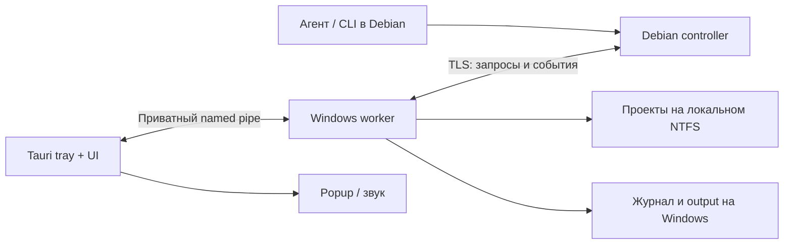

# WinBridge: каркас Debian ↔ Windows

Предложение от 2026-10-04. Это проект следующего приложения; выполнение команд, синхронизация и уведомления пока не реализованы в Netwatch.

## Направление

Сделать WinBridge приложением для управления рабочими проектами на Windows из Debian. Общие библиотеки обеспечивают соединение, IPC, задачи и журнал событий. Netwatch использует их для мониторинга, WinBridge — для синхронизации исходников, сборки и запуска.

Для начала достаточно одного Rust workspace, статически подключаемых модулей и двух приложений. Выделять отдельный репозиторий или динамические плагины стоит после появления второго реального потребителя. Уже полезны самостоятельный Rust агент, Tauri tray, React/Mantine UI и разделение UI/агента.

## Что сейчас связано с Netwatch

| Текущее место | Изменение для общего каркаса |
| --- | --- |
| `agent/src/transport.rs` | Выделить соединение и сессию; ping/pong и измерения оставить в модуле мониторинга. Сейчас сервер принимает только control frames, приложение RPC отсутствует. |
| `agent/src/config.rs` | Заменить зависимость возможностей от `desktop`/`vps` на настройки listener/connect и список capabilities. ОС и возможности узла описывать отдельно. |
| `agent/src/status.rs`, `agent/src/ipc.rs` | Общие health, ошибки, идентификаторы, версии протокола, запросы и события; DTO мониторинга оставить в Netwatch. |
| `launcher/src-tauri/src/health.rs` | Согласовывать версию протокола и capabilities. Версии приложений передавать отдельно: сейчас требуется совпадение версии launcher и агента. |
| Windows pipe | Добавить идентификатор приложения/экземпляра к SID. Сейчас все Netwatch агенты одного пользователя используют одно имя независимо от runtime directory. |
| `launcher/src-tauri/src/supervisor.rs` | Явная политика владения и времени жизни. Для WinBridge пользовательский фоновый агент должен продолжать работу после закрытия UI и разрыва связи с Debian. |
| `ui/src/App.tsx` | Сгенерированные TypeScript DTO и подписка на события с восстановлением пропусков; сейчас весь статус запрашивается раз в 5 секунд. |
| `scripts/*source_archive.py` | Оставить ручной перенос исходников. Автоматическую синхронизацию строить как отдельный протокол со снимками и восстановлением. |

Предлагаемые библиотеки: `bridge-protocol` (контракты), `bridge-runtime` (IPC, сессии, очередь, журнал, policy), `bridge-platform` (Windows/Linux процессы и файловые операции). Модули приложений: `monitor`, `workspace-sync`, `runner`, `log-reader`, `attention`. Статический реестр Rust обработчиков позволит добавлять функции без системы динамических плагинов.

## Соединение в обычной VM

В текущей среде `systemd-detect-virt` возвращает `vmware`. Рекомендуемая схема — сеть host-only между Windows и Debian, при необходимости второй адаптер NAT для доступа Debian в интернет. Это предложение настройки; сетевые настройки машины в рамках ревью не изменялись. VMware описывает host-only как частную сеть хоста и подключённых VM. [Документация Broadcom](https://knowledge.broadcom.com/external/article/309842/understanding-networking-types-in-hosted.html).

Windows агент инициирует защищённое постоянное соединение к Debian. По этой же двусторонней сессии Debian передаёт задачи обратно на Windows. Так можно сохранить направление подключения существующего проекта и обойти необходимость входящего listener на Windows. Listener Debian привязывается к адресу виртуального адаптера. Внешний VPS для связи хоста и его VM не требуется.

Стрелки запросов не определяют, кто устанавливает TCP соединение. Windows подключается к Debian, после чего запросы и ответы ходят в обе стороны.

MVP транспорта — WebSocket поверх TLS с проверкой обоих узлов, например mTLS и закреплёнными сертификатами после pairing. Текущий `direct-ip` предназначен для проверки ping/pong и не подходит для выполнения команд. Core должен отличать транспортное соединение от подтверждённой идентичности и разрешённых возможностей.

Варианты реализации:

| Вариант | Когда выбирать | Ограничения |
| --- | --- | --- |
| Собственный Rust worker + WebSocket/TLS | Рекомендуемый продукт: постоянные задачи, общий журнал, Windows UI, portable runtime | Нужно реализовать сессии, pairing и восстановление задач. |
| OpenSSH на Windows + тонкий controller/UI | Прототип, если SSH уже доступен и настроен | Всё равно нужны учёт задач, output, управление деревьями процессов и уведомления. Настройка системного SSH сервера — отдельное действие. |
| gRPC/HTTP2 | Несколько клиентов, языков и большой строго типизированный API | Дополнительный стек и codegen; файловые операции и дедупликация задач остаются прикладной логикой. |

QUIC имеет смысл оценивать при нескольких одновременно больших передачах и доказанной задержке управляющих сообщений. Для первой версии в локальной VM проще разделить управляющую и файловую сессии.

## Контракт задач

ИИ агент в Debian вызывает CLI или локальный MCP адаптер. Они обращаются к controller через приватный Unix socket; Windows полномочия проверяет worker. Оба интерфейса используют одни и те же операции:

- `workspace.sync(projectId, snapshotId)` — подготовить точный снимок проекта.
- `task.submit(projectId, recipeId, parameters, idempotencyKey)` — запустить зарегистрированную задачу.
- `task.get(taskId)` и `task.cancel(taskId)` — получить состояние или отменить задачу.
- `process.start/stop(projectId, recipeId)` — управлять длительно работающим приложением.
- `log.read/tail(projectId, logId, offset, limit)` — ограниченное чтение зарегистрированного лога.
- `events.subscribe(afterSequence)` — получить события и восстановить пропуски.
- `attention.request(taskId, severity, message, soundId)` — привлечь внимание пользователя.

Запрос содержит версию протокола, `requestId`, `projectId`, срок ожидания и payload. Повторение одного `idempotencyKey` с тем же payload возвращает прежнюю задачу; другой payload с тем же ключом отклоняется. Для событий нужны `taskId`, `stepId`, идентификатор узла/его поколения и монотонный sequence. UTC время удобно для показа; порядок событий одного источника определяется sequence.

Worker сохраняет принятую задачу до подтверждения. Разрыв соединения не отменяет уже принятую сборку. После восстановления controller спрашивает состояние задачи по ID, а UI дочитывает журнал с последнего sequence.

Состояния: `queued`, `running`, `succeeded`, `failed`, `cancelled`, `interrupted`, `indeterminate`. После падения между запуском внешнего процесса и записью результата нельзя гарантировать, что команда не выполнилась. Такие задачи не запускаются повторно автоматически: worker проверяет доступные признаки и сообщает неопределённый результат. Это особенно важно для публикаций и других действий с внешними эффектами.

## Рабочие папки и выполнение

Пользователь регистрирует проект в Windows UI: локальный корень, разрешённые рецепты, переменные окружения и пути логов. Удалённый запрос выбирает `projectId`, а не произвольный путь на диске. Например, проект `netwatch` может иметь рецепты `build-portable`, `run`, `stop`, `tail-agent-log`.

Рецепт задаёт executable, аргументы, рабочую папку, допустимые параметры и timeout. Для native executables использовать отдельные аргументы процесса. PowerShell скрипты, `.cmd`/`.bat` и npm scripts требуют своей проверки аргументов; набор аргументов нельзя превращать в строку shell через конкатенацию. Свободное выполнение команд можно добавить как отдельную явно разрешаемую возможность для конкретного проекта.

Корни, traversal, абсолютные пути, NTFS alternate streams, регистр имён, symlinks и junctions проверяются на стороне Windows. Разрешение сборки доверенного проекта позволяет коду сборки действовать с правами пользователя; ограничение `cwd` само по себе не изолирует файловую систему. Изоляция недоверенных проектов потребует отдельной учётной записи или другого настоящего sandbox.

Windows worker читает stdout и stderr одновременно, хранит exit code и управляет всей группой дочерних процессов. Job Objects позволяют управлять группой, включая завершение дерева; это механизм жизненного цикла, а ограничения безопасности процесса задаются отдельно. [Документация Microsoft](https://learn.microsoft.com/en-us/windows/win32/procthread/job-objects).

UI показывает timeline: инициатор, snapshot/commit, папка, рецепт и фактические аргументы с редактированием секретов, время начала/окончания, exit code, stdout/stderr и результат отмены. Управление длительно работающим приложением отделено от короткой команды сборки: успешный запуск процесса ещё не означает успешную проверку приложения.

## Журнал и логи

Источник истины для исполнения — Windows worker. Метаданные задач и событий хранить локально в SQLite; output больших команд — сегментами файлов с лимитами и политикой хранения. UI получает новые события через агент и Tauri, затем догружает историю по sequence. Медленный UI не должен блокировать чтение stdout процесса или heartbeat.

SQLite WAL допускает одновременное чтение и запись, но база должна находиться на локальном диске одного хоста. Размещение общей live базы на SMB или в общей папке VM не подходит. Выбрать версию SQLite с актуальными исправлениями WAL при реализации. [Документация SQLite](https://www.sqlite.org/wal.html).

Для хвоста файла использовать byte offset и идентификатор файла/поколения; усечение или ротация создаёт явное событие. Ограничивать размер одного ответа и корректно обрабатывать многобайтные символы и output разных кодировок Windows. После достижения квоты вывод продолжает считываться: политика должна сообщать о пропущенных данных, а не подвешивать приложение.

## Popup и звук

Worker записывает запрос внимания, а Tauri companion в пользовательской сессии показывает popup или проигрывает встроенный звук. Пользователь управляет уровнем уведомлений, громкостью, quiet hours и повторами. В запросе передаётся зарегистрированный `soundId`, без произвольного пути или URL. Нужны дедупликация и лимит частоты.

Для portable MVP достаточно окна Tauri, badge в tray и встроенного звука. Стандартный Tauri notification plugin документирует поддержку Windows только для установленных приложений; для native toast нужно отдельно выбрать установщик или механизм регистрации unpackaged приложения. [Документация Tauri](https://v2.tauri.app/plugin/notification/).

При отсутствии tray companion задача продолжает работать, запрос внимания остаётся в журнале как недоставленный. Получение запроса агентом, показ уведомления и подтверждение пользователем — разные события.

## Передача файлов и скорость

Сборку выполнять в собственной копии проекта на локальном NTFS Windows. Debian хранит свою копию на локальной Linux FS. Общую папку VMware/SMB можно использовать для доставки пакетов, но выбор места сборки и метода доставки нужно сравнить измерениями на этой машине.

1. **Точный commit.** Controller фиксирует SHA при создании задачи. Windows получает именно его через Git fetch или incremental Git bundle, проверяет SHA и создаёт отдельный checkout. Изменение ветки во время задачи не меняет исходники сборки. Git bundle поддерживает инкрементальную передачу объектов, но не включает незакоммиченные изменения. [Документация Git](https://git-scm.com/docs/git-bundle).
2. **Незакоммиченные правки.** Manifest содержит нормализованный путь, размер и hash. Worker сообщает отсутствующие файлы/объекты; передаются только они. Файлы, удалённые в новом снимке, также описываются, но удаление применяется только к исходникам, которыми владеет sync.
3. **Пакет первой версии.** Архив точного снимка для первой загрузки, затем пакет изменившихся файлов. Упаковывать мелкие файлы вместе; большие передавать бинарными chunks с hash и возможностью продолжения. Размер chunk, параллелизм и сжатие выбирать по измерениям.
4. **Без полного копирования.** Исключать runtime конфиги, секреты, базы, логи, `.git`, `target`, `node_modules` и результаты сборок. Передавать не только `src`, но и необходимые manifest/lockfiles, build scripts, assets и шаблоны конфигурации по allowlist проекта.
5. **Локальные caches.** Сохранять Windows build/dependency caches между задачами, используя отдельные каталоги и ключи toolchain/lockfiles. Linux и Windows зависимости и артефакты не считать взаимозаменяемыми.
6. **Публикация снимка.** Принимать файлы в staging, проверить manifest и hashes, затем сделать снимок доступным задаче. Запретить одновременную запись и сборку одного workspace. Recovery journal нужен для обновления на месте; отдельные поколения упрощают восстановление. Не изменять работающий executable на месте.
7. **Управление отдельно от больших данных.** Небольшие JSON сообщения для команд, бинарные данные для файлов. При появлении больших передач выделить отдельную аутентифицированную сессию для файлов, чтобы ping, cancel и attention не стояли за файлом в очереди. Event/output batching и bounded queues нужны на обеих сторонах.

Измерять отдельно first sync и повторную синхронизацию: объём переданных данных, время подготовки manifest/архива, записи и проверки на NTFS, задержку cancel/attention во время передачи. Fixtures: много мелких файлов, один большой файл, изменение одного файла и восстановление оборванной передачи. Без этих измерений нельзя обещать, что другой транспорт ускорит работу.

## Первый сценарий и порядок реализации

Сценарий: выбрать SHA в Debian → передать snapshot → проверить его на Windows → выполнить `build-portable` → сохранить stdout/stderr и exit code → запустить полученный бинарник → дочитать его лог → запросить внимание пользователя. Каждый шаг создаёт события, видимые в Windows UI. После провала сборки последующие шаги не выполняются.

1. Выделить общие контракты и IPC, сохранив Netwatch первым потребителем. Добавить идентификатор экземпляра и независимую версию протокола.
2. Создать Windows worker и Debian CLI/controller: TLS/pairing, `task.submit/get/cancel`, один зарегистрированный проект и один рецепт сборки. Добавить локальный журнал и timeline UI.
3. Реализовать доставку точного committed snapshot и проверку результата. Затем добавить incremental/dirty sync, log tail и длительные процессы.
4. Добавить attention через tray, восстановление соединения и задач, лимиты и retention. До расширения использования проверить duplicate submission, обрыв при исполнении, рестарт worker, отмену дерева процессов и сбой публикации snapshot.
5. После измерений решить, нужны ли отдельный файловый канал, более сложная delta или другой транспорт. Добавить MCP адаптер поверх уже проверенного CLI/API.

## Названия

| Название | Подходящий акцент |
| --- | --- |
| **WinBridge** | Основная рекомендация: понятный мост к Windows для команд, файлов и UI. |
| **HostBridge** | Общий каркас для работы с хостом из VM, с перспективой других ОС. |
| **DevRelay** | Доставка исходников и управление циклом разработки. |
| **TaskBridge** | Удалённые задачи и события, включая применение за пределами сборок. |
| **BuildBridge** | Сборки на другой ОС как основная функция. |
| **WinConnector** | Соединение с Windows, нейтральное инфраструктурное название. |
| **WinAccess** | Доступ к ресурсам Windows, с акцентом на управление доступом. |

Предпочтение: приложение **WinBridge**, общий каркас **HostBridge** или нейтральные библиотеки `bridge-*`, Netwatch как отдельное приложение мониторинга.
