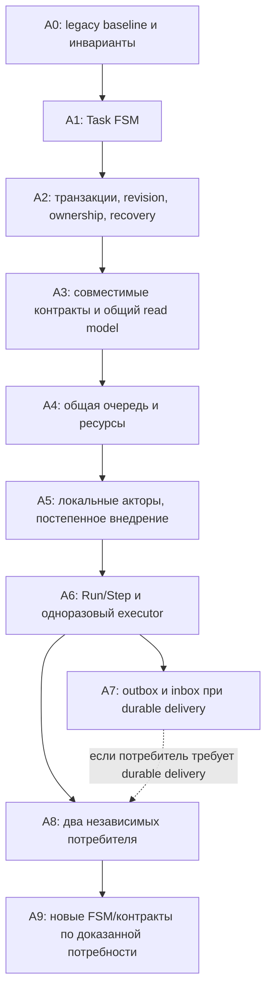

# Постепенный переход: FSM, консистентность и Actor Model

Дата: 2026-10-13. Исходная реализация: `a42cd7e`, завершённые этапы 0–7.
Это новый цикл **A0–A9**, а не переименование завершённых этапов.
На момент составления плана новый runtime ещё не реализован.

Основания: [Actor Model + FSM](../../analysis/actor-model-fsm/README.md),
[консистентность и расширяемость](../../analysis/consistency-extensibility/README.md),
[техники консистентности](../../analysis/consistency-techniques/README.md).
Этот документ объединяет их предложения и задаёт порядок выполнения;
аналитические отчёты сохраняются как обоснование. [Повторное ревью](review.md)
проверяет зависимости, совместимость, восстановление и цену расширения.

Ход первого пакета и evidence: [A0 — legacy baseline](baseline.md).
Обновление 2026-10-13 после planning commit `d524e68`: A0 завершён,
14 новых tests и полный workspace (171 tests) passed.
[A1 Task FSM](task-fsm.md) завершена: 182 workspace и
[66 native Windows tests](windows-task-fsm-gate-2026-10-13.md) passed.
[A2.1 task revisions/CAS](durable-transitions.md) завершён: 197 workspace и
[107 native tests](windows-task-cas-gate-2026-10-13.md) passed; общий A2 и A3–A9
ещё не завершены.
[A2.2 domain transitions](domain-transitions.md) завершены: 213 workspace и
[125 native Windows tests](windows-domain-cas-gate-2026-10-13.md) passed. [A2.3.1 authority/attempt context](ownership-context.md) реализован, native gate ожидается;
A2.3.2 durable leases и A2.4 reconciliation ещё впереди.

## Результат для пользователя и проектов

Два-три Debian проекта независимо отправляют Windows проверки через CLI/MCP.
Worker сохраняет запрос, сообщает его место и причину ожидания, запускает работу
в пределах выбранной пользователем нагрузки. Desktop и агент получают одну
подтверждённую картину: проект → операция → шаг → команда → вывод → результат.
Разрыв связи, повтор запроса и перезапуск не создают повторного внешнего эффекта.
Неизвестный исход показывается явно и требует решения, а не автоматического запуска.

WinBridge остаётся одним локальным продуктом. Внутри компонентов могут быть
несколько акторов с отдельными FSM. Центральный coordinator маршрутизирует
запросы; один главный актор не выполняет все сборки, I/O и обработчики подряд.
Проектный executor — отдельный управляемый процесс со стабильным контрактом,
а не удалённый ActorRef или зависимость проекта от внутреннего runtime WinBridge.

## Что сохраняется на всём переходе

- Windows worker — authority исполнения; durable acceptance предшествует ACK.
  Controller, desktop и MCP читают его состояние, а не назначают свой успех.
- SQLite остаётся источником истины. FSM проверяет переход, транзакция фиксирует
  решение, actor сериализует обращения, platform выполняет внешний эффект.
  Mailbox и supervision не заменяют журнал и recovery.
- Старые task/import/workflow/application IDs, ключи и история сохраняются.
  Для legacy запросов остаётся прежний fingerprint; новый формат не пересчитывает
  старые payload. Версия контракта входит в новый fingerprint, а не создаёт
  отдельный namespace, позволяющий повторно исполнить ту же операцию.
- Wire version, business contract version, схема БД и build identity — разные
  величины. Версия операции закрепляется до ACK и не меняется после reconnect.
- Внешние команды не выполняются в SQLite транзакции. Сначала durable intent,
  затем effect, затем подтверждённый результат. Неопределённость между ними
  сохраняется как `indeterminate`; фактический процесс нельзя восстановить replay.
- Закрытие UI/потеря controller не отменяют задачу. Cancel остаётся намерением
  до подтверждения остановки управляемого дерева. Stdout/stderr читаются независимо.
- Локальный `ws://`, прежние IPC, verified snapshots и постоянные Windows пути
  `runtime`/`src` сохраняются. Новые TLS, firewall/IP policy и сервисы не вводятся.
- Один активный исполнитель внешнего эффекта. Сравнение старого и нового reducer
  возможно без side effects; одновременно запускать два execution engine нельзя.

## Порядок и зависимости

A7 — условная ветка: получение сохранённого отчёта через query/poll не требует
нового брокера. Если первый executor требует push с durable receipt, A7 включается
в его реализацию **до** production enable A6. Заранее можно готовить test packs
потребителя; новые mutating API не включаются до завершения своих зависимостей.

Общая очередь A4 появляется до полной миграции на акторы и новый executor:
это первый самостоятельный результат для нескольких проектов. Простые текущие
task/workflow продолжают работать через адаптеры. Акторы внедряются постепенно;
A5 не означает обязательную перепись каждого модуля перед A6.

## A0 — закрепить совместимость и правила

**Поставка:** ADR о границах изменений; versioned JSON/SQLite fixtures и тесты
legacy Hello, task states, fingerprint, acceptance, cancellation и recovery.
Fixtures синтетические, с provenance; пользовательские журналы и configs не брать.

**Проверка:** реальные production DTO/Store читают frozen fixtures; потерянный ACK
и повтор после reopen возвращают прежний Task ID; конфликт payload отвергается;
running с PID или без него после recovery становится indeterminate; queued остаются
в очереди, terminal не меняются, recovery сам не запускает процессы. Новые состояния/capabilities в закрытый v1 enum
попадать не могут. Проверить чтение исторической схемы журнала и сохранение ключей.

**Готово когда:** тесты закоммичены и проходят; границы baseline и неизвестные
свойства перечислены. Это защитный фундамент, ещё не новый runtime.
**Откат:** только тесты/docs; рабочая БД, Windows runtime и протокол не меняются.

## A1 — чистая Task FSM, прежний внешний контракт

**Поставка:** typed state/event/effect/error и reducer в `crates/core`, без I/O.
Worker применяет его сначала на одном полном маршруте задачи, затем на остальных
task переходах. Internal `Starting` проецируется в существующий v1 `running`;
cancel intent, факт выхода и неизвестный исход различаются внутри FSM.
Сохранять фактическую legacy семантику; её исправления оформлять отдельными изменениями.

**Проверка:** таблицы допустимых/недопустимых переходов, terminal immutability,
cancel/exit/timeout races, duplicate completion, восстановление intent. Сравнение
с A0; fault injection на границах commit/spawn/exit; автоматический Windows gate
перед принятой миграцией process lifecycle.

**Готово когда:** переходы задач имеют один маршрут решений; поздний completion
не переписывает terminal; понятные journal events/UI сохраняются. Durable guards
между разными attempts добавляются в A2, до миграции owners.
**Откат:** прежний adapter при неизменённой wire/DB схеме; один effect owner.

## A2 — durable переходы и владение

**Поставка:** общий application service поверх Store: загрузка → проверка
FSM/expected revision/owner → атомарная запись состояния, события и resource decision.
Revision для сущности, durable epoch для области владения, journal incarnation,
OperationRef и явные attempt IDs. UUID generation соединения не считать epoch.
OS handles остаются у process owner, SQLite actor не ждёт завершения процесса.

Инвентаризировать **все writers**: task/output/cancel, import, workflow/application,
attention, retention/recovery. Переводить их по одному, сохраняя адаптеры; нельзя
объявить защиту общей, пока старый writer обходит revision/ownership. Полная FSM
каждого домена может появиться позже, но изменяемые им ресурсы уже под общим guard.

Миграции additive, consistent backup и проверяемый отказ старого binary на новой
схеме. Сохранять legacy payload и dedup. Recovery сначала сверяет durable intents
и фактические owners, затем открывает admission; actor restart сам не выдаёт
новое разрешение на неизвестный spawn. Epoch защищает записи, но не физические
файлы от старого процесса: новый owner требует доказанной остановки либо нового
изолированного workspace. После restore с утратой ключей нужен recovery mode.

**Проверка:** stale CAS/epoch, cancel с последующим настоящим exit (revision выхода
не равен launch revision), атомарный rollback, schema migration/reopen, неизвестный
владелец ресурса, авария между каждым commit и effect. Реальное crash recovery на Windows.

**Готово когда:** общий guard не обходится; reconciliation показывает unresolved
ресурсы; legacy fixtures сохраняют IDs/keys. **Откат:** выключить новый admission;
уже принятые операции обслуживает совместимый binary. БД не понижать механически.

## A3 — совместимость контрактов и единое наблюдение

**Поставка:** optional discovery catalog в читаемом v1 WorkerInfo, если full-route
tests подтвердят это; отсутствие catalog означает только legacy. Hello/закрытые
capabilities не расширять до доказанного безопасного bootstrap. Отдельно хранить
`supported`, `verified`, `pair-tested`, `enabled`; фиксировать проверенную пару
build/route/contract и политику проекта. Неподдерживаемое действие отвергать до effect.

Определить общий read model, получаемый из согласованного journal snapshot:
OperationRef, project, status, reason, resources, last event/cursor, revision и
отдельная freshness. До A4 UI показывает доступную текущую информацию; новые queue
причины приходят вместе с scheduler. DTO → schemas/TS → CLI/MCP/UI, без отдельной FSM в UI.

**Проверка:** old/old, old/new, new/old, new/new по controller/worker/desktop/MCP;
metadata через старый controller может потеряться — это безопасный legacy fallback.
Строгие команды, неизвестные read-only данные с отключёнными действиями; фильтрованный
sequence допускает gaps, cursor не пропускает необходимые сообщения.

**Готово когда:** версии согласуются до принятия нового запроса, reconnect не
меняет контракт принятой операции, stale/offline нельзя принять за success.
**Откат:** отключить новые контракты, сохранить legacy discovery/API.

## A4 — очередь двух-трёх проектов и ограничение нагрузки

**Поставка:** политика global slots, backlog limit, pause admission и fair selection
между готовыми проектами; FIFO внутри сравнимого класса. Атомарная выдача полного
набора resources: workspace mutation, build slot, binary/cache, IPC/port, interactive
desktop. Учесть task, import, workflow и application, включая уже запущенные owners.

Родитель workflow и child не занимают один slot дважды. Build slot отпускается между
шагами, живое приложение удерживает свой binary/IPC lease. Не выдавать ресурс по TTL,
если прежний процесс может жить. Отдельная граница backlog: rejected не является
accepted; после ACK задачу нельзя терять из-за переполнения actor mailbox.

UI/MCP показывают running/queued, причину ожидания, лимит, занятые ресурсы и следующий
допустимый action. Для пользователя pause новых запусков отличается от stop/cancel.
Policy влияет на новые запуски и не обрывает принятые задачи; сохранение project config
по-прежнему требует manual worker restart. Конкретные production лимиты выбрать
с пользователем при включении; tests используют явные изолированные значения.

**Проверка:** три агента/проекта, starvation, pending queue старше recent page,
cancel/status под нагрузкой, overlapping roots, parent/child lease и recovery.
Windows gate измеряет throughput и cancel/attention latency; status доступен во время build.

**Готово когда:** несколько проектов работают предсказуемо, общий обзор объясняет
ожидание; safety и fairness подтверждены. **Откат:** legacy scheduling policy только
после сверки живых ресурсов; принятый backlog и leases остаются в журнале.

## A5 — локальные акторы за существующими interfaces

**Поставка:** пилот одного state owner, затем task/process, scheduler, connection,
imports/workflows/attention по отдельным вертикальным пакетам. Kameo — кандидат
из [оценки](../../analysis/actor-model/kameo.md); зависимость выбирается по проверенной
версии/MSRV/API и пилоту, внешние контракты от неё не зависят.

Ограниченный mailbox, короткие handlers, выделенный Store executor, адресация через
устойчивые IDs и registry. Долгое I/O вне actor handler, завершение отдельным сообщением
с attempt/epoch. Для status/cancel предусмотреть путь без ожидания долгой команды;
размер очередей/backpressure наблюдаем. Ask timeout не является cancel, supervision
не повторяет неизвестный OS effect. Recovery/owner grant обязательны после restart.

**Проверка:** actor crash/mailbox overload/shutdown во всех состояниях, late message,
медленный reader и deadlock, повтор восстановления; A0–A4 и native lifecycle tests.
**Готово когда:** пилот сохраняет durable guarantees и latency; следующие owners
переносятся без изменения public API. **Откат:** прежний owner implementation
через тот же service, после quiesce/reconciliation, без второго writer.

## A6 — Run/Step и одноразовый проектный executor

**Поставка:** потребитель сначала задаёт versioned contract/test pack: inputs,
report schema, examples, limits, expected errors и portable/native проверки.
Provider добавляет safety/fault tests. Последовательные typed steps, Operation ID,
Step/Attempt, закреплённые executable/contract/source. Старые recipe/direct/workflow
идут через адаптеры; произвольный DAG и scripting language пока не нужны.

WinBridge собирает/запускает Windows executor из verified snapshot. Проект сам
управляет Debian executor. Общий Rust contract и portable logic, отдельные нативные
бинарники/OS adapters; не обещать один executable для двух ОС. Первый report
ограниченный/валидируемый, сохраняется worker и доступен через query/poll.
Execution outcome и test verdict разделены: exit 0 не доказывает test success.
Принятие одного report на attempt дедуплицируется, terminal результат неизменяем.

**Проверка:** malformed/oversized/duplicate report, crash до/после report commit,
timeout/unknown outcome, несовместимая версия и mixed pair. Native new/new плюс
legacy regressions; candidate тестируется без production effects. Enable только
для проверенного профиля; stable executor contract не менять при каждой правке приложения.

**Готово когда:** реальный test report виден человеку и агенту, выбор версии
обоснован evidence, старый consumer работает. **Откат:** запрет нового admission;
совместимый executor/reader завершает уже принятые runs, контракт не понижается.

## A7 — durable доставка там, где появилась потребность

**Поставка:** outbox в транзакции state/event, inbox + результат обработки + receipt
в транзакции получателя. Один stable Message ID при retry, business dedup по
operation/attempt/report-kind, порядок по определённому stream. Delivery ACK
после commit; at-least-once delivery не означает повторное выполнение команды.

Recipient ledger нужен участнику, обещающему durable processing. Controller,
остающийся forwarder, не становится второй execution authority. UI уведомления
могут остаться best effort: долговечен сам attention record. Kafka и новый сетевой
actor runtime для этой задачи не требуются.

**Проверка:** crash/потеря ACK/reconnect, replay той же доставки и новый Message ID
для того же report, перезапуск обоих stores, stream cursors, storage quota и lag.
**Готово когда:** нужный получатель доказывает отсутствие двойного business effect.
**Откат:** остановить новые подписки/контракты, сохранить и обслужить pending outbox;
не удалять inbox, чтобы затем не принять доставленное заново.

## A8 — проверка независимыми потребителями

**Поставка:** Netwatch и второй проект пользуются документированным adapter/contract
без правок WinBridge для каждой команды. Нет path dependency на соседний repository.
Consumer pack проходит на Debian и Windows, reports/errors/cancel одинаково понятны.
Общий SDK выделять только при доказанном повторении у двух потребителей.

**Проверка:** одновременные MCP запросы, native build/test/report, UI attention,
зависший executor, старый consumer рядом с новым, update проверенной пары.
**Готово когда:** добавление проекта ограничивается config/contract/adapter/tests;
не требует нового transport, task journal или process owner.
**Откат:** выключить профиль одного потребителя; остальные проекты продолжают работать.

## A9 — расширение по тем же правилам

Довести FSM/actors доменов, где A5 оставил совместимый adapter; затем добавлять
новые typed steps, report kinds и ресурсы. Long-lived executor, duplex и более
сложный граф — только для конкретной потребности, с inbox/recovery/lifetime
контрактом. Для каждой новой функции: consumer pack → provider safety tests →
candidate → mixed/native pair gate → enable → наблюдение.

Удаление v1 — отдельное решение после inventory всех consumers и завершения
принятых v1 операций; не автоматический последний шаг плана. Изменение retention
не удаляет dedup/recovery evidence ради свободного места.

## Контроль выполнения, проверки и затраты

Каждый пакет отдельно фиксирует implemented / native gate pending / enabled;
в handoff записываются source/build, evidence, ограничения и следующий пакет.
Commit нового Rust enum не равен готовому поведению на Windows.
До первого изменения схемы — fixture-backed migration и consistent backup;
до нового process owner/scheduler — fault tests и automatic native gate.

На Windows working worker остаётся каналом запуска **отдельного** candidate runtime
с фиксированным тестовым путём, изолированными instance/state/workspace/IPC.
До прогона сообщать нужные worker/desktop и ожидаемые окна, после — что закрыть.
Тестовое окно обозначено явно; каждую правку не сопровождать повторением всей
ручной проверки. Выполнять автоматические scenarios по затронутым рискам; при
неожиданном поведении working worker остановиться и запросить обновление/уточнение.

Грубые ориентиры для последовательной работы, не обещание сроков: A0 — 1–3 дня;
A1–A2 — 2–4 недели; A3–A4 — 2–4 недели; actor pilot A5 — 1–2 недели;
A6 и первый consumer — 2–4 недели; A7 при необходимости — 1–2 недели.
Полная миграция остальных owners и контрактов — несколько последующих пакетов.
Диапазоны не складывать с оценками аналитических отчётов: они частично описывают
одну работу. Главные риски стоимости — recovery физических effects, schema/legacy
совместимость, UI и native tests, а не синтаксис actor library.

Первая реализация после commit этого плана — **A0**. Следующий runtime пакет —
Task FSM A1; настройку production parallelism и сложные executors сейчас не включать.
