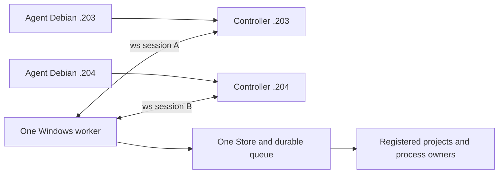

# Один worker и два Debian controller

2026-10-26, ветка `feat/multi-controller`, base9b47a9c.
Первый агент192.168.44.203, второй192.168.44.204.
Пользователь отменил Git coordination. Репозиторий остаётся только средством
совместной разработки: Git claims/очередей/состояния Windows здесь нет.
До готовности функции пользователь при необходимости вручную переключает
worker перезапуском. Агент .204 не использует Windows в этой итерации.

## Целевой сценарий

Один процесс worker на Windows держит два независимых исходящих ws:// соединения
к `.203:1143` и `.204:1143`. На каждом Debian остаётся собственный controller,
CLI/MCP агенты используют его обычный локальный вход. Worker не становится новым
TCP server; входящие firewall rules на Windows для этой схемы не требуются.
Stable test exe/firewall policy из AGENTS.md сохраняется.



Одновременно принимаются запросы обоих controller. Независимые проекты могут
выполняться параллельно по общему WorkSchedulingPolicy. Мутации одного project
выполняются последовательно; workflow сохраняет lease между import/build/start.
Scheduler, Store, execution domain и владельцы процессов остаются **в единственном
экземпляре**, не создаются заново на каждое соединение.

Общий worker не объединяет автоматически исходные Git branches. Для независимых
сборок двух версий одного репозитория рекомендуются отдельные project IDs и
непересекающиеся Windows workspace roots. Один project ID означает намеренно
общую рабочую область с общей очередью, а не две изолированные копии.

## Сессии и конфигурация

Portable `controller_sessions::Topology` описывает endpoints с устойчивыми IDs
`debian-203`/`debian-204` и явным primary. Это локальные labels соединений;
существующие nodeId в пользовательских configs не переименовываются.
Оба controller должны ожидать один worker node и общий worker instanceId.
Controller generations/session IDs независимы; совпадение строк session ID
между двумя соединениями не делает их одной сессией.

Новое поле `worker.controllerTopology` взаимоисключающее с legacy
`worker.controllerUrl`. Ни одно/None сохраняет local-only IPC. Старый single-url
config сохраняет прежнее поведение и serialized scope; пустые новые поля должны
опускаться. В этой ветке WorkerSettings расширен; установленный0.1.1 новый формат
не поддерживает. Два поля одновременно дают явную ошибку,
а не выбор одного адреса или игнорирование второго.

Пример для новой сборки из этой ветки, **не применять к текущему0.1.1**:

```json
{
  "schemaVersion": 1,
  "primary": "debian-203",
  "controllers": [
    {"id": "debian-203", "url": "ws://192.168.44.203:1143"},
    {"id": "debian-204", "url": "ws://192.168.44.204:1143"}
  ]
}
```

Это содержимое `worker.controllerTopology`, не целый WorkerConfig. Legacy
`controllerUrl` при переходе нужно удалить. Оба адреса — исходящие соединения
одного worker. Конфигурации реальных .203/.204 пока не менялись.

Подключённый transport slice:

1. Создать одну immutable topology при старте worker и независимый reconnect task
   на каждый endpoint. Каждый attempt получает ticket с настоящим fresh worker
   generation, endpoint ID и attempt number.
2. Хранить связь и readonly projections по endpoint ID. Disconnect A очищает
   только A; late EOF/Welcome от старого attempt не меняет новое подключение.
3. Проверять peer protocol/component/instance/capabilities, полный journal context
   и provider build, как сейчас. Сама модель sequence/TTL не заменяет эти проверки.
4. Legacy local Info/desktop показывает явно выбранный primary. Для полного списка
   нужна отдельная typed extension с per-controller state/last confirmation/error;
   frozen старые DTO не дополняются незаметно и не получают чужую readiness.
   Сетевой Info каждого controller возвращает именно его connection/projection в
   существующих полях; остальные поля каталога сохраняются. Поэтому secondary
   не получает чужую readiness. Формат старых DTO не изменён. Полный список связей
   в локальном desktop/diagnostics ещё предстоит добавить отдельной typed extension.

Recovery pair удаляет оба режима подключения: восстановленный config остаётся
local-only до явной настройки. Isolated update validation отвергает оба режима.
Shutdown supervisor не просто abort-ит родителя: сигнал останавливает и join-ит
все endpoint tasks до завершения service. Drop owner также подаёт сигнал на cleanup.
Регрессионные тесты проверяют suspended upgrade и остановку двух активных связей.

## Общая очередь, RPC и происхождение заданий

RPC admission общий: например32 in-flight handlers всего и16 на controller для
двух endpoints. Это предел обработки запросов, не число работающих процессов.
Билды/импорты ограничиваются существующими durable project/resource/work leases.
Socket disconnect не освобождает ещё выполняющийся blocking handler; permit
завершается владельцем handler после его фактического окончания. Старый completion
не может освободить новый RPC с тем же request ID после reconnect.

`Permit::origin()` захватывает worker/controller/session generation из соединения
в момент admission. Пользовательские TaskSubmission аргументы не задают этот origin.
Он остаётся прежним после disconnect/reconnect. Это атрибуция, не новая система
аутентификации и не право на отмену/обновление.

Для durable attribution следующий шаг — отдельная internal side table операций
в Store. Записывать creator атомарно **только при fresh acceptance**; duplicate
возвращает исходный task и creator, не заменяет его последним caller. Связанные
дети workflow наследуют creator родителя. Отмена другим controller отдельно
указывает инициатора отмены; создатель задачи при этом не меняется.
Такой side table/миграции/readonly DTO в этой итерации ещё нет.
Номер будущей схемы и migration boundary выбирать после синхронизации с актуальным
main первого агента, который развивает updater; здесь версия журнала не резервируется.

Глобальный ключ `(projectId,idempotencyKey)` сохраняется. Origin не добавляется
в fingerprint: иначе retry через другой controller мог бы породить второй process.
Агенты используют уникальные logical keys; lost ACK сохраняет исходные context/key/
payload. Переподключение не означает автоматическую отправку команды заново.

MVP предполагает двух доверенных caller в общей области работ. Оба видят общую
историю и могут отменять принятые задачи по ID. Per-agent ACL/изоляция пользователей
не подразумеваются; это отдельная будущая политика.

## Разрывы связи и обслуживание

Отключение .203 не отменяет его accepted tasks и не мешает .204 наблюдать очередь.
Если оба controller пропали, worker продолжает принятое и сохраняет результаты.
После worker restart stale incarnation отвергается обоим; новые connections не
авторизуют повторные внешние эффекты по старому неизвестному исходу.
Общий maintenance/update drain должен перекрывать мутации всех endpoints.
Normal-service updater и передача lifetime остаются отдельной работой первого
агента; нельзя объявить их multi-controller совместимыми только после двух TCP.

Общая история/артефакты worker станут естественным местом, где оба агента найдут
результат одного прогона. Для полноценного native-proof reuse позже нужен readonly
индекс validation runs с hashes source/manifest/harness/selection/profile/toolchain
и ready bundles. Ordinary task succeeded не заменяет native verifier. Compiler
cache reuse остаётся отдельно под Windows cache lease. Никаких Git locks для этого.

## Что проверено сейчас

Pure core sessions: topology/legacy validation, stale/foreign worker callbacks,
независимость projections, TTL/clock rollback, общие RPC limits и immutable origin.
Worker integration model на Debian использует **один реальный Worker/SQLite и
настоящие локальные fixture процессы**, но имитирует два transport entry points:

- Два одновременных submit одного payload/key с разными correlation IDs дают один
  task/process; RPC origins различаются.
- Следующая мутация того же project остаётся queued, пока первая работает.
- Disconnect A не отменяет принятое; B видит его и в trusted MVP может отменить.
  После физического cleanup запускается следующая задача. runs.log показывает
  ровно два запуска, без дубликата от повторного submit.
- Разные projects одновременно Running с разными PID, в общем capacity=2.

Модельные тесты не используют TCP. Дополнительно добавлены library integration
tests: два настоящих Controller с TCP/WebSocket listener на ephemeral loopback
портах и один Worker::serve с настоящим SQLite и Linux fixture процессами.
Они проверяют собственный сетевой Info обоих caller, dedup/общую очередь,
отключение/новую generation одного controller, повтор исходного ключа без нового
процесса, cross-controller cancel/output, stale journal rejection и параллельные
проекты. Намеренно одинаковые nodeId controller не смешивают соединения.
Это два library runtime в одном test process, не два CLI subprocess и не Windows.

Сетевой runtime подключён в исходниках feature-ветки; production readiness
не объявлена и новые capabilities не объявлены. Следом нужны отдельный Windows
gate и проверка настоящих .203+.204 после ручного предоставления Windows
пользователем. Installed worker/config/firewall не менялись.

Текущий slice: **136 library tests passed /3 штатно ignored**:
core38 (в том числе8 sessions/config), worker86, controller12 (в том числе2
actual multi-controller WebSocket). Linux free space перед сборками **20 GiB**;
Windows space не опрашивался, native Windows сборок/прогонов в этой итерации нет.
Дополнительно **51 regression passed /2 штатно ignored**: legacy_baseline8,
maintenance10, multi_controller_model2, recovery_pair10, request_context8,
runtime8, update_coordination5. Всего **187 passed /5 ignored**.
Clippy core/worker/controller all-targets с `-D warnings`, fmt, scaffold290 и
`cargo check -p winbridge-worker --target x86_64-pc-windows-msvc --locked` passed.
Последнее — cross-target compile check из Debian, не выполнение Windows worker.

Команды для повторения (из feature worktree; `CARGO_INCREMENTAL=0`, основной
`CARGO_TARGET_DIR=/home/user1/winbridge/target`):

```sh
cargo test -p winbridge-core -p winbridge-worker -p winbridge-controller --lib --locked
cargo test -p winbridge-worker --locked --test multi_controller_model --test recovery_pair --test request_context --test legacy_baseline --test runtime --test update_coordination --test maintenance
cargo clippy -p winbridge-core -p winbridge-worker -p winbridge-controller --all-targets --locked -- -D warnings
cargo check -p winbridge-worker --target x86_64-pc-windows-msvc --locked
```

Тесты вызывают неизменённый `Worker::handle_fenced`, не добавляют новый
публичный dispatch без проверки scope. Снимок origin пока хранится в RPC permit
и test observations; durable task creator не объявляется реализованным.

Следующий source slice без Windows: typed readonly список всех соединений для
локальных diagnostics/desktop (primary, state, error, confirmed time, RPC counters),
затем durable creator attribution с атомарным fresh acceptance и неизменным dedup.
Это не разрешение на смену installed worker. Отдельный native gate требует
доступного пользователем Windows worker; normal-service updater остаётся отдельно.

Удалены origin refs `coordination/windows-v1` и
`feat/multi-controller-foundation`, а также local branch последней. Проверено,
что в удаляемом канале не было claim/task. Новый branch содержит только полезный
core commit и дальнейшую прямую multi-controller работу; отвергнутые Git tools,
state/result indexes не входят в его дерево и не включаются в installed runtime.
