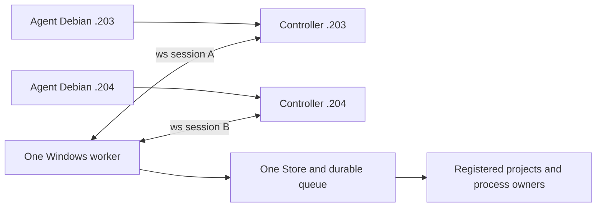

# Один worker и два Debian controller

2026-10-26, ветка `feat/multi-controller`, base9b47a9c.
Первый агент192.168.44.203, второй192.168.44.204.
Пользователь отменил Git coordination. Репозиторий остаётся только средством
совместной разработки: Git claims/очередей/состояния Windows здесь нет.
До готовности функции пользователь при необходимости вручную переключает
worker перезапуском. Агент .204 не использует Windows в этой итерации.

## Целевой сценарий

Один процесс worker на Windows держит два независимых исходящих ws:// соединения
к `.203:1143` и `.204:1143`. На каждом Debian остаётся собственный controller,
CLI/MCP агенты используют его обычный локальный вход. Worker не становится новым
TCP server; входящие firewall rules на Windows для этой схемы не требуются.
Stable test exe/firewall policy из AGENTS.md сохраняется.



Одновременно принимаются запросы обоих controller. Независимые проекты могут
выполняться параллельно по общему WorkSchedulingPolicy. Мутации одного project
выполняются последовательно; workflow сохраняет lease между import/build/start.
Scheduler, Store, execution domain и владельцы процессов остаются **в единственном
экземпляре**, не создаются заново на каждое соединение.

Общий worker не объединяет автоматически исходные Git branches. Для независимых
сборок двух версий одного репозитория рекомендуются отдельные project IDs и
непересекающиеся Windows workspace roots. Один project ID означает намеренно
общую рабочую область с общей очередью, а не две изолированные копии.

## Сессии и конфигурация

Portable `controller_sessions::Topology` описывает endpoints с устойчивыми IDs
`debian-203`/`debian-204` и явным primary. Это локальные labels соединений;
существующие nodeId в пользовательских configs не переименовываются.
Оба controller должны ожидать один worker node и общий worker instanceId.
Controller generations/session IDs независимы; совпадение строк session ID
между двумя соединениями не делает их одной сессией.

Новое поле `worker.controllerTopology` взаимоисключающее с legacy
`worker.controllerUrl`. Ни одно/None сохраняет local-only IPC. Старый single-url
config сохраняет прежнее поведение и serialized scope; пустые новые поля должны
опускаться. В этой ветке WorkerSettings расширен; установленный0.1.1 новый формат
не поддерживает. Два поля одновременно дают явную ошибку,
а не выбор одного адреса или игнорирование второго.

Пример для новой сборки из этой ветки, **не применять к текущему0.1.1**:

```json
{
  "schemaVersion": 1,
  "primary": "debian-203",
  "controllers": [
    {"id": "debian-203", "url": "ws://192.168.44.203:1143"},
    {"id": "debian-204", "url": "ws://192.168.44.204:1143"}
  ]
}
```

Это содержимое `worker.controllerTopology`, не целый WorkerConfig. Legacy
`controllerUrl` при переходе нужно удалить. Оба адреса — исходящие соединения
одного worker. Конфигурации реальных .203/.204 пока не менялись.

Подключённый transport slice:

1. Создать одну immutable topology при старте worker и независимый reconnect task
   на каждый endpoint. Каждый attempt получает ticket с настоящим fresh worker
   generation, endpoint ID и attempt number.
2. Хранить связь и readonly projections по endpoint ID. Disconnect A очищает
   только A; late EOF/Welcome от старого attempt не меняет новое подключение.
3. Проверять peer protocol/component/instance/capabilities, полный journal context
   и provider build, как сейчас. Сама модель sequence/TTL не заменяет эти проверки.
4. Legacy local Info/desktop показывает явно выбранный primary. Для полного списка
   нужна отдельная typed extension с per-controller state/last confirmation/error;
   frozen старые DTO не дополняются незаметно и не получают чужую readiness.
   Сетевой Info каждого controller возвращает именно его connection/projection в
   существующих полях; остальные поля каталога сохраняются. Поэтому secondary
   не получает чужую readiness. Формат старых DTO не изменён. Полный список связей
   доступен через отдельную typed readonly extension и новую панель desktop;
   native Windows проверка этой панели ещё не пройдена.

Recovery pair удаляет оба режима подключения: восстановленный config остаётся
local-only до явной настройки. Isolated update validation отвергает оба режима.
Shutdown supervisor не просто abort-ит родителя: сигнал останавливает и join-ит
все endpoint tasks до завершения service. Drop owner также подаёт сигнал на cleanup.
Регрессионные тесты проверяют suspended upgrade и остановку двух активных связей.

## Общая очередь, RPC и происхождение заданий

RPC admission общий: например32 in-flight handlers всего и16 на controller для
двух endpoints. Это предел обработки запросов, не число работающих процессов.
Билды/импорты ограничиваются существующими durable project/resource/work leases.
Socket disconnect не освобождает ещё выполняющийся blocking handler; permit
завершается владельцем handler после его фактического окончания. Старый completion
не может освободить новый RPC с тем же request ID после reconnect.

`Permit::origin()` захватывает worker/controller/session generation из соединения
в момент admission. Пользовательские TaskSubmission аргументы не задают этот origin.
Он остаётся прежним после disconnect/reconnect. Это атрибуция, не новая система
аутентификации и не право на отмену/обновление.

Durable attribution подключена отдельной internal side table операций
в Store (schema18, детали ниже). Creator записывается атомарно **только при fresh acceptance**; duplicate
возвращает исходный task и creator, не заменяет его последним caller. Связанные
дети workflow наследуют creator родителя. Для отмены другим controller следом
нужна отдельная запись инициатора; создатель задачи при этом не меняется.
Side table, migration, readonly DTO/SDK и task detail UI реализованы в feature
source. Инициатор отмены отдельно ещё не записывается. После fetch main остаётся
9b47a9c/schema17; schema18 выделена только в этой ветке, установленный worker
и main не менялись. Слияние с дальнейшими updater изменениями требует сверки схем.

Глобальный ключ `(projectId,idempotencyKey)` сохраняется. Origin не добавляется
в fingerprint: иначе retry через другой controller мог бы породить второй process.
Агенты используют уникальные logical keys; lost ACK сохраняет исходные context/key/
payload. Переподключение не означает автоматическую отправку команды заново.

MVP предполагает двух доверенных caller в общей области работ. Оба видят общую
историю и могут отменять принятые задачи по ID. Per-agent ACL/изоляция пользователей
не подразумеваются; это отдельная будущая политика.

## Разрывы связи и обслуживание

Отключение .203 не отменяет его accepted tasks и не мешает .204 наблюдать очередь.
Если оба controller пропали, worker продолжает принятое и сохраняет результаты.
После worker restart stale incarnation отвергается обоим; новые connections не
авторизуют повторные внешние эффекты по старому неизвестному исходу.
Общий maintenance/update drain должен перекрывать мутации всех endpoints.
Normal-service updater и передача lifetime остаются отдельной работой первого
агента; нельзя объявить их multi-controller совместимыми только после двух TCP.

Общая история/артефакты worker станут естественным местом, где оба агента найдут
результат одного прогона. Для полноценного native-proof reuse позже нужен readonly
индекс validation runs с hashes source/manifest/harness/selection/profile/toolchain
и ready bundles. Ordinary task succeeded не заменяет native verifier. Compiler
cache reuse остаётся отдельно под Windows cache lease. Никаких Git locks для этого.

## Что проверено сейчас

Pure core sessions: topology/legacy validation, stale/foreign worker callbacks,
независимость projections, TTL/clock rollback, общие RPC limits и immutable origin.
Worker integration model на Debian использует **один реальный Worker/SQLite и
настоящие локальные fixture процессы**, но имитирует два transport entry points:

- Два одновременных submit одного payload/key с разными correlation IDs дают один
  task/process; RPC origins различаются.
- Следующая мутация того же project остаётся queued, пока первая работает.
- Disconnect A не отменяет принятое; B видит его и в trusted MVP может отменить.
  После физического cleanup запускается следующая задача. runs.log показывает
  ровно два запуска, без дубликата от повторного submit.
- Разные projects одновременно Running с разными PID, в общем capacity=2.

Модельные тесты не используют TCP. Дополнительно добавлены library integration
tests: два настоящих Controller с TCP/WebSocket listener на ephemeral loopback
портах и один Worker::serve с настоящим SQLite и Linux fixture процессами.
Они проверяют собственный сетевой Info обоих caller, dedup/общую очередь,
отключение/новую generation одного controller, повтор исходного ключа без нового
процесса, cross-controller cancel/output, stale journal rejection и параллельные
проекты. Намеренно одинаковые nodeId controller не смешивают соединения.
Это два library runtime в одном test process, не два CLI subprocess и не Windows.

Сетевой runtime подключён в исходниках feature-ветки; production readiness
не объявлена и новые capabilities не объявлены. Следом нужны отдельный Windows
gate и проверка настоящих .203+.204 после ручного предоставления Windows
пользователем. Installed worker/config/firewall не менялись.

Текущий slice: **136 library tests passed /3 штатно ignored**:
core38 (в том числе8 sessions/config), worker86, controller12 (в том числе2
actual multi-controller WebSocket). Linux free space перед сборками **20 GiB**;
Windows space не опрашивался, native Windows сборок/прогонов в этой итерации нет.
Дополнительно **51 regression passed /2 штатно ignored**: legacy_baseline8,
maintenance10, multi_controller_model2, recovery_pair10, request_context8,
runtime8, update_coordination5. Всего **187 passed /5 ignored**.
Clippy core/worker/controller all-targets с `-D warnings`, fmt, scaffold290 и
`cargo check -p winbridge-worker --target x86_64-pc-windows-msvc --locked` passed.
Последнее — cross-target compile check из Debian, не выполнение Windows worker.

Команды для повторения (из feature worktree; `CARGO_INCREMENTAL=0`, основной
`CARGO_TARGET_DIR=/home/user1/winbridge/target`):

```sh
cargo test -p winbridge-core -p winbridge-worker -p winbridge-controller --lib --locked
cargo test -p winbridge-worker --locked --test multi_controller_model --test recovery_pair --test request_context --test legacy_baseline --test runtime --test update_coordination --test maintenance
cargo clippy -p winbridge-core -p winbridge-worker -p winbridge-controller --all-targets --locked -- -D warnings
cargo check -p winbridge-worker --target x86_64-pc-windows-msvc --locked
```

Тесты вызывают неизменённый `Worker::handle_fenced`, не добавляют новый
публичный dispatch без проверки scope. Снимок origin пока хранится в RPC permit
и test observations; durable task creator не объявляется реализованным.

Durable creator attribution с атомарным fresh acceptance и неизменным dedup
подключена ниже. Следом нужны инициатор отмены и CLI/MCP оболочка readonly API.
Это не разрешение на смену installed worker. Отдельный native gate требует
доступного пользователем Windows worker; normal-service updater остаётся отдельно.

## Readonly диагностика всех соединений, 2026-10-26

`winbridge.controller-connections` v1 работает поверх существующего
`winbridge.extensions` v1. Новый контракт отдельно объявлен в catalog и schema
fingerprints; frozen WorkerInfo/worker RPC 1/2 и прежние fingerprints не расширены.
Запрос — строго пустой JSON object `{}` плюс pinned RequestContext в envelope.
`[]`, null, неизвестные поля/версии и чужая journal incarnation отклоняются.
SDK предварительно проверяет catalog/schema/context; старый worker получает
только Info, без неизвестной extension и без fallback к командам.

Ответ содержит один согласованный срез всех настроенных связей (до4): endpoint ID,
URL, primary, connection/session/controller generation, last confirmation,
last connected/disconnected time, число попыток и последнюю ошибку. Последняя
ошибка сохраняется между попытками и после успешного reconnect отдельно от
текущей ошибки. Stale callback старого attempt её не перезаписывает. Ошибки
ограничены по размеру с сохранением UTF-8; весь ответ укладывается в frame budget.
Local-only worker возвращает пустой список и primary=null.

Общие и per-controller RPC counters — lifetime observations текущей worker
generation, без записи в SQLite. admitted/completed/rejected/attempts передаются
decimal strings, без потери точности в JavaScript. inFlight — реально занятые
network handler permits, включая старые соединения после reconnect. completed
растёт только при окончательном освобождении permit; timeout/drop сокета не
завершает ещё работающий blocking handler. rejected означает отказ до handler
из-за RPC admission/буфера session, а не все ошибки выполнения методов.
Info/readiness/readonly запросы тоже учитываются. Сам сетевой запрос диагностики
видит собственный занятый слот; локальный IPC не входит в сетевой budget.
Counters saturate на u64::MAX; decoder проверяет суммы, лимиты и scope/generation.

Доступны local IPC SDK `winbridge_transport::controller_connections`, сетевой Rust
SDK `Controller::controller_connections` и main-window Tauri command с тем же
именем. CLI/MCP operation для нового контракта ещё не добавлена.
Новая панель «Соединения с Debian» показывает все связи и явный primary;
legacy desktop alert остаётся fallback для старого worker. Панель автоматически
читает срез при подключении к worker, затем обновляется явной кнопкой. Постоянного
дополнительного polling нет. Ошибка/потеря IPC сохраняет прошлый срез с предупреждением;
старые ответы после смены scope/generation не попадают в новую панель. Это
наблюдение на момент среза, не подтверждение завершения задач и не право на update.

Проверки текущего slice:

- 140 library tests passed /3 штатно ignored (core38, worker87, controller12,
  protocol3). Два настоящих loopback WebSocket проверяют новый SDK от обоих
  controller, local IPC, loss/reconnect, сохранение ошибки и перезапуск generation.
- 30 worker integration tests passed: controller_connections2, legacy_baseline8,
  multi_controller_model2, recovery_pair10, request_context8.
- 64 protocol tests passed, включая3 из library группы: старые wire/fingerprint
  контракты, новое negotiation и21 malformed/stale observation cases.
- `test:controller-connections`: Chromium + настоящий Linux worker/local IPC,
  два loopback адреса; primary/error/counters, delayed old-generation response,
  lost IPC, offline и old-worker no-query. Никаких принятых задач.
- Clippy protocol/core/worker/controller all-targets с `-D warnings`, contracts
  generation/check, TypeScript, UI build, fmt (workspace и standalone desktop),
  scaffold290, standalone desktop Linux check и MSVC worker check прошли.
  Browser test прошёл с включённым Chromium sandbox. Linux free space перед работой
  **19 GiB**. Windows не опрашивался и не использовался.

Повтор browser test после сборки worker и установки npm dependencies:

```sh
CARGO_TARGET_DIR=/home/user1/winbridge/target PLAYWRIGHT_CHROMIUM_EXECUTABLE_PATH=/usr/bin/chromium npm run test:controller-connections
```

Переменная Chromium необязательна при установленном Playwright browser. Harness
использует create-only временные каталоги и удаляет только собственные fixtures;
production controller/worker/config не открывает.

## Durable creator attribution, 2026-10-26

В source-ветке journal schema **18**. Таблица `operation_creators` хранит creator
и parent workflow отдельно от frozen TaskRecord/ImportRecord/WorkflowRecord/
ApplicationRecord. JSON fingerprints запросов и глобальный `(project,key)` не
меняются. INSERT creator — часть той же транзакции, что acceptance, queue root
и resource plan: ошибка/ignored INSERT откатывает всё. UPDATE/DELETE автора
запрещены SQLite triggers. Первоначальные creator и родитель не дописываются
при duplicate, даже если legacy запись не имеет автора.

Network creator берётся из immutable RPC Permit при admission: configured
endpoint ID, observed controller node/generation/session и worker generation.
Он передаётся явно в blocking handler, не вычисляется по текущей связи после
reconnect и не принимается из TaskSubmission/payload. Local handler отмечается
как local worker entry; это не идентификация человека или конкретного desktop/CLI.
Прямой низкоуровневый Store API без runtime context записывает unknown.
Workflow import/build/start/application наследуют сохранённого creator родителя
в своих acceptance транзакциях. Отмена другим controller не меняет creator;
отдельного durable cancellation actor в этом slice пока нет.

При normal cold open схемы17 создаётся create-new consistent SQLite backup с
проверкой quick_check, версии и authority, pinned file identity и sync. Только
затем отдельная транзакция добавляет таблицу/guards и меняет user_version на18.
Legacy history не переписывается и не получает выдуманных авторов. Active update
блокирует миграцию до любых schema writes. Activation cold-open сохраняет правило
exact schema и сам миграцию17→18 не разрешает. Это не реализация updater migration
driver и не native Windows proof. Старый schema17 worker отказывает на18.
Прежний pinned native proof16→17 остаётся замороженным на source/schema17, его
ignored test теперь явно помечен историческим; он не является gate для18.

Readonly контракт `winbridge.operation-attribution` v1 отдельно advertised и
schema-pinned: context + kind/operationId → creator nullable, inheritedFrom,
provider/current worker generation и observation time. Creator generation может
быть исторической: после worker restart она намеренно не перепривязывается.
SDK проверяет scope, operation, provider и generation ответа; old worker не
получает неизвестного extension. Доступны local IPC SDK, сетевой Controller Rust
SDK и main-window Tauri command `operation_attribution`. Desktop task detail
показывает источник первоначального запроса, unknown history, наследование и
явные ошибки/несвежие сведения; дополнительного постоянного polling нет.
Для остальных operation kinds readonly API есть, отдельные detail UI и CLI/MCP
оболочка ещё не добавлены. Старый публичный wire RPC/Info и его hash не менялись.

Проверки:

- Полный `cargo test --workspace --locked`: **819 passed /17 штатно ignored**.
  Реальные два WebSocket проверяют одного автора при concurrent duplicate,
  неизменность после cross-controller cancel/reconnect/retry. Реальный workflow
  проверяет inheritance у import/build/start/application.
- Ещё3 protocol attribution tests passed: historical generation/unknown, семь
  malformed/stale cases и отказ старого worker до dispatch.
- Unit SQLite: concurrent connections выбирают одного автора; ignored creator
  INSERT откатывает task/queue/resource admission; immutable guards; consistent
  backup17 и legacy unknown после retry/reopen. Старые migration fixtures удаляют
  новую таблицу при построении предыдущих схем; future-schema fixtures обновлены,
  activation reader использует current+1, не принимает18 за future после обновления.
- `scripts/test-attribution-migration.py` прошёл с actual сохранённым schema17
  Linux worker: настоящая старая task/history →18, backup rows совпадают,
  retry не назначает автора и не запускает повторно; fresh local creator пережил
  restart; старый exe отказал без записи в journal18. Ровно2 `/bin/sh` исполнения
  (старая и новая task), а не синтетический rewrite версии.
- `test:operation-attribution`: Chromium sandbox + actual Linux worker IPC,
  одна owned `/bin/true` task, новый author UI, scope/offline/old-worker сценарии.
  TypeScript и UI build passed. Workspace Clippy all-targets с `-D warnings`,
  standalone desktop Linux check, MSVC worker check, contracts generation/check,
  workspace/desktop fmt и scaffold290 passed.
- Перед тяжёлыми сборками Debian free space **17 GiB**, после workspace9.5 GiB;
  `CARGO_INCREMENTAL=0`, основной target переиспользован. Windows не опрашивался,
  его worker/config/journal не открывались.

Actual Linux migration proof повторяется с проверенным schema17 reference.json
(sha256 exe + isolated rehearsal report), не с production state:

```sh
python3 scripts/test-attribution-migration.py --reference PRIVATE_REFERENCE_JSON --worker NEW_LINUX_WORKER
CARGO_TARGET_DIR=/home/user1/winbridge/target PLAYWRIGHT_CHROMIUM_EXECUTABLE_PATH=/usr/bin/chromium npm run test:operation-attribution
```

Удалены origin refs `coordination/windows-v1` и
`feat/multi-controller-foundation`, а также local branch последней. Проверено,
что в удаляемом канале не было claim/task. Новый branch содержит только полезный
core commit и дальнейшую прямую multi-controller работу; отвергнутые Git tools,
state/result indexes не входят в его дерево и не включаются в installed runtime.
