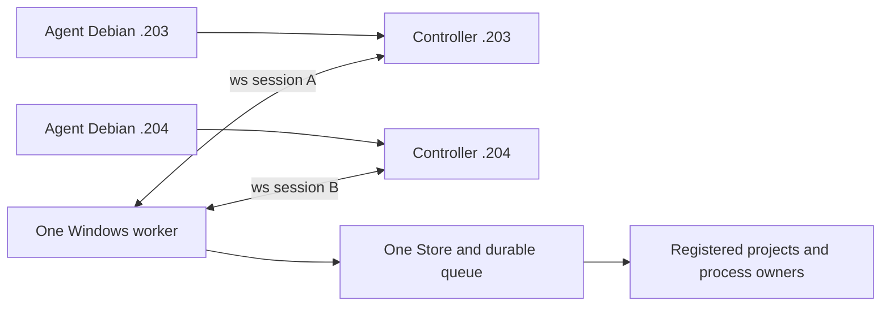

# Один worker и несколько Debian controller

2026-10-26, ветка `feat/multi-controller`, base9b47a9c.
Первый агент192.168.44.203, второй192.168.44.204.
Текущая source schema19: creator и первый cancellation actor реализованы отдельно;
readonly CLI/MCP wrappers добавлены2026-10-27. Проверки и границы миграции
описаны в последних разделах. Installed/main schema17
не мигрировались, Windows gate19 ещё впереди.
Пользователь отменил Git coordination. Репозиторий остаётся только средством
совместной разработки: Git claims/очередей/состояния Windows здесь нет.
До готовности функции пользователь при необходимости вручную переключает
worker перезапуском. Агент .204 не использует Windows в этой итерации.

## Целевой сценарий

Один процесс worker на Windows держит от1 до4 независимых исходящих ws:// соединений.
Исходный сценарий — `.203:1143` и `.204:1143`; третий и четвёртый controller
добавляются тем же списком, без отдельных веток runtime. На каждом Debian свой controller,
CLI/MCP агенты используют его обычный локальный вход. Worker не становится новым
TCP server; входящие firewall rules на Windows для этой схемы не требуются.
Stable test exe/firewall policy из AGENTS.md сохраняется.



Одновременно принимаются запросы обоих controller. Независимые проекты могут
выполняться параллельно по общему WorkSchedulingPolicy. Мутации одного project
выполняются последовательно; workflow сохраняет lease между import/build/start.
Scheduler, Store, execution domain и владельцы процессов остаются **в единственном
экземпляре**, не создаются заново на каждое соединение.

Общий worker не объединяет автоматически исходные Git branches. Для независимых
сборок разных версий одного репозитория рекомендуются отдельные project IDs и
непересекающиеся Windows workspace roots. Один project ID означает намеренно
общую рабочую область с общей очередью, а не две изолированные копии.

## Сессии и конфигурация

Portable `controller_sessions::Topology` описывает endpoints с устойчивыми IDs
`debian-203`/`debian-204` и явным primary. Это локальные labels соединений;
существующие nodeId в пользовательских configs не переименовываются.
Оба controller должны ожидать один worker node и общий worker instanceId.
Controller generations/session IDs независимы; совпадение строк session ID
между двумя соединениями не делает их одной сессией.

Новое поле `worker.controllerTopology` взаимоисключающее с legacy
`worker.controllerUrl`. Ни одно/None сохраняет local-only IPC. Старый single-url
config сохраняет прежнее поведение и serialized scope; пустые новые поля должны
опускаться. В этой ветке WorkerSettings расширен; установленный0.1.1 новый формат
не поддерживает. Два поля одновременно дают явную ошибку,
а не выбор одного адреса или игнорирование второго.

Минимальный пример с двумя controller для новой сборки из этой ветки,
**не применять к текущему0.1.1**:

```json
{
  "schemaVersion": 1,
  "primary": "debian-203",
  "controllers": [
    {"id": "debian-203", "url": "ws://192.168.44.203:1143"},
    {"id": "debian-204", "url": "ws://192.168.44.204:1143"}
  ]
}
```

Это содержимое `worker.controllerTopology`, не целый WorkerConfig. Для третьего и
четвёртого Debian добавить элементы `{id,url}` с уникальными ID и фактическими
адресами; primary может быть любым из них. Граница1–4 задаётся общей константой
`winbridge_protocol::MAX_CONTROLLERS`, которую используют и config validator, и
decoder списка связей. Пятый endpoint явно отклоняется. Legacy
`controllerUrl` при переходе нужно удалить. Оба адреса — исходящие соединения
одного worker. Конфигурации реальных .203/.204 пока не менялись.

Подключённый transport slice:

1. Создать одну immutable topology при старте worker и независимый reconnect task
   на каждый endpoint. Каждый attempt получает ticket с настоящим fresh worker
   generation, endpoint ID и attempt number.
2. Хранить связь и readonly projections по endpoint ID. Disconnect A очищает
   только A; late EOF/Welcome от старого attempt не меняет новое подключение.
3. Проверять peer protocol/component/instance/capabilities, полный journal context
   и provider build, как сейчас. Сама модель sequence/TTL не заменяет эти проверки.
4. Legacy local Info/desktop показывает явно выбранный primary. Для полного списка
   нужна отдельная typed extension с per-controller state/last confirmation/error;
   frozen старые DTO не дополняются незаметно и не получают чужую readiness.
   Сетевой Info каждого controller возвращает именно его connection/projection в
   существующих полях; остальные поля каталога сохраняются. Поэтому secondary
   не получает чужую readiness. Формат старых DTO не изменён. Полный список связей
   доступен через отдельную typed readonly extension и новую панель desktop;
   native Windows проверка этой панели ещё не пройдена.

Recovery pair удаляет оба режима подключения: восстановленный config остаётся
local-only до явной настройки. Isolated update validation отвергает оба режима.
Shutdown supervisor не просто abort-ит родителя: сигнал останавливает и join-ит
все endpoint tasks до завершения service. Drop owner также подаёт сигнал на cleanup.
Регрессионные тесты проверяют suspended upgrade и остановку двух активных связей.

## Общая очередь, RPC и происхождение заданий

RPC admission общий:32 in-flight handlers всего и16 на controller независимо
от числа endpoints. Например, четыре caller могут одновременно держать по8 slots.
Общий budget не умножается при добавлении Debian. Это upper bounds, не fair-share
резервация: при заполненных32 slots новый RPC получает отказ до dispatch. Это предел обработки запросов, не число работающих процессов.
Билды/импорты ограничиваются существующими durable project/resource/work leases.
Socket disconnect не освобождает ещё выполняющийся blocking handler; permit
завершается владельцем handler после его фактического окончания. Старый completion
не может освободить новый RPC с тем же request ID после reconnect.

`Permit::origin()` захватывает worker/controller/session generation из соединения
в момент admission. Пользовательские TaskSubmission аргументы не задают этот origin.
Он остаётся прежним после disconnect/reconnect. Это атрибуция, не новая система
аутентификации и не право на отмену/обновление.

Durable attribution подключена отдельной internal side table операций
в Store (schema18, детали ниже). Creator записывается атомарно **только при fresh acceptance**; duplicate
возвращает исходный task и creator, не заменяет его последним caller. Связанные
дети workflow наследуют creator родителя. Для отмены другим controller следом
нужна отдельная запись инициатора; создатель задачи при этом не меняется.
Side table, migration, readonly DTO/SDK и task detail UI реализованы в feature
source. Инициатор отмены отдельно подключён в schema19 (раздел ниже). После fetch main остаётся
9b47a9c/schema17; schema18 выделена только в этой ветке, установленный worker
и main не менялись. Слияние с дальнейшими updater изменениями требует сверки схем.

Глобальный ключ `(projectId,idempotencyKey)` сохраняется. Origin не добавляется
в fingerprint: иначе retry через другой controller мог бы породить второй process.
Агенты используют уникальные logical keys; lost ACK сохраняет исходные context/key/
payload. Переподключение не означает автоматическую отправку команды заново.

MVP предполагает до четырёх доверенных caller в общей области работ. Все видят общую
историю и могут отменять принятые задачи по ID. Per-agent ACL/изоляция пользователей
не подразумеваются; это отдельная будущая политика.

## Разрывы связи и обслуживание

Отключение .203 не отменяет его accepted tasks и не мешает .204 наблюдать очередь.
Если оба controller пропали, worker продолжает принятое и сохраняет результаты.
После worker restart stale incarnation отвергается обоим; новые connections не
авторизуют повторные внешние эффекты по старому неизвестному исходу.
Общий maintenance/update drain должен перекрывать мутации всех endpoints.
Normal-service updater и передача lifetime остаются отдельной работой первого
агента; нельзя объявить их multi-controller совместимыми только после двух TCP.

Общая история/артефакты worker станут естественным местом, где оба агента найдут
результат одного прогона. Для полноценного native-proof reuse позже нужен readonly
индекс validation runs с hashes source/manifest/harness/selection/profile/toolchain
и ready bundles. Ordinary task succeeded не заменяет native verifier. Compiler
cache reuse остаётся отдельно под Windows cache lease. Никаких Git locks для этого.

## Что проверено сейчас

Pure core sessions: topology/legacy validation, stale/foreign worker callbacks,
независимость projections, TTL/clock rollback, общие RPC limits и immutable origin.
Worker integration model на Debian использует **один реальный Worker/SQLite и
настоящие локальные fixture процессы**, но имитирует два transport entry points:

- Два одновременных submit одного payload/key с разными correlation IDs дают один
  task/process; RPC origins различаются.
- Следующая мутация того же project остаётся queued, пока первая работает.
- Disconnect A не отменяет принятое; B видит его и в trusted MVP может отменить.
  После физического cleanup запускается следующая задача. runs.log показывает
  ровно два запуска, без дубликата от повторного submit.
- Разные projects одновременно Running с разными PID, в общем capacity=2.

Модельные тесты не используют TCP. Дополнительно добавлены library integration
tests: два настоящих Controller с TCP/WebSocket listener на ephemeral loopback
портах и один Worker::serve с настоящим SQLite и Linux fixture процессами.
Они проверяют собственный сетевой Info обоих caller, dedup/общую очередь,
отключение/новую generation одного controller, повтор исходного ключа без нового
процесса, cross-controller cancel/output, stale journal rejection и параллельные
проекты. Намеренно одинаковые nodeId controller не смешивают соединения.
Это два library runtime в одном test process, не два CLI subprocess и не Windows.

Сетевой runtime подключён в исходниках feature-ветки; production readiness
не объявлена и новые capabilities не объявлены. Следом нужны отдельный Windows
gate и проверка настоящих .203+.204 после ручного предоставления Windows
пользователем. Installed worker/config/firewall не менялись.

Текущий slice: **136 library tests passed /3 штатно ignored**:
core38 (в том числе8 sessions/config), worker86, controller12 (в том числе2
actual multi-controller WebSocket). Linux free space перед сборками **20 GiB**;
Windows space не опрашивался, native Windows сборок/прогонов в этой итерации нет.
Дополнительно **51 regression passed /2 штатно ignored**: legacy_baseline8,
maintenance10, multi_controller_model2, recovery_pair10, request_context8,
runtime8, update_coordination5. Всего **187 passed /5 ignored**.
Clippy core/worker/controller all-targets с `-D warnings`, fmt, scaffold290 и
`cargo check -p winbridge-worker --target x86_64-pc-windows-msvc --locked` passed.
Последнее — cross-target compile check из Debian, не выполнение Windows worker.

Команды для повторения (из feature worktree; `CARGO_INCREMENTAL=0`, основной
`CARGO_TARGET_DIR=/home/user1/winbridge/target`):

```sh
cargo test -p winbridge-core -p winbridge-worker -p winbridge-controller --lib --locked
cargo test -p winbridge-worker --locked --test multi_controller_model --test recovery_pair --test request_context --test legacy_baseline --test runtime --test update_coordination --test maintenance
cargo clippy -p winbridge-core -p winbridge-worker -p winbridge-controller --all-targets --locked -- -D warnings
cargo check -p winbridge-worker --target x86_64-pc-windows-msvc --locked
```

Тесты вызывают неизменённый `Worker::handle_fenced`, не добавляют новый
публичный dispatch без проверки scope. Снимок origin пока хранится в RPC permit
и test observations; durable task creator не объявляется реализованным.

Durable creator attribution с атомарным fresh acceptance и неизменным dedup
подключена ниже. Инициатор отмены добавлен в следующем slice; далее CLI/MCP оболочка readonly API.
Это не разрешение на смену installed worker. Отдельный native gate требует
доступного пользователем Windows worker; normal-service updater остаётся отдельно.

## Readonly диагностика всех соединений, 2026-10-26

`winbridge.controller-connections` v1 работает поверх существующего
`winbridge.extensions` v1. Новый контракт отдельно объявлен в catalog и schema
fingerprints; frozen WorkerInfo/worker RPC 1/2 и прежние fingerprints не расширены.
Запрос — строго пустой JSON object `{}` плюс pinned RequestContext в envelope.
`[]`, null, неизвестные поля/версии и чужая journal incarnation отклоняются.
SDK предварительно проверяет catalog/schema/context; старый worker получает
только Info, без неизвестной extension и без fallback к командам.

Ответ содержит один согласованный срез всех настроенных связей (до4): endpoint ID,
URL, primary, connection/session/controller generation, last confirmation,
last connected/disconnected time, число попыток и последнюю ошибку. Последняя
ошибка сохраняется между попытками и после успешного reconnect отдельно от
текущей ошибки. Stale callback старого attempt её не перезаписывает. Ошибки
ограничены по размеру с сохранением UTF-8; весь ответ укладывается в frame budget.
Local-only worker возвращает пустой список и primary=null.

Общие и per-controller RPC counters — lifetime observations текущей worker
generation, без записи в SQLite. admitted/completed/rejected/attempts передаются
decimal strings, без потери точности в JavaScript. inFlight — реально занятые
network handler permits, включая старые соединения после reconnect. completed
растёт только при окончательном освобождении permit; timeout/drop сокета не
завершает ещё работающий blocking handler. rejected означает отказ до handler
из-за RPC admission/буфера session, а не все ошибки выполнения методов.
Info/readiness/readonly запросы тоже учитываются. Сам сетевой запрос диагностики
видит собственный занятый слот; локальный IPC не входит в сетевой budget.
Counters saturate на u64::MAX; decoder проверяет суммы, лимиты и scope/generation.

Доступны local IPC SDK `winbridge_transport::controller_connections`, сетевой Rust
SDK `Controller::controller_connections` и main-window Tauri command с тем же
именем. CLI/MCP operation для нового контракта ещё не добавлена.
Новая панель «Соединения с Debian» показывает все связи и явный primary;
legacy desktop alert остаётся fallback для старого worker. Панель автоматически
читает срез при подключении к worker, затем обновляется явной кнопкой. Постоянного
дополнительного polling нет. Ошибка/потеря IPC сохраняет прошлый срез с предупреждением;
старые ответы после смены scope/generation не попадают в новую панель. Это
наблюдение на момент среза, не подтверждение завершения задач и не право на update.

Проверки текущего slice:

- 140 library tests passed /3 штатно ignored (core38, worker87, controller12,
  protocol3). Два настоящих loopback WebSocket проверяют новый SDK от обоих
  controller, local IPC, loss/reconnect, сохранение ошибки и перезапуск generation.
- 30 worker integration tests passed: controller_connections2, legacy_baseline8,
  multi_controller_model2, recovery_pair10, request_context8.
- 64 protocol tests passed, включая3 из library группы: старые wire/fingerprint
  контракты, новое negotiation и21 malformed/stale observation cases.
- `test:controller-connections`: Chromium + настоящий Linux worker/local IPC,
  два loopback адреса; primary/error/counters, delayed old-generation response,
  lost IPC, offline и old-worker no-query. Никаких принятых задач.
- Clippy protocol/core/worker/controller all-targets с `-D warnings`, contracts
  generation/check, TypeScript, UI build, fmt (workspace и standalone desktop),
  scaffold290, standalone desktop Linux check и MSVC worker check прошли.
  Browser test прошёл с включённым Chromium sandbox. Linux free space перед работой
  **19 GiB**. Windows не опрашивался и не использовался.

Повтор browser test после сборки worker и установки npm dependencies:

```sh
CARGO_TARGET_DIR=/home/user1/winbridge/target PLAYWRIGHT_CHROMIUM_EXECUTABLE_PATH=/usr/bin/chromium npm run test:controller-connections
```

Переменная Chromium необязательна при установленном Playwright browser. Harness
использует create-only временные каталоги и удаляет только собственные fixtures;
production controller/worker/config не открывает.

## Durable creator attribution, 2026-10-26

В source-ветке journal schema **18**. Таблица `operation_creators` хранит creator
и parent workflow отдельно от frozen TaskRecord/ImportRecord/WorkflowRecord/
ApplicationRecord. JSON fingerprints запросов и глобальный `(project,key)` не
меняются. INSERT creator — часть той же транзакции, что acceptance, queue root
и resource plan: ошибка/ignored INSERT откатывает всё. UPDATE/DELETE автора
запрещены SQLite triggers. Первоначальные creator и родитель не дописываются
при duplicate, даже если legacy запись не имеет автора.

Network creator берётся из immutable RPC Permit при admission: configured
endpoint ID, observed controller node/generation/session и worker generation.
Он передаётся явно в blocking handler, не вычисляется по текущей связи после
reconnect и не принимается из TaskSubmission/payload. Local handler отмечается
как local worker entry; это не идентификация человека или конкретного desktop/CLI.
Прямой низкоуровневый Store API без runtime context записывает unknown.
Workflow import/build/start/application наследуют сохранённого creator родителя
в своих acceptance транзакциях. Отмена другим controller не меняет creator;
отдельного durable cancellation actor в этом slice пока нет.

При normal cold open схемы17 создаётся create-new consistent SQLite backup с
проверкой quick_check, версии и authority, pinned file identity и sync. Только
затем отдельная транзакция добавляет таблицу/guards и меняет user_version на18.
Legacy history не переписывается и не получает выдуманных авторов. Active update
блокирует миграцию до любых schema writes. Activation cold-open сохраняет правило
exact schema и сам миграцию17→18 не разрешает. Это не реализация updater migration
driver и не native Windows proof. Старый schema17 worker отказывает на18.
Прежний pinned native proof16→17 остаётся замороженным на source/schema17, его
ignored test теперь явно помечен историческим; он не является gate для18.

Readonly контракт `winbridge.operation-attribution` v1 отдельно advertised и
schema-pinned: context + kind/operationId → creator nullable, inheritedFrom,
provider/current worker generation и observation time. Creator generation может
быть исторической: после worker restart она намеренно не перепривязывается.
SDK проверяет scope, operation, provider и generation ответа; old worker не
получает неизвестного extension. Доступны local IPC SDK, сетевой Controller Rust
SDK и main-window Tauri command `operation_attribution`. Desktop task detail
показывает источник первоначального запроса, unknown history, наследование и
явные ошибки/несвежие сведения; дополнительного постоянного polling нет.
Для остальных operation kinds readonly API есть, отдельные detail UI и CLI/MCP
оболочка ещё не добавлены. Старый публичный wire RPC/Info и его hash не менялись.

Проверки:

- Полный `cargo test --workspace --locked`: **819 passed /17 штатно ignored**.
  Реальные два WebSocket проверяют одного автора при concurrent duplicate,
  неизменность после cross-controller cancel/reconnect/retry. Реальный workflow
  проверяет inheritance у import/build/start/application.
- Ещё3 protocol attribution tests passed: historical generation/unknown, семь
  malformed/stale cases и отказ старого worker до dispatch.
- Unit SQLite: concurrent connections выбирают одного автора; ignored creator
  INSERT откатывает task/queue/resource admission; immutable guards; consistent
  backup17 и legacy unknown после retry/reopen. Старые migration fixtures удаляют
  новую таблицу при построении предыдущих схем; future-schema fixtures обновлены,
  activation reader использует current+1, не принимает18 за future после обновления.
- `scripts/test-attribution-migration.py` прошёл с actual сохранённым schema17
  Linux worker: настоящая старая task/history →18, backup rows совпадают,
  retry не назначает автора и не запускает повторно; fresh local creator пережил
  restart; старый exe отказал без записи в journal18. Ровно2 `/bin/sh` исполнения
  (старая и новая task), а не синтетический rewrite версии.
- `test:operation-attribution`: Chromium sandbox + actual Linux worker IPC,
  одна owned `/bin/true` task, новый author UI, scope/offline/old-worker сценарии.
  TypeScript и UI build passed. Workspace Clippy all-targets с `-D warnings`,
  standalone desktop Linux check, MSVC worker check, contracts generation/check,
  workspace/desktop fmt и scaffold290 passed.
- Перед тяжёлыми сборками Debian free space **17 GiB**, после workspace9.5 GiB;
  `CARGO_INCREMENTAL=0`, основной target переиспользован. Windows не опрашивался,
  его worker/config/journal не открывались.

Actual Linux migration proof повторяется с проверенным schema17 reference.json
(sha256 exe + isolated rehearsal report), не с production state:

```sh
python3 scripts/test-attribution-migration.py --reference PRIVATE_REFERENCE_JSON --worker NEW_LINUX_WORKER
CARGO_TARGET_DIR=/home/user1/winbridge/target PLAYWRIGHT_CHROMIUM_EXECUTABLE_PATH=/usr/bin/chromium npm run test:operation-attribution
```

## Первый инициатор отмены, schema19, 2026-10-26

`operation_cancellations` — отдельная immutable таблица с first effective intent:
kind/operation, timestamp, actor(nullable), parent workflow/application(nullable).
Она вводится миграцией18→19, без изменения creators, business DTO или idempotency
fingerprints. Creator/schema18 и его readonly контракт v1 остаются прежними.
Для cold17/18→19 используются verified consistent SQLite backups с исходным
номером схемы; active update проверяется до writable migration и в transaction.
Никакого migration driver для активной updater activation здесь не добавлено.

Все foreground cancel/stop берут initiator из того же immutable RPC permit/local
entry, что и creator acceptance. Task, import, workflow и application пишут intent
в transaction смены состояния: ignored/failed INSERT откатывает cancellation
state/events/revision. INSERT не выполняется для duplicate, terminal no-op или
старого уже принятого намерения без metadata. UPDATE/DELETE intent запрещены.
Отмена queued import сохраняет прежние finish/attempt semantics, workflow/app —
attention/CAS semantics. Повтор stop уже Stopping application не увеличивает revision.

Workflow propagates свой cancellation actor на pending/running children;
application propagates на managed task. Parent reference объясняет цепочку.
Успешным/уже отменённым children метаданные заново не назначаются. Явный cancel
конкретной child раньше родителя сохраняет своего первоначального инициатора.
Runtime timeout/failure/низкоуровневый Store cancel без caller context не получает
ложного local user: actor может быть unknown. Creator никогда не подменяется.

`winbridge.operation-cancellation` v1 — отдельный schema-pinned readonly контракт;
query использует kind/operationId и pinned journal scope. Ответ содержит nullable
intent и observation/provider/current generation; сохранённая actor generation
может быть исторической. `intent=null` означает отсутствие записи, а не доказанное
отсутствие старого cancel. API не вызывает команды и не разрешает новый cancel.
Local IPC SDK, Controller Rust SDK, main-window Tauri command и task detail UI
подключены. Старому worker неизвестный запрос не передаётся; CLI/MCP wrapper ещё
впереди. UI обновляет сведения по смене Task status/cancel flag и явной кнопке,
без дополнительного interval. Intent не выдаётся за terminal status/physical proof.

Проверки текущего slice:

- **829 workspace tests passed /17 штатно ignored +3 protocol cancellation tests**.
  Unit SQLite проверяет concurrent cancels, immutable actor/time, no-op terminal
  без backfill, ignored INSERT rollback для task/import, reopen и migration18
  с сохранением creator/unknown history. Active18 update отказан до backup/write.
- Actual два controller/WebSocket: A создаёт running task, B отменяет; A повторяет,
  оба видят одного initiator B и прежнего creator A. Real workflow startup cancel
  передаёт actor через application к process task; successful import/build не
  получают fake cancellation intent. Managed fixture процессы завершаются.
- Actual сохранённые Linux schema17 и18 binaries: history →19 с consistent backup,
  source creator сохраняется (unknown для17), retry/restart не заменяют creator
  или cancellation actor/time; late terminal cancel остаётся без новой записи.
  На каждый прогон:2 completed `/bin/sh` команды и1 started/cancelled process,
  без повторного исполнения. Старые17/18 exe отказывают на19 без записи в journal.
  `scripts/test-attribution-migration.py` теперь проверяет оба source schemas и19.
- `test:operation-cancellation`: sandbox Chromium + actual Linux worker IPC,
  running owned process и реальная отмена, author/intent UI, status-change refresh,
  scope/offline/old-worker cases. TypeScript/UI build и workspace Clippy all-targets
  с `-D warnings`, standalone desktop Linux check, MSVC worker check,
  contracts generation/check, workspace/desktop fmt и scaffold290 прошли.
- Debian free space перед сборками **9.5 GiB**, после workspace9.3 GiB;
  CARGO_INCREMENTAL=0, основной target reused. Windows не использовался;
  installed config/journal/firewall не менялись. Windows native gate19 не объявлен.

Пример local browser проверки после сборки worker:

```sh
CARGO_TARGET_DIR=/home/user1/winbridge/target PLAYWRIGHT_CHROMIUM_EXECUTABLE_PATH=/usr/bin/chromium npm run test:operation-cancellation
```

Старые proof16→17 и17→18 выше относятся к соответствующим прошлым source slices;
новые17/18→19 результаты Linux не заменяют native Windows/updater migration proof.

Удалены origin refs `coordination/windows-v1` и
`feat/multi-controller-foundation`, а также local branch последней. Проверено,
что в удаляемом канале не было claim/task. Новый branch содержит только полезный
core commit и дальнейшую прямую multi-controller работу; отвергнутые Git tools,
state/result indexes не входят в его дерево и не включаются в installed runtime.

## CLI/MCP readonly диагностика — 2026-10-27

Добавлены `controller-connections`, `operation-attribution`, `operation-cancellation`
и одноимённые MCP tools с префиксом `winbridge_`/underscores.
[Примеры аргументов и ответов](../guides/mcp.md#readonly-диагностика-нескольких-controller).
Для всех operation kinds доступны creator/cancellation queries; отдельные detail UI
для import/workflow/application остаются дальнейшим UI расширением.

Отдельный strict `controllerDiagnosticsVersion:1` envelope обслуживается только
локальным Debian IPC. В нём нет command/verify route. Не меняются закрытый
ControllerApiRequest, legacy worker RPC, catalog fingerprints и journal schema19.
Controller вызывает существующие negotiated readonly SDK; local client проверяет
версию ответа, kind, scope/operation и schema/generation. Старые компоненты,
неверная schema и изменившийся context дают ошибку без fallback/rebind. MCP
annotations readonly подкреплены реальным typed dispatch; CLI error имеет JSON и
ненулевой exit. Activity log хранит только method/outcome.

Проверки:

- 37 controller tests прошли, включая actual два controller/WebSocket/private IPC,
  real CLI/MCP subprocesses и один owned Linux task. A создаёт, B отменяет, оба
  читают одинакового creator A и initiator B. Усиленный тест повторён отдельно:
  запросы CLI/MCP при running task оставляют её running без cancel flag.
- 72 protocol tests с jsonschema прошли; закрытые legacy DTO по-прежнему отклоняют
  новый envelope. Поддержаны только три readonly метода; extra nested fields,
  mixed diagnostics/cancel/verify frames и будущая version отклоняются.
- Unit preflight каждого query: missing catalog, неверный fingerprint и чужая scope
  останавливают запрос после Info; future controller route version не делает даже
  Info. Ответ старого controller отвергается без legacy переинтерпретации.
- Финальный combined controller/protocol run: **109 passed /0 ignored**.
  Workspace Clippy all-targets `-D warnings`, MSVC workspace compile check,
  contracts generation/check, TypeScript/UI build, fmt и scaffold290 прошли.
  Cross-target check не выполняет Windows программы.
- Debian free space перед сборками9.2 GiB, после основных проверок9.0 GiB;
  CARGO_INCREMENTAL=0 и основной target reused. Windows не опрашивался и не запускался;
  runtime/config/journal/firewall не менялись. Native gate19 остаётся обязательным.

Исторические пометки «CLI/MCP впереди» в предыдущих slices относятся к тому source;
текущие wrappers готовы в feature-ветке. Native Windows/updater migration proof
по-прежнему не объявлены, установленный worker0.1.1 не заменён.

## Review и новые изменения main — 2026-10-27

[Отчёт и source patch](multi-controller-review-2026-10-27.md): main обновлён до
c4b7aea, самостоятельный source ac9e0cb проверен. Временное объединение с сохранением
local-service gates и общей topology прошло879 workspace tests/17 ignored,
Clippy/MSVC all-targets с update-validation, contracts/TS/UI/fmt/scaffold298.
Добавлен staged-service/two-controller regression test. Это проверка совместимости,
а не слияние веток, не Windows gate и не разрешение миграции updater17→19.

## Три и четыре controller — 2026-10-27

Проверена просьба пользователя о третьем/четвёртом агенте. Production runtime уже
обходит полный topology list; registry/observations — maps/vector по endpoint ID,
а UI показывает все links через map. Жёсткой пары A/B в dispatch, reconnect,
attribution, cancellation, project leases и primary selection нет.

Небольшой refactor: общая `MAX_CONTROLLERS=4` вместо отдельных literals в config
и readonly decoder. Test harness теперь создаёт произвольное допустимое число
controller/listeners/projects и выбранный primary. Старые парные проверки сохранены.
DTO/schema fingerprints, journal19, runtime RPC budgets32/16 и installed configs
не меняются. Количество выполняемых процессов задаётся WorkSchedulingPolicy и
project/resource leases отдельно от количества controller.

Добавленные проверки:

- Core:1–4 endpoints принимаются,0/5 отклоняются; primary необязательно первый.
  Четыре peers занимают32 slots по8, overflow отклоняется; disconnect/reconnect
  третьего не освобождает старые handlers, late completion не освобождает новый.
  Per-peer16 не запрещает запросы остальных, пока есть общий budget.
- Actual Linux runtime с3 и4 controller: один Worker/Store, совпадающие node IDs,
  primary последний, собственные Info/readiness projections и полный список связей.
  Все участники создают команды в своих проектах и повторяют исходный logical
  request первого; запускается ровно один процесс на key.
- Один проект сериализован между caller. Disconnect/restart одного controller
  сохраняет его running task, остальных peers и исторического creator. Каждый
  controller выступает cancel actor для чужой операции. После cleanup очередь
  продвигается, counts starts.log исключают повторное исполнение, shutdown
  закрывает все3/4 соединения и не удерживает Worker через endpoint task.
- Protocol decoder принимает согласованные observations с1–4 links/last primary,
  но отказывает при5; прежние scope/generation/provider/counter checks сохранены.

Финальные проверки: **182 controller/core/protocol tests passed /0 ignored**,
включая3/4-controller runtime; workspace Clippy all-targets `-D warnings`, MSVC
workspace all-targets compile check, Rust→TypeScript contracts check, fmt/diff и
scaffold291 прошли. DTO fingerprints не менялись; frontend runtime не менялся.
Debian перед сборками8.8 GiB, CARGO_INCREMENTAL=0, основной target reused. Windows не
опрашивался, configs/runtime/journal/firewall не менялись. Native Windows gate19
и реальное объединение с main по предыдущему review всё ещё впереди.

## Повторное сравнение main ba9557b — 2026-10-27

[Новый review и полный source patch](multi-controller-review-ba9557b.md) заменяют
прежний patch для актуальных source pins. Проверяется вся текущая feature2ececad,
включая3/4-controller tests. Новый Main25 network preflight напрямую обращался
к удалённому singular field; в probe он читает Links, сохраняя single-route fixture
и запрет topology. Windows independent verifier остаётся frozen на worker17;
Linux/cross-target checks не объявляются доказательством native schema19/Main25.
Main подтянут fast-forward доba9557b; source branches всё ещё раздельны.
Исправленное временное объединение:894 workspace/update-validation tests passed,
17 ignored, Clippy/MSVC all-targets, contracts/TS/UI/fmt/scaffold301 passed.
Disk threshold отказы первого run устранены только очисткой старых неиспользуемых
Debian build caches; runtime/space guards не ослаблялись. Полные детали в review.
