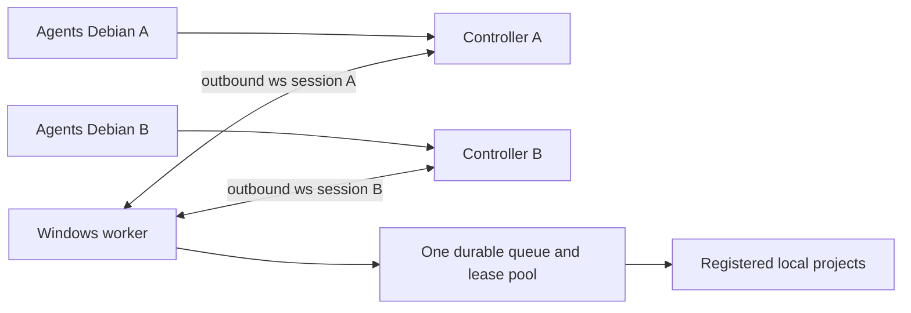

# Два Debian controller и один Windows worker

Текущая разработка: [прямые multi-controller sessions](multi-controller-runtime.md)
в `feat/multi-controller`, только Debian tests. Git coordination отменена пользователем;
до runtime implementation переключение Windows между .203/.204 остаётся ручным.

Анализ2026-10-26 для worker0.1.1. **Функция не реализована**, в patch release
её не включать. Windows локальная сеть/ws:// сохраняется; без TLS/relay/VPN/SSH.

## Что работает сейчас

Несколько CLI/MCP агентов на **одном Debian** могут использовать один controller:
он принимает несколько local IPC клиентов и мультиплексирует RPC в одну worker
session. Worker хранит общую очередь/leases, а не отдельный процесс на агента.
Это общая область управления: клиенты видят общие работы и могут их отменять.

Другой Debian со своим controller не подключается одновременно к этому worker:
`WorkerSettings.controller_url` — один outbound endpoint,
`network::connect` — один reconnect loop; worker не слушает TCP для агентов.
У controller нет удалённого agent API: его WebSocket server принимает Worker Hello,
CLI/MCP вход локальный. Просто указать второму агенту IP первого Debian недостаточно.

Два worker на Windows возможны без изменения кода, но нужны:

| Ресурс | Требование |
| --- | --- |
| `instanceId` |Разные между worker: pipe имя включает SID+instanceId, путь config/state его не разделяет|
| `stateDirectory` |Разные локальные каталоги: exclusive lock и SQLite owner на экземпляр|
| `nodeId` |Отдельный worker node, ожидаемый соответствующим Debian controller|
| `controllerUrl` |Каждый worker к своему Debian; controller instanceId совпадает со своей парой|
| `workspaceRoot` |Раздельные папки проектов/поколений; Store одного worker не блокирует другой Store|
| delivery namespace |Раздельные publications/назначения; общий HGFS root сам по себе не координирует записи|
| compiler cache |Для простого варианта раздельные targets; общий cache требует общего lease-протокола|

Два worker с разными config/exe папками и одним workspace небезопасно запускать
на мутации: каждый считает себя единственным владельцем своего журнала/процессов.
Лимит CPU/параллельных работ каждого экземпляра не является общим Windows лимитом.

## Рекомендуемый первый вариант функции

Один worker, два доверенных controller, общие зарегистрированные проекты и очередь.
Многопользовательская изоляция/ACL по агентам — отдельная задача, не предположение
этого MVP. Существующие runner/Job Object/SQLite ownership/atomic claims сохранить.

Основная работа — пять связанных областей, а не переписывание исполнения:

1. **Config/connect:** список controller endpoints с устойчивыми IDs и одним
   явно выбранным primary. Старый `controllerUrl` продолжает означать одну пару;
   конфликты старого/нового режима отклоняются. Worker открывает две независимые
   outbound sessions; разрыв A не меняет B и не отменяет accepted task.
2. **State/projections:** сейчас `Worker.controller_connection` и
   `controller_projection` одиночные; `network::update` очищает глобальный cache.
   Нужны per-controller connection/generation/session/projection/sequence/TTL.
   Readiness от A не должна отображаться как доказательство возможностей B.
   Legacy поле остаётся наблюдением явно выбранного primary; новые observations
   — отдельный typed contract/extension без подмены frozen старых DTO.
3. **Caller attribution:** передавать проверенный внутренний origin в dispatch:
   Windows local IPC или controller ID+session. Долговечно связывать принятые
   операции с origin и показывать его в новых observations/UI. IDs маршрутизируют
   доверенных peers; это не новая система аутентификации пользователей.
4. **Общие пределы/ключи:** общий bounded RPC admission, а не безграничные16 calls
   на каждый новый endpoint; независимые deadlines и transport request IDs.
   Дедупликация `(project,idempotencyKey)` остаётся общим контрактом: агентам нужны
   уникальные keys; lost ACK повторяется с тем же original key/context/payload.
   Нельзя тихо добавлять controller к fingerprint и превращать один logical retry
   в новый process. Глобальные scheduler/resource/maintenance leases сохраняются.
5. **Lifecycle/recovery:** stale journal incarnation отклоняется у обоих controller;
   восстановление пары/config должно учитывать все peers. Maintenance/update drain
   действует на общую authority и всех callers; отключение инициатора не освобождает
   его lease. Нельзя объявлять updater/recovery поддержанными только из-за двух TCP.

## Вертикальная проверка

Сначала две изолированные controller instances и один Windows worker:
два подключения → Info каждого → задания разных проектов → сериализация одного
проекта и общий capacity → дубли/конфликты keys → attribution → disconnect/reconnect
одного peer при работающем другом → timeout/cancel дерева → crash recovery без
replay → stale projections/contexts → общий maintenance barrier и bounded RPC flood.
Проверить также legacy single-controller, local desktop и frozen contracts.

После этого — настоящие два Debian с разными IP. Срок в днях без реализации и
native результатов не фиксируется. Это **отдельная архитектурная фича среднего
объёма**, с хорошей уже готовой основой очереди, но не правка нескольких настроек.
До неё практичный вариант — две раздельные пары с разными workspace/state/instance.
