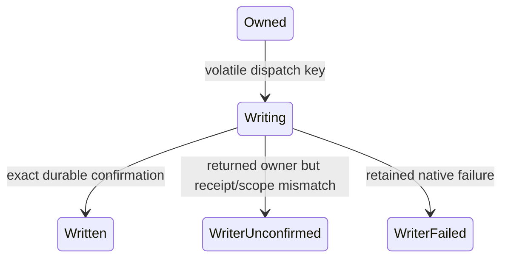

# Supervisor24/view16: одноразовый journal writer

2026-10-25 America/New_York. Продолжение
[ledger19/private writer3](journal-writer-runtime.md). **Actor24 и view16
реализованы и прошли source/local IPC/cross проверки. Настоящего native writer
gate ещё нет.** После checkpoint36f9895 добавлены Rust Main24 и independent
verifier; PS/observer/actual migration fixtures теперь подключены в source. Подробности в
[текущем checkpoint](resume-2026-10-25-journal-activation.md).
Updater19/worker17 и private physical2/writer3 прежние.
Public install и advertised activation/controller/desktop drivers=None.

## Владение и запуск

Отдельные actions `ActivateJournalWriter` / `ObserveJournalWriter` требуют24,
exact Active bound supervisor, launch/revision/token и отсутствия caller
`workerCommand`. Нет новых полей с executable/path/receipt/key/force в request.
Обычный `SupervisorChild::command` эту операцию не выполняет; fallback на23/1 нет.

`FilesActor` потребляет только свой resident `Owned` guard, генерирует один
canonical command UUID и переносит owner в единственный blocking slot:

Результат должен иметь прежний intent, тот же key/physical receipt и валидную
Confirmed запись из graph-bound journal reader. Все результаты, в том числе
unexpected completion, сохраняют полученный guard/failure. Cold data и
`WriterUnconfirmed` не превращаются обратно в fresh Owned. Повтор start после
начала попытки только наблюдает; нового key/child/send нет.

`writer_key` — resident correlation data. Он может существовать до durable
Issued; это не nonce и не startup permit. После actual driver flow источником
истины остаются updater intent/history и worker atomic receipt, а не ACK.

## Почему start и busy отвечают без полного snapshot

Обычный `SupervisorResponse` contract24 имеет `preparation=None` только для
**volatile dispatch ACK или active blocking driver**. Ошибка scope/version/token
передаётся отдельно. `SupervisorChild::activation_writer(start)` возвращает
`Result<Option<UpdatePreparationView>>`: None не означает success, durable
admission или отсутствие работы. После retirement observe возвращает Some16.
Это правило только24; прежние contracts/replies не изменены.

Перед private grant нельзя тратить оставшееся окно на повторный полный audit.
В предыдущем physical run StateOwned был saved109925ms после admission при
original120000ms. Поэтому новый start сначала проверяет resident dispatch
eligibility и немедленно передаёт owner; Root/authority/capability/live/window
окончательно сверяет trusted driver **до** intent/эффекта. Пока work active,
observe не блокирует original IO driver синхронным обходом всей истории.
Timeout по-прежнему исходный, без продления.

## View16: факт, residency и liveness различаются

- `durablePhase`, `revision`, `savedReceipt`: сохранённая история. Confirmed
  receipt не означает normal service/controller/lifetime или успех всего update.
- `phase`: NotStarted, Activating, Confirmed, Indeterminate или NotResident.
  Confirmed live projection требует Written owner, exact saved confirmation,
  actual child liveness=true и отсутствия driver error.
- `residentProcess` / `processAlive`: только actual retained owner. Cold reader
  возвращает NotResident с прежней receipt и unknown liveness, не создаёт owner.
- Missing/uncertain owner, failure или exited/inconclusive child сохраняют data
  отдельно от Indeterminate текущего состояния. Ошибка не стирает receipt.

Views1–15 не получают `activationWriter`. Старые14/15 после writer progress
сохраняют physical/process diagnostics и показывают Indeterminate с указанием24.
В16 подтверждённый same-child writer согласован с physical StateOwned. Во всех
случаях root пока VerifyingLocal; новая очередь/normal worker не запускаются.

## Код и проверки

| Файл | Назначение |
| --- | --- |
| `crates/protocol/src/update/activation_writer_view.rs`, `update.rs` | Strict DTO/view16 и actions24 без нового request payload. |
| `apps/update/src/activation/writer_view.rs` | Cold projection без resident/liveness claims. |
| `apps/update/src/journal/supervisor.rs` | Consistent snapshot16; прежние shapes сохранены. |
| `apps/update/src/supervisor/activation_files.rs` | Consuming state/one key, completion proof, retained errors, legacy/new projections. |
| `apps/update/src/supervisor.rs` | Typed client, versioned handler, one slot/completion retirement и быстрый ACK/busy. |
| `apps/worker/src/update_control.rs` | Реальный local mailbox test: missing owner и14 invalid scope/version/token/extra-command requests без journal effects. |

**Workspace781/0 (16 ignored), focused writer19/0 и actual local mailbox24 1/0**
прошли. Linux/MSVC all-target validation Clippy, contracts/generation, TS/UI,
fmt/scaffold/diff passed. Логи `.winbridge/update-preparation/actor24-*.log`,
summary `actor24-checks.json`. Mailbox проверяет доступ/readonly/cold refusal,
не настоящий Windows writer effect. Перед ним explicit standalone updater build
обновил копируемый test image; stale binary нельзя выдавать за новый actor.

Source/cross checks не заменяют actual Windows test. Installed d052/runtime не
менялся. Disk task `71d3d949-57a9-4a2e-9530-8a8805d6975b` succeeded/0:
Windows13696045056 / Debian25193771008 bytes перед checks; receipt
`.winbridge/update-preparation/actor24-disk-20261025T160724Z-6de358fe.json`.
Cleanup не выполнялся. Desktop/новых UI окон нет; desktop можно закрыть,
installed worker оставить.
Fresh Info2026-10-25T16:36:48Z: прежний d052/generation
8f8d1fb9-e5b1-4984-a17e-d067db46268e, controller connected, active0,
maintenance/recovery errors=null, coverage.complete=true. Evidence
`actor24-post-info.json` в том же local directory. Debian free25153507328 bytes,
Cargo terminal/exit0. Ручное обновление установленного worker не требуется.

## Готовая clean receiver fixture

Source commit `1a2149f88407fd9c33d101e12d07d7c4b64599d3` экспортирован clean,
с built UI: **813 files / 13011755 payload bytes**. Shared ZIP:

`/mnt/hgfs/shared/WinBridge/sources/winbridge-20261025T163918Z-1a2149f-8b8c082c.zip`

- ZIP SHA256 `abc74d43ee4e43f0b60a86f0cd3bc9dd35679fcf8b6f010cb1ca3c5c72573c1b`.
- Manifest SHA256 `b27808d7f52abd9fdbb4c5fe01e078493950d22e5f5a46c8b59b992bb453bed1`.
- Updater19 / worker17 / actor24 / view16 / physical2 / writer3.
- Independently rechecked every manifest path/size/SHA and archive/source/role
  markers. Это source fixture, **windowsExecutionVerified=false**.

Local export/pin `.winbridge/update-preparation/actor24-receiver-{export,pin}.json`.
Использовать её как **target** будущего distinct harness producer; вручную
обновлять installed runtime ради этого fixture не требуется. Старый target1370d6b
и старый schema17 reference не подменяют новые19/17 target и18 migration reference.
Для actual18→19 reference сначала связать successful physical132 source/history/
old18 image с retained verified pins, не менять поле schema у прежнего17 pin.

## Следующий шаг: один combined native gate

1. Новая **receiver19/17/private3/actor24 готова выше**. Rust Main24 и независимый
   writer verifier добавлены, actual execution ещё нет. После
   source review/checks, затем экспортировать distinct producer. Migration
   fixtures и PS/observer уже подключены. Старый
   receiver1370d6b/18/16/private2 не подходит. Writer flags/mode в существующих
   PS/Python сценариях пока **не добавлены**; не считать их уже доступными.
2. Main: обычные shutdown/backup/preparation/replacement/Ready/state handoff,
   затем **немедленный24 start без intermediate audits**. Новый helper принимает
   None ACK/busy и ждёт stable Some16; не требует Some от start и не трактует
   None как success. Тяжёлые независимые проверки после receipt/Job cleanup.
3. Доказать same child/PID/birth/host/session/generation/lock/file IDs, один private
   send, одну worker epoch/receipt, old cached authority fenced, active maintenance,
   immutable worker/updater command linkage, duplicates и cold refusal. Saved
   Confirmed отдельно от exited/nonresident child; Root не продвинут до service.
4. Actual updater18→19/refusal — взять successful18 history из physical132 run
   `20261025-100933-d8a50807`, с retained pins в общем checkpoint. Actual worker16→17:
   отдельно inactive16 task/history/keys migration/refusal и active16 accepted-update
   refusal до writes. Не выдавать synthetic released-shutdown history за реально
   завершённый старый16 self-update: такой production flow ещё не реализован.
5. Independent verifier связывает оба journals/command digests/receipts, causal
   prefixes и actual ownership/liveness, отвергает scope/epoch/hash/history mutations.
   После positive proof — normal service/reconciliation/local/controller/lifetime,
   remaining U2 faults/management, U3/U4. Goal остаётся незавершённой.

Перед новым Windows run fresh Info/оба диска≥6GiB, один cache lease, объявить
worker-only/no UI. Не replay terminal/unknown task. При неожиданном поведении
installed worker либо требовании ручного обновления остановить зависимые действия.

## Подготовленный Main24 source

`apps/worker/tests/update_shutdown/activation_writer.rs` вызывается из быстрой
ветки StateOwned до старых physical-only audits. Baseline берётся до admission
и требует Exited старого worker. Нативный helper проверяет actual header/receipt,
cached owner fencing, Quiesced lease/accepted stop и digest всех остальных таблиц,
duplicate/legacy views и cold actual exit/освобождение lock. Для нового эффекта
post-crash refusal сравнивает bytes после writer; прежний physical режим по-прежнему
требует неизменённый worker journal с начала сценария.

Validation-only create-new before-send marker не перезаписывается второй попыткой.
Он не является delivery receipt. Новый `scripts/update-activation-writer-proof.py`
связывает его с physical prefix, обоими SQL observations и Confirmed history,
отделяет saved facts от residency/liveness/service. Schema pair19/17 задаётся
явно; legacy defaults18/16 и CLI modes не расширялись.

Checks: portable hooks4/0, Python19/0 (writer component6 и25 отдельных tamper cases,
coordinated epoch rewrite, counter/privacy/schema boundaries), обе workspace
all-target validation Clippy passed. Old132/45-files/44+40+12-mutations readonly
recheck принят. Logs `writer-main24-*.log`, summary `writer-main24-source-checks.json`.
Это source/cross и synthetic verifier evidence; Windows Main24 ещё не запускался,
PS/observer writer mode подключён следующим блоком ниже. Installed d052
healthy/idle, runtime прежний; native execution ещё не подтверждён.

## Подключение combined gate

PS/observer mode и actual migration fixtures добавлены. Новый composite reference
создаётся из successful Main23 pin: updater18 image/manifest и worker16/fixture
берутся из установленного target1370d6b, а не из его producer7b270c6. Independent
reference verifier повторно проверяет old physical proof и ready bytes.

Updater fixture копирует SQLite через backup API, сохраняет physical18 history,
проверяет19 backup/fencing/old18 refusal. Повтор replacement даёт Existing data,
не fresh permit. Worker fixture запускает actual old16 CLI в отдельном instance,
сверяет task/output/dedup с SQL, затем проверяет inactive16→17 backup/preservation/
old16 refusal и active16 отказ до schema writes/backup. Копии PE удерживаются read
pins; прежние runtime/state не меняются. Новые source tests не доказывают execution.

Checks: Python24/0, Linux/MSVC all-target validation Clippy, legacy132 readonly
regression passed. Independent migration audit содержит18 tamper cases. Pwsh в
Debian нет; следующим шагом clean producer export и Windows syntax preflight,
затем один combined run с `--activation-writer`. Receiver1a2149f прежний;
нужен только installed worker, desktop/UI windows не требуются.
