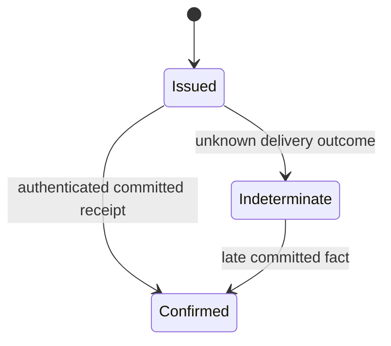

# Journal writer: ledger19 и private contract3

2026-10-25 America/New_York. Продолжение
[existing-state connection](activation-journal-opening.md).
В source добавлены updater schema19, delivery FSM/ledger и trusted native
blocking driver, worker private V3 handler. **Actor successor24/view16, новый
combined native gate и обычный сервис activated worker ещё не подключены.**
Public install off, advertised activation/controller/desktop drivers=None.
Supervisor23/view15 и private physical2 сохранены; worker journal17 прежний.

## Intent до эффекта, receipt отдельно от готовности сервиса

`ActivationWriterRecord` хранит immutable command и typed state:

Issued0 — одноразовый durable intent, не подтверждение отправки/commit.
Confirmed1 или2 — receipt о worker header CAS/immutable row; это не LocalVerified,
controller connection или whole-update success. Indeterminate1 не разрешает
повтор команды. Confirmed terminal; команды/keys/deadline не меняются. Новое
наблюдение не создаёт второй grant, не обновляет исходные120s.

Таблицы `activation_writer_intents`, `activation_writer_records`,
`activation_writer_history`: unique command key, FK к прежнему activation,
immutable/retained triggers, revision CAS, affected-row/readback и causal
history проверка. Начальная запись и append выполняются в одной transaction.
Игнорируемая trigger-ом запись не даёт acceptance. Обычная миграция18→19
использует прежний owner lock, consistent backup, epoch fencing/readback;
старый executable18 должен отказать19 до writable изменений — actual proof
предстоит получить в combined native gate.

Factory связывает command с exact StateOwned6 и `sourceAuthority` из verified
final backup в той же updater transaction, проверяет original nonce/owner/root/
supervisor и schema. Разная old/new worker schema не получает startup grant.
После полной graph validation повторное чтение immutable backup row в том же
snapshot сравнивается с сохранённым digest; второй recursive graph walk не нужен.
Публичный readonly reader сохраняет binding к историческому StateOwned6 после
дальнейшего local/root progress; чтение не восстанавливает live custody.

## Новый private шаг

Protocol добавляет отдельные serde frames `ActivationReceiverWriterCommand` /
`ActivationReceiverWriterReceipt`, contract3 и marker
`WINBRIDGE_PRIVATE_JOURNAL_WRITER_V3`. Ready1 и physical2 остаются frozen. Неизвестные
поля, другой contract, command/hash/key/scope и неправильная next epoch отвергаются.
Frames не регистрируют публичный worker RPC; nonce по-прежнему не попадает в argv,
reports или сериализованный owner.

`ActivationProcessGuard::activate_journal_blocking` потребляет **тот же**
original Owned guard через original IO driver. Сначала проверяет marker3 точного
pinned worker, затем сохраняет Issued, затем повторяет original graph/physical/
child/window checks и делает **одну** запись в исходный authenticated channel.
Duplicate admission не возвращает fresh permit. Read timeout/partial write/EOF
дают неопределённость; failure retains original process/Job/channel/state custody,
нового child или send нет. Поздняя receipt сохраняется как факт, без нового окна.

Worker V3 handler работает после собственного physical StateOwned. Он читает
current Issued/root/owner/supervisor в одном updater snapshot, сравнивает exact
command и свою прежнюю physical receipt. Под тем же acquired state lock создаёт
`ActivationJournal`. Повторяет actual parent/runtime, monotonic/wall window и
current snapshot checks при opening и внутри atomic activation. Возвращает
receipt только после fresh worker transaction acceptance. Store/lock/fresh data
permit удерживаются до следующего отдельного шага или выхода. Обычный scheduler,
local IPC и controller ещё не стартуют, maintenance остаётся active.

`activate_journal_blocking` — trusted Rust library. В supervisor23 пока нет
действия, которое его вызывает, или нового view, показывающего writer phase.
Не выдавать этот source за готовый публичный update flow.

## Карта кода и проверки

| Файл | Назначение |
| --- | --- |
| `apps/update/src/activation/writer_record.rs` | Delivery FSM, chronology, immutable command/result. |
| `apps/update/src/journal/activation_writer.rs` | Schema19, graph-bound factory/history и child snapshot. |
| `apps/update/src/journal/activation_writer/tests.rs` | SQLite rollback/history/migration и synthetic FSM tests. |
| `crates/protocol/src/update/activation_receiver.rs`, `apps/update/src/activation/channel.rs` | Private3 frames/marker и strict validation. |
| `apps/update/src/runtime_replacement/activation_writer.rs` | One-shot native private send/result, retained failures. |
| `apps/worker/src/activation.rs` | Same-child private3 handler; no ordinary service. |

Final checks: **workspace776/0 (16 ignored), ledger6/0, channel8/0**, Linux/MSVC
all-target validation Clippy с warnings=errors, fmt/contracts/scaffold/diff passed.
Final logs `.winbridge/update-preparation/writer-v3-*-final.log`, summary
`writer-v3-final.json`. Channel/contracts прошли в предшествующем fixed pipeline;
последующий review менял только ledger observation. Source/cross checks не
доказывают настоящее Windows writer activation. Cargo/observers terminal.

Review дополнительно исправил append позднего факта: он использует immutable
StateOwned6 после текущего Indeterminate7, как и readonly reader. Отдельный
regression test проверяет эту причинную связь; fresh send по progressed prefix
не разрешён. Перед private write явно запрещён нулевой remaining startup window.
Тесты независимо проверяют old-header mismatch, key/index tamper и duplicate key
после migration fencing, сохраняя настоящий history/dedup behavior.

Во время тестирования исправлена synthetic fixture: schema должна задаваться
**до** вычисления process/Job receipts. Изменение intent после Created правильно
отклонялось как foreign Job; production validation не ослаблена.

Disk query task `fec8cf4b-2e31-4d8e-abca-c10e2ad4672f` terminal succeeded/0,
receipt `.winbridge/update-preparation/writer-ledger-disk-20261025T150345Z-9f1d3069.json`.
Windows13735268352 / Debian25224003584 bytes перед первыми checks.
Финальное измерение: task `6170c9a2-12a1-43d4-8c0c-c525e0a932f3`, succeeded/0,
Windows13727096832 / Debian25196503040 bytes; receipt
`.winbridge/update-preparation/writer-v3-final-disk-20261025T153030Z-c6dc6ecb.json`. Installed d052/runtime
не менялся, desktop/новых UI окон нет. Cleanup не выполнялся.
Fresh Info2026-10-25T15:40:17Z: generation8f8d1fb9-e5b1-4984-a17e-d067db46268e
и build d052 прежние, controller connected, active0, maintenance/recovery errors=null,
coverage.complete=true. Evidence `writer-v3-post-info.json`; Debian free25195933696.
Все Cargo/observer handles terminal, ожиданий native tasks нет. Desktop можно
закрыть, installed worker оставить работать. Ручного обновления пока не требуется.

## Дальше: actor, actual proof и оставшаяся активация

1. Supervisor successor24 с отдельными start/observe writer и view16. Один blocking
   slot, consuming original Owned owner, responsive status, duplicate/cold/failure
   projection, все старые views frozen. Не запускать driver из caller JSON.
2. После source review/checks/clean commit — clean receiver **updater19/worker17/
   private3**, distinct producer и combined native writer gate. Target1370d6b
   содержит updater18/worker16/private2 и новому gate не подходит.
3. Реальный same child/lock/config, **ровно одна** новая epoch/receipt, old writer
   fenced, active maintenance, private send once, lost ACK/cold/late/foreign
   refusal и retained failure custody. Independent verifier должен связывать
   оба DB journals/command digests и actual process identities, а не только JSON.
4. Добавить actual updater18→19/refusal и worker16→17/refusal на consistent
   copies настоящей старой истории, сохранив backups/keys/receipts. Старый
   native132/0 относится к18/16/physical2 и эти изменения не доказывает.
5. Local service/reconciliation → actual new controller session → owned Job
   lifetime/commit/scoped lease release → U2 faults/management → U3 desktop → U4
   installed self-update. Original120s не увеличивать. Затем возврат к A4.3.
